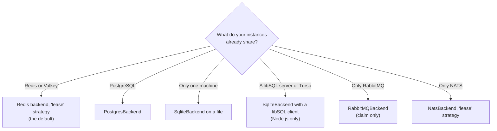
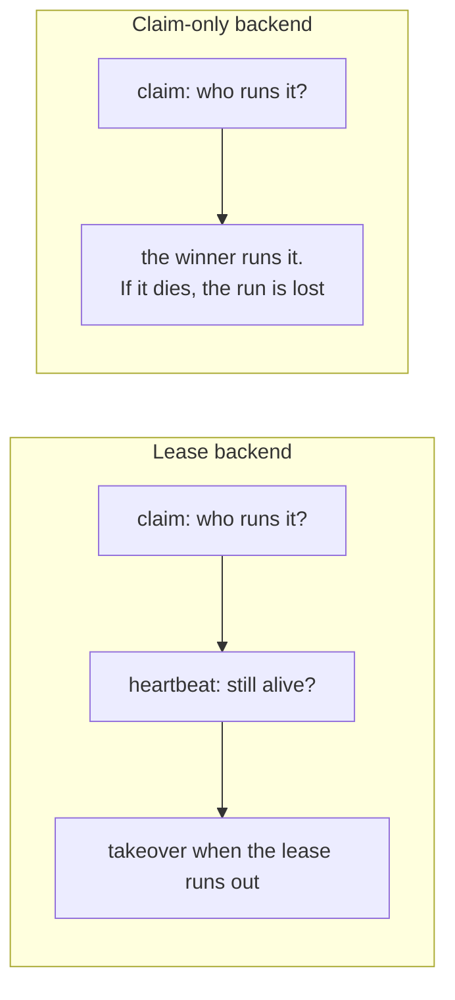

import { Tabs, TabItem } from '@astrojs/starlight/components';

A **backend** is the adapter between anarchon and the store your instances share. Every backend makes sure one instance wins each run. Some can also hold a lease, which is what enables backups, overlap protection and catch-up.

## Choosing



Use what you already run. If you have both Redis and PostgreSQL, Redis has the lower latency per claim; PostgreSQL keeps the job history next to your data.

## What each backend gives you

"Other strategies" means Redis or Valkey with `stream-id` or `script`, and Redis with `idmp`.

| | Redis / Valkey `lease` | Redis / Valkey other strategies | PostgreSQL | SQLite / libSQL | RabbitMQ | NATS `msg-id` | NATS `lease` |
| --- | --- | --- | --- | --- | --- | --- | --- |
| One winner per run | yes | yes | yes | yes | yes | yes | yes |
| A backup takes over a dead runner | yes | no | yes | yes | no | no | yes |
| No overlapping runs (`overlap: 'skip'`) | yes | no | yes | yes | no | no | yes |
| Retries after a dead runner (`maxAttempts`) | yes | no | yes | yes | no | no | yes |
| Catch-up after downtime (`catchUpMs`) | yes | no | yes | yes | no | no | yes |
| Healthy instances claim first after a failure (`yieldAfterFailure`) | yes | no | yes | yes | no | no | yes |
| Hand-over on `stop()` | yes | no | yes | yes | no | no | yes |
| History (`history()`, `lastRun()`) | yes | yes | yes | yes | yes | yes | yes |
| History by age (`historyTtlMs`) | yes | yes ¹ | yes | yes | no | no | no |
| `historySize` per job | yes | yes | yes | yes | yes | shared ² | shared ² |
| How long a claimed run is remembered | always | `stream-id` always, `idmp` `durationSec`, `script` `windowMs` | always | always | `slotTtlMs` | `duplicateWindowMs` | always |
| Job names | any | any | any | any | letters, digits, `_`, `-` | letters, digits, `_`, `-` | letters, digits, `_`, `-` |
| Instances on several machines | yes | yes | yes | with a libSQL server | yes | yes | yes |
| Needs | Redis 5+ or Valkey | Redis 5+ or Valkey; `idmp` Redis 8.6+ | PostgreSQL 9.5+ | SQLite 3.35+ | RabbitMQ 3.9+ | JetStream | JetStream on nats-server 2.10+, `@nats-io/kv` |
| .NET package | `Anarchon.Redis` | `Anarchon.Redis` | `Anarchon.Postgres` | `Anarchon.Sqlite`, files only | `Anarchon.RabbitMQ` | `Anarchon.Nats` | `Anarchon.Nats` |

The table uses the Node.js names. In .NET they are `PascalCase` without `Ms` and take a `TimeSpan`: `Overlap = OverlapPolicy.Skip`, `MaxAttempts`, `CatchUp`, `YieldAfterFailure`, `HistoryAsync()`, `LastRunAsync()`, `HistoryTtl`, `HistorySize`, `StopAsync()`. The strategies are `RedisStrategy.Lease`, `StreamId`, `Idmp`, `Script` and `NatsStrategy.MsgId`, `Lease`.

¹ With `script`, `historyTtlMs` must be longer than the strategy's `windowMs` (`ScriptWindow` in .NET).
² NATS keeps one history size for all its jobs: the largest of the backend's `historySize` and every job's.

## Which options each backend takes

Most options work everywhere. The ones that need a lease are refused elsewhere, so a setting can never be silently ignored: typed code doesn't compile, and a job or scheduler set up from a decorator or plain JavaScript throws a `TypeError` that names the option and the backend. In .NET, adding the job or creating the scheduler throws an `AnarchonException` with the code `AnarchonErrorCode.Unsupported`, and a claim-only window that is too short throws one with `UnsafeJob`.

| Option | Set on | Lease backends | Claim-only backends | Notes |
| --- | --- | --- | --- | --- |
| `jitterMs`, `timeoutMs`, `data`, `offsetMs`, `timezone` | job, scheduler | yes | yes | |
| `maxLateMs` | job, scheduler | yes | yes | On claim-only backends `jitterMs + maxLateMs` must be shorter than how long the backend remembers a run; checked when the job is added |
| `historySize` | job, scheduler | yes | yes | NATS: the largest wins, see ² |
| `historyTtlMs` | job, scheduler | yes, but not NATS | Redis/Valkey only | RabbitMQ and NATS refuse it |
| `overlap`, `maxAttempts`, `catchUpMs`, `yieldAfterFailure` | job | yes | refused | `at()` never takes `overlap` |
| `leaseMs`, `heartbeatMs` | scheduler | yes | refused | |

The .NET names are `Jitter`, `Timeout`, `Data`, `Offset`, `TimeZone`, `MaxLate`, `HistorySize`, `HistoryTtl`, `Overlap`, `MaxAttempts`, `CatchUp`, `YieldAfterFailure`, `Lease` and `Heartbeat`.

<Tabs syncKey="language">
<TabItem label="Node.js">

```ts
const onPostgres = new Scheduler({ backend: new PostgresBackend({ connection: pool }), leaseMs: 10_000 });
onPostgres.every('export', '1h', exportAll, { overlap: 'skip', maxAttempts: 2, catchUpMs: 30 * 60_000 }); // all fine

const onNats = new Scheduler({ backend: new NatsBackend() });
onNats.every('notify', '1m', notify, { timeoutMs: 30_000, maxLateMs: 60_000 }); // fine
onNats.every('notify', '1m', notify, { maxAttempts: 2 }); // type error: NATS 'msg-id' has no leases

const onNatsLeases = new Scheduler({ backend: new NatsBackend({ strategy: 'lease' }) });
onNatsLeases.every('notify', '1m', notify, { maxAttempts: 2 }); // fine
```

</TabItem>
<TabItem label=".NET">

```csharp
var onPostgres = new Scheduler(new SchedulerOptions { Backend = new PostgresBackend(new PostgresBackendOptions { DataSource = dataSource }), Lease = TimeSpan.FromSeconds(10) });
onPostgres.Every("export", TimeSpan.FromHours(1), ExportAllAsync, new() { Overlap = OverlapPolicy.Skip, MaxAttempts = 2, CatchUp = TimeSpan.FromMinutes(30) }); // all fine

var onNats = new Scheduler(new SchedulerOptions { Backend = new NatsBackend("nats://localhost:4222") });
onNats.Every("notify", TimeSpan.FromMinutes(1), NotifyAsync, new() { Timeout = TimeSpan.FromSeconds(30), MaxLate = TimeSpan.FromMinutes(1) }); // fine
onNats.Every("notify", TimeSpan.FromMinutes(1), NotifyAsync, new() { MaxAttempts = 2 }); // AnarchonException (Unsupported): NATS MsgId has no leases

var onNatsLeases = new Scheduler(new SchedulerOptions { Backend = new NatsBackend(new NatsBackendOptions { Strategy = NatsStrategy.Lease }) });
onNatsLeases.Every("notify", TimeSpan.FromMinutes(1), NotifyAsync, new() { MaxAttempts = 2 }); // fine
```

</TabItem>
</Tabs>

## Each backend's own options

The options of the backend objects themselves. Every backend also accepts a client your app already has, and never closes it.

<Tabs syncKey="language">
<TabItem label="Node.js">

| Backend | Option | Default | What it is for |
| --- | --- | --- | --- |
| `RedisBackend` | `redis` | `localhost:6379` | A URL, `{ host, port, ... }`, or your client |
| | `strategy` | `'lease'` | A name, or `{ name: 'idmp', durationSec, maxSize }` / `{ name: 'script', windowMs }` |
| | `prefix` | `'cron:'` | Keeps services that share a Redis apart |
| `ValkeyBackend` | `valkey` | `localhost:6379` | Like `redis` |
| | `strategy` | `'lease'` | As above, without `idmp` |
| | `prefix` | `'cron:'` | As above |
| `PostgresBackend` | `connection` | pg's defaults | A connection string, a pg Pool or Client, postgres.js, or `{ all, transaction }` |
| | `table` | `'anarchon_runs'` | The tables' name, schema allowed; keeps services apart |
| `SqliteBackend` | `database` | `'./anarchon.db'` | A file path, a node:sqlite or better-sqlite3 database, or a libSQL client |
| | `table` | `'anarchon_runs'` | As above |
| | `busyTimeoutMs` | `5000` | How long a claim waits for another process's write |
| `RabbitMQBackend` | `url` / `connection` | `amqp://localhost` | Where RabbitMQ is, or your amqplib connection |
| | `prefix` | `'cron.'` | Queue names |
| | `slotTtlMs` | `300000` | How long a claimed run is remembered |
| `NatsBackend` | `servers` / `connection` | `nats://localhost:4222` | Where NATS is, or your connection |
| | `strategy` | `'msg-id'` | `'lease'` for backups, no overlap, catch-up and retries |
| | `stream`, `prefix` | `'CRON'`, `'cron.'` | The JetStream stream and its subjects; with `lease`, also the bucket `<stream>_RUNS` |
| | `duplicateWindowMs` | `300000` | `msg-id`: how long a claimed run is remembered |
| | `historySize` | `1000` | Runs kept per job, at least |
| | `replicas` | `1` | Stream replicas; `3` in a NATS cluster |

</TabItem>
<TabItem label=".NET">

| Backend | Option | Default | What it is for |
| --- | --- | --- | --- |
| `RedisBackend` | `Configuration` / `Connection` | `localhost:6379` | A StackExchange.Redis configuration string, or your `IConnectionMultiplexer` |
| | `Database` | `-1` | The database number; `-1` is the connection's default |
| | `Strategy` | `RedisStrategy.Lease` | `StreamId`, `Idmp` (with `IdmpDuration`, `IdmpMaxSize`) or `Script` (with `ScriptWindow`) |
| | `Prefix` | `"cron:"` | Keeps services that share a Redis apart. Valkey uses the same backend |
| `PostgresBackend` | `ConnectionString` / `DataSource` | `Host=localhost;Database=postgres` | An Npgsql connection string, or your `NpgsqlDataSource` |
| | `Table` | `"anarchon_runs"` | The tables' name, schema allowed; keeps services apart |
| `SqliteBackend` | `ConnectionString` | `Data Source=anarchon.db` | A Microsoft.Data.Sqlite connection string naming a file. Its `Default Timeout` is how long a claim waits for another process's write |
| | `Table` | `"anarchon_runs"` | As above, without a schema |
| `RabbitMQBackend` | `ConnectionString` / `Connection` | `amqp://localhost` | An AMQP URI, or your `IConnection` |
| | `Prefix` | `"cron."` | Queue names |
| | `SlotTtl` | 5 minutes | How long a claimed run is remembered |
| `NatsBackend` | `ConnectionString` / `Connection` | `nats://localhost:4222` | One URL or several separated by commas, or your `INatsConnection` |
| | `Strategy` | `NatsStrategy.MsgId` | `NatsStrategy.Lease` for backups, no overlap, catch-up and retries |
| | `Stream`, `Prefix` | `"CRON"`, `"cron."` | The JetStream stream and its subjects; with `Lease`, also the bucket `<stream>_RUNS` |
| | `DuplicateWindow` | 5 minutes | `MsgId`: how long a claimed run is remembered |
| | `HistorySize` | `1000` | Runs kept per job, at least |
| | `Replicas` | not set (1 for a new stream) | Stream replicas; `3` in a NATS cluster |

Each backend's constructor takes its options object, or only a connection string: `new RedisBackend("localhost:6379")`, `new PostgresBackend(connectionString)`.

</TabItem>
</Tabs>

<Tabs syncKey="language">
<TabItem label="Node.js">

```ts
new RedisBackend({ redis: process.env.REDIS_URL, strategy: { name: 'script', windowMs: 10 * 60_000 }, prefix: 'billing:cron:' });
new ValkeyBackend({ valkey: process.env.VALKEY_URL });
new PostgresBackend({ connection: pool, table: 'scheduler.runs' });
new SqliteBackend({ database: '/var/lib/app/jobs.db', busyTimeoutMs: 10_000 });
new RabbitMQBackend({ url: process.env.AMQP_URL, prefix: 'billing.cron.', slotTtlMs: 10 * 60_000 });
new NatsBackend({ servers: ['nats://n1:4222', 'nats://n2:4222'], replicas: 3, duplicateWindowMs: 10 * 60_000 });
```

</TabItem>
<TabItem label=".NET">

```csharp
var config = builder.Configuration;
new RedisBackend(new RedisBackendOptions { Configuration = config.GetConnectionString("redis"), Strategy = RedisStrategy.Script, ScriptWindow = TimeSpan.FromMinutes(10), Prefix = "billing:cron:" });
new RedisBackend(new RedisBackendOptions { Configuration = config.GetConnectionString("valkey") }); // Valkey
new PostgresBackend(new PostgresBackendOptions { DataSource = dataSource, Table = "scheduler.runs" });
new SqliteBackend(new SqliteBackendOptions { ConnectionString = "Data Source=/var/lib/app/jobs.db;Default Timeout=10" });
new RabbitMQBackend(new RabbitMQBackendOptions { ConnectionString = config.GetConnectionString("amqp"), Prefix = "billing.cron.", SlotTtl = TimeSpan.FromMinutes(10) });
new NatsBackend(new NatsBackendOptions { ConnectionString = "nats://n1:4222,nats://n2:4222", Replicas = 3, DuplicateWindow = TimeSpan.FromMinutes(10) });
```

</TabItem>
</Tabs>

## Choosing by what a job needs

| The job | Needs | Backends that fit |
| --- | --- | --- |
| Must not run twice, even if its runner dies (payments) | `maxAttempts: 1`, writes keyed by `ctx.slot` | Any lease backend |
| Must still run after a full outage (daily reports) | `catchUpMs` | Any lease backend |
| Takes longer than its interval (exports) | `overlap: 'skip'`, hand-over on deploy | Any lease backend |
| Cheap and frequent, a missed run doesn't matter (cache refresh) | jitter, a short `maxLateMs` | Any backend |
| Sends whatever is outstanding (notifications from an outbox) | nothing special | Any backend, brokers included |

The [examples folder](https://github.com/aristoteliss/anarchon/tree/main/examples) has a runnable file for each of these: `billing.ts`, `nightly-export.ts`, `cache-refresh.ts`, `broker-notifications.ts`, and `tenants.ts` for per-tenant jobs. The [.NET examples](https://github.com/aristoteliss/anarchon-dotnet/tree/main/examples) have the same as projects: `Billing`, `NightlyExport`, `CacheRefresh`, `BrokerNotifications` and `Tenants`.

## Lease backends and claim-only backends

The split comes from what the store can express.

A **lease backend** stores, for each run, who is running it and until when. Other instances can read that and act on it. Redis (with a Lua script), PostgreSQL and SQLite (with a transaction) can all do "read the run, decide, write" as one atomic step. NATS with the `lease` strategy does it with a key-value write that succeeds only if nobody wrote since the read.

A **claim-only backend** can answer exactly one question atomically: "was I first?" RabbitMQ and NATS `msg-id` use broker features that can tell a publisher it was first, but leave no record that a backup could check later and atomically replace. [Brokers and leases](../brokers-and-leases/) explains why, and what could change it.



Use a claim-only backend when losing the occasional run to a crash is acceptable and you don't want another piece of infrastructure.

## How each one picks the winner

Each store has a different primitive that lets exactly one writer succeed. The details, with diagrams, are in [Claim algorithms](../../internals/claim-algorithms/).

| Backend | The atomic step |
| --- | --- |
| Redis `lease` | A Lua script that reads the run's state and writes the claim |
| Redis `stream-id` | `XADD` with the run time as the entry ID; Redis refuses an ID that isn't greater than the last |
| Redis `idmp` | `XADD ... IDMP`; Redis keeps the first entry for an idempotency key |
| Redis `script` | A Lua script that appends the run only if it isn't in the stream |
| PostgreSQL | One transaction on the run's row, serialized per job |
| SQLite | One `BEGIN IMMEDIATE` transaction; SQLite has one writer at a time |
| RabbitMQ | A queue that holds one message and rejects the rest, with publisher confirms |
| NATS `msg-id` | JetStream de-duplication by message ID |
| NATS `lease` | A key-value write at the revision that was read; a refused write is decided again |

## Using a backend

Every backend is created and passed in as `backend` (`Backend` in .NET). In .NET each backend is a package of its own:

<Tabs syncKey="language">
<TabItem label="Node.js">

```ts
import { NatsBackend, PostgresBackend, RabbitMQBackend, RedisBackend, Scheduler, SqliteBackend } from 'anarchon';

new Scheduler({ backend: new RedisBackend({ redis: 'redis://localhost:6379' }) });
new Scheduler({ backend: new PostgresBackend({ connection: process.env.DATABASE_URL }) });
new Scheduler({ backend: new SqliteBackend({ database: './jobs.db' }) });
new Scheduler({ backend: new RabbitMQBackend({ url: 'amqp://localhost' }) });
new Scheduler({ backend: new NatsBackend({ servers: 'nats://localhost:4222', strategy: 'lease' }) });
```

</TabItem>
<TabItem label=".NET">

```csharp
using Anarchon;
using Anarchon.Nats;      // Anarchon.Nats package
using Anarchon.Postgres;  // Anarchon.Postgres package
using Anarchon.RabbitMQ;  // Anarchon.RabbitMQ package
using Anarchon.Redis;     // Anarchon.Redis package
using Anarchon.Sqlite;    // Anarchon.Sqlite package

new Scheduler(new SchedulerOptions { Backend = new RedisBackend(new RedisBackendOptions { Configuration = "localhost:6379" }) });
new Scheduler(new SchedulerOptions { Backend = new PostgresBackend(new PostgresBackendOptions { ConnectionString = config.GetConnectionString("app") }) });
new Scheduler(new SchedulerOptions { Backend = new SqliteBackend(new SqliteBackendOptions { ConnectionString = "Data Source=jobs.db" }) });
new Scheduler(new SchedulerOptions { Backend = new RabbitMQBackend(new RabbitMQBackendOptions { ConnectionString = "amqp://localhost" }) });
new Scheduler(new SchedulerOptions { Backend = new NatsBackend(new NatsBackendOptions { ConnectionString = "nats://localhost:4222", Strategy = NatsStrategy.Lease }) });
```

</TabItem>
</Tabs>

With a .NET host, `AddAnarchon()` followed by `UseRedis()`, `UsePostgres()`, `UseSqlite()`, `UseRabbitMQ()` or `UseNats()` does the same; each takes a connection string or a callback that sets the options. See [ASP.NET Core](../../recipes/aspnet-core/).

`scheduler.backend.name` (`scheduler.Backend.Name` in .NET) tells you which one is in use: `'redis:lease'`, `'postgres'`, `'sqlite'`, `'rabbitmq'`, `'nats'` or `'nats:lease'`.

## Your own connections

Every backend accepts a client your app already has. anarchon never closes a client it didn't open, so `stop()` (`StopAsync()`) leaves yours usable.

<Tabs syncKey="language">
<TabItem label="Node.js">

```ts
const pool = new Pool({ connectionString: process.env.DATABASE_URL });
const scheduler = new Scheduler({ backend: new PostgresBackend({ connection: pool }) });

await scheduler.stop();
await pool.query('SELECT 1'); // still works
```

</TabItem>
<TabItem label=".NET">

```csharp
await using var dataSource = NpgsqlDataSource.Create(config.GetConnectionString("app")!);
var scheduler = new Scheduler(new SchedulerOptions { Backend = new PostgresBackend(new PostgresBackendOptions { DataSource = dataSource }) });

await scheduler.StopAsync();
await using var command = dataSource.CreateCommand("SELECT 1");
await command.ExecuteScalarAsync(); // still works
```

</TabItem>
</Tabs>

## Sharing a store between services

Two services on the same Redis or database must not see each other's jobs. Give each its own namespace:

| Backend | Option | Default |
| --- | --- | --- |
| Redis / Valkey | `prefix` | `'cron:'` |
| PostgreSQL / SQLite | `table` | `'anarchon_runs'` |
| RabbitMQ | `prefix` | `'cron.'` |
| NATS | `prefix` and `stream` | `'cron.'`, `'CRON'` |

In .NET the options are `Prefix`, `Table` and `Stream`, with the same defaults. Node.js and .NET instances that use the same values share the jobs, so one service can run on both.

Instances of the **same** service must use the same value. See [Several services on one store](../../recipes/several-services/).

## Next

Pick your store: [Redis and Valkey](../redis/), [PostgreSQL](../postgres/), [SQLite and libSQL](../sqlite/), [RabbitMQ](../rabbitmq/), [NATS](../nats/), or [write your own](../custom/).
