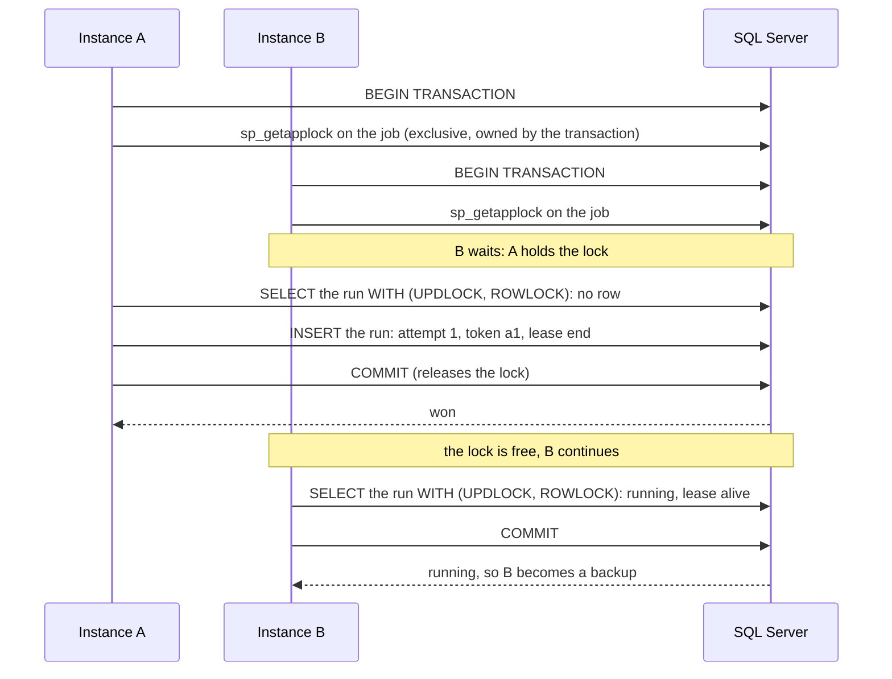

`SqlServerBackend` gives you everything the Redis `lease` strategy does: one winner per run, backups, no overlapping runs, catch-up and hand-over on `StopAsync()`. It needs SQL Server 2016 or newer, or Azure SQL (Database or Managed Instance). It is the `Anarchon.SqlServer` package, on Microsoft.Data.SqlClient.

:::note[.NET only]
The Node.js package has no SQL Server backend, so only .NET instances can share these tables. To mix Node.js and .NET instances, use [PostgreSQL](../postgres/), [SQLite](../sqlite/), [Redis](../redis/) or [NATS](../nats/).
:::

```sh
dotnet add package Anarchon.SqlServer
```

```csharp
using Anarchon;
using Anarchon.SqlServer;

var scheduler = new Scheduler(new SchedulerOptions
{
    Backend = new SqlServerBackend(builder.Configuration.GetConnectionString("app")!),
});
```

With a host:

```csharp
builder.Services.AddAnarchon()
    .UseSqlServer(builder.Configuration.GetConnectionString("app")!)
    .AddJobs<ReportJobs>();
```

## Connecting

`ConnectionString` takes a Microsoft.Data.SqlClient connection string, and is required. Connections come from SqlClient's pool for that string, which your app's own connections with the same string share; `StopAsync()` closes nothing.

```csharp
// A user and a password
new SqlServerBackend("Server=db;Database=app;User Id=app;Password=...;Encrypt=true");

// Azure SQL with a managed identity, or whatever DefaultAzureCredential finds
new SqlServerBackend("Server=tcp:app.database.windows.net;Database=app;Authentication=Active Directory Default");
```

Every authentication method SqlClient supports works, since the backend only opens connections with the string you give it.

## Options

| Option | Default | Meaning |
| --- | --- | --- |
| `ConnectionString` | required | A SqlClient connection string. Missing or empty throws an `ArgumentException` |
| `Table` | `"anarchon_runs"` | Table name. May include a schema that exists: `"jobs.cron_runs"` |

```csharp
builder.Services.AddAnarchon().UseSqlServer(options =>
{
    options.ConnectionString = builder.Configuration.GetConnectionString("app");
    options.Table = "jobs.cron_runs"; // the schema must exist
});
```

## Tables

They are created on `StartAsync()` if they don't exist. Two instances starting together is fine.

| Table | One row per | Holds |
| --- | --- | --- |
| `<table>` | run | attempt, token, status, runner, lease end |
| `<table>_attempts` | attempt | who, why, when it was claimed, how it ended (the history) |
| `<table>_meta` | setting | the store format, so a newer anarchon's data is never misread |

The columns are the ones PostgreSQL and SQLite use, with SQL Server's types: `NVARCHAR` text with a binary collation (`Latin1_General_100_BIN2`) and `BIGINT` times. So:

- **Job names compare case-sensitively**, as on every other backend, whatever your database's collation: `report` and `Report` are two jobs.
- **A job name holds up to 400 characters**, to keep the tables' keys under SQL Server's 900-byte limit.

If your application's database user can't create tables, create them once with a privileged user by running `StartAsync()` in a migration step, then grant `SELECT, INSERT, UPDATE, DELETE` on the three tables. Claims also call `sp_getapplock`, which every user may.

## How one instance wins

A run is a row with the primary key `(job, slot)`. A claim is one short READ COMMITTED transaction:



The first statement of every claim takes an application lock named after the table and the job, held until the transaction ends. Claims of one job happen one after another, and the second reads the run only after the first has committed, so it always sees the winner's row. Claims of **different** jobs don't wait for each other.

The claim reads the run's rows with update locks, so a heartbeat can't change a row between the claim's read and its write. It doesn't take key-range locks (`HOLDLOCK`): the application lock already keeps other claims from adding the job's rows, and range locks could make claims of different jobs wait for each other.

### Snapshot isolation

Azure SQL Database turns on `READ_COMMITTED_SNAPSHOT` by default; a SQL Server database has it off unless you set it. The backend works the same either way: a read with `UPDLOCK` waits for a writer instead of returning the last committed version. A claim always runs at READ COMMITTED, even on a pooled connection your app left at another isolation level. The tests run the lease rules on a database with each setting.

## Reads and writes

- A **claim that can win** is a transaction (a few statements).
- A **heartbeat**, a hand-over and "finished" are single `UPDATE ... WHERE token = @token` statements.
- A **backup checking on a live run** is a single `SELECT`. It opens a transaction only when the lease has run out.

With three instances and the default 5-second heartbeat, a running job costs about one small `UPDATE` every 5 seconds and one `SELECT` per backup every 5 to 10 seconds.

## The database's clock

Lease ends are computed with the database's clock (`SYSUTCDATETIME()`, through `DATEDIFF_BIG`), not the instances' clocks. A clock difference between two instances can't make a live lease look expired. `DATEDIFF_BIG` is why SQL Server 2016 is the oldest version: on an older server `StartAsync()` throws an `AnarchonException` with the code `Server`.

## History

History lives in `<table>_attempts`, trimmed to about `HistorySize` attempts per job and to `HistoryTtl` if you set it. Because it is an ordinary table, you can query it yourself:

```sql
SELECT TOP (20) job, slot, attempt, instance_id, reason, claimed_at
FROM anarchon_runs_attempts
WHERE job = 'sync'
ORDER BY slot DESC, attempt DESC;
```

Treat the table layout as internal: it can change between versions. `HistoryAsync()` is the stable way to read it.

## Work in the same database

When a job writes to tables in the same database, key its writes by the run's slot (`ctx.Slot`) and make them in one transaction. A retry after a takeover then finds what the first attempt committed instead of doing it twice. The [`SqlServer` example](https://github.com/aristoteliss/anarchon-dotnet/tree/main/examples/SqlServer) runs a worker service that does this: run it in two or three terminals and stop the one running "rollup".

## Next

- [Claim algorithms](../../internals/claim-algorithms/#sql-server)
- [Leases](../../internals/leases/)
- [Your own SQL database](../custom/), on the same `SqlBackend` this backend uses
