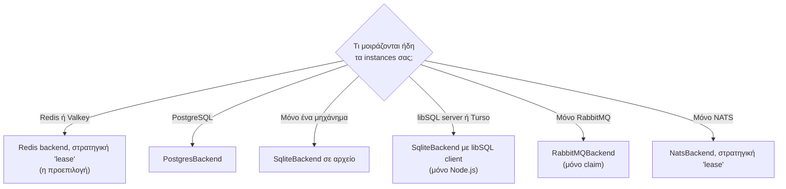
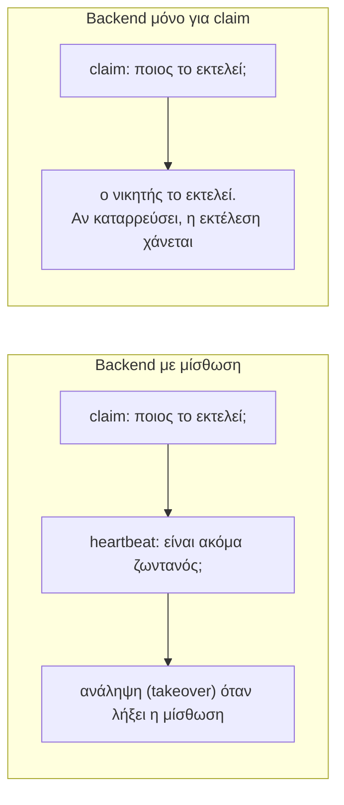

import { Tabs, TabItem } from '@astrojs/starlight/components';

Ένα **backend** είναι ο προσαρμογέας (adapter) μεταξύ του anarchon και του store που μοιράζονται τα instances σας. Κάθε backend διασφαλίζει ότι ένα instance κερδίζει κάθε εκτέλεση. Ορισμένα μπορούν επίσης να διατηρούν μίσθωση (lease), η οποία καθιστά εφικτά τους εφεδρικούς (backups), την προστασία επικάλυψης (overlap protection) και την ανάκτηση (catch-up).

## Επιλογή



Χρησιμοποιήστε ό,τι εκτελείτε ήδη. Αν διαθέτετε τόσο Redis όσο και PostgreSQL, το Redis έχει χαμηλότερη καθυστέρηση (latency) ανά claim· η PostgreSQL διατηρεί το ιστορικό των εργασιών δίπλα στα δεδομένα σας.

## Τι σας προσφέρει κάθε backend

«Άλλες στρατηγικές» σημαίνει Redis ή Valkey με `stream-id` ή `script`, και Redis με `idmp`.

| | Redis / Valkey `lease` | Redis / Valkey άλλες στρατηγικές | PostgreSQL | SQLite / libSQL | RabbitMQ | NATS `msg-id` | NATS `lease` |
| --- | --- | --- | --- | --- | --- | --- | --- |
| Ένας νικητής ανά εκτέλεση | ναι | ναι | ναι | ναι | ναι | ναι | ναι |
| Ένας εφεδρικός αναλαμβάνει έναν ανενεργό runner | ναι | όχι | ναι | ναι | όχι | όχι | ναι |
| Χωρίς επικαλυπτόμενες εκτελέσεις (`overlap: 'skip'`) | ναι | όχι | ναι | ναι | όχι | όχι | ναι |
| Επαναλήψεις μετά από ανενεργό runner (`maxAttempts`) | ναι | όχι | ναι | ναι | όχι | όχι | ναι |
| Catch-up μετά από downtime (`catchUpMs`) | ναι | όχι | ναι | ναι | όχι | όχι | ναι |
| Τα υγιή instances διεκδικούν πρώτα μετά από αποτυχία (`yieldAfterFailure`) | ναι | όχι | ναι | ναι | όχι | όχι | ναι |
| Παράδοση (hand-over) στο `stop()` | ναι | όχι | ναι | ναι | όχι | όχι | ναι |
| Ιστορικό (`history()`, `lastRun()`) | ναι | ναι | ναι | ναι | ναι | ναι | ναι |
| Ιστορικό βάσει ηλικίας (`historyTtlMs`) | ναι | ναι ¹ | ναι | ναι | όχι | όχι | όχι |
| `historySize` ανά εργασία | ναι | ναι | ναι | ναι | ναι | κοινό ² | κοινό ² |
| Για πόσο θυμάται μια διεκδικημένη εκτέλεση | πάντα | `stream-id` πάντα, `idmp` `durationSec`, `script` `windowMs` | πάντα | πάντα | `slotTtlMs` | `duplicateWindowMs` | πάντα |
| Ονόματα εργασιών | οποιαδήποτε | οποιαδήποτε | οποιαδήποτε | οποιαδήποτε | γράμματα, ψηφία, `_`, `-` | γράμματα, ψηφία, `_`, `-` | γράμματα, ψηφία, `_`, `-` |
| Instances σε πολλά μηχανήματα | ναι | ναι | ναι | με libSQL server | ναι | ναι | ναι |
| Απαιτήσεις | Redis 5+ ή Valkey | Redis 5+ ή Valkey· `idmp` Redis 8.6+ | PostgreSQL 9.5+ | SQLite 3.35+ | RabbitMQ 3.9+ | JetStream | JetStream σε nats-server 2.10+, `@nats-io/kv` |
| Πακέτο .NET | `Anarchon.Redis` | `Anarchon.Redis` | `Anarchon.Postgres` | `Anarchon.Sqlite`, μόνο αρχεία | `Anarchon.RabbitMQ` | `Anarchon.Nats` | `Anarchon.Nats` |

Ο πίνακας χρησιμοποιεί τα ονόματα του Node.js. Στο .NET είναι σε `PascalCase` χωρίς το `Ms` και δέχονται `TimeSpan`: `Overlap = OverlapPolicy.Skip`, `MaxAttempts`, `CatchUp`, `YieldAfterFailure`, `HistoryAsync()`, `LastRunAsync()`, `HistoryTtl`, `HistorySize`, `StopAsync()`. Οι στρατηγικές είναι `RedisStrategy.Lease`, `StreamId`, `Idmp`, `Script` και `NatsStrategy.MsgId`, `Lease`.

¹ Με το `script`, το `historyTtlMs` πρέπει να είναι μεγαλύτερο από το `windowMs` της στρατηγικής (`ScriptWindow` στο .NET).
² Το NATS κρατά ένα μέγεθος ιστορικού για όλες τις εργασίες του: το μεγαλύτερο ανάμεσα στο `historySize` του backend και σε εκείνο κάθε εργασίας.

## Ποιες επιλογές δέχεται κάθε backend

Οι περισσότερες επιλογές λειτουργούν παντού. Όσες χρειάζονται μίσθωση απορρίπτονται αλλού, ώστε μια ρύθμιση να μην αγνοείται ποτέ σιωπηλά: ο κώδικας με τύπους δεν μεταγλωττίζεται, και μια εργασία ή ένας scheduler από decorator ή απλή JavaScript πετά `TypeError` που ονομάζει την επιλογή και το backend. Στο .NET, η προσθήκη της εργασίας ή η δημιουργία του scheduler πετά ένα `AnarchonException` με τον κωδικό `AnarchonErrorCode.Unsupported`, και ένα παράθυρο μόνο για claim που είναι πολύ μικρό πετά ένα με `UnsafeJob`.

| Επιλογή | Ορίζεται σε | Backends μίσθωσης | Backends μόνο για claim | Σημειώσεις |
| --- | --- | --- | --- | --- |
| `jitterMs`, `timeoutMs`, `data`, `offsetMs`, `timezone` | εργασία, scheduler | ναι | ναι | |
| `maxLateMs` | εργασία, scheduler | ναι | ναι | Στα backends μόνο για claim το `jitterMs + maxLateMs` πρέπει να είναι μικρότερο από όσο το backend θυμάται μια εκτέλεση· ελέγχεται όταν προστίθεται η εργασία |
| `historySize` | εργασία, scheduler | ναι | ναι | NATS: κερδίζει το μεγαλύτερο, δείτε ² |
| `historyTtlMs` | εργασία, scheduler | ναι, όχι στο NATS | μόνο Redis/Valkey | Τα RabbitMQ και NATS το απορρίπτουν |
| `overlap`, `maxAttempts`, `catchUpMs`, `yieldAfterFailure` | εργασία | ναι | απορρίπτονται | Το `at()` δεν δέχεται ποτέ `overlap` |
| `leaseMs`, `heartbeatMs` | scheduler | ναι | απορρίπτονται | |

Τα ονόματα στο .NET είναι `Jitter`, `Timeout`, `Data`, `Offset`, `TimeZone`, `MaxLate`, `HistorySize`, `HistoryTtl`, `Overlap`, `MaxAttempts`, `CatchUp`, `YieldAfterFailure`, `Lease` και `Heartbeat`.

<Tabs syncKey="language">
<TabItem label="Node.js">

```ts
const onPostgres = new Scheduler({ backend: new PostgresBackend({ connection: pool }), leaseMs: 10_000 });
onPostgres.every('export', '1h', exportAll, { overlap: 'skip', maxAttempts: 2, catchUpMs: 30 * 60_000 }); // όλα εντάξει

const onNats = new Scheduler({ backend: new NatsBackend() });
onNats.every('notify', '1m', notify, { timeoutMs: 30_000, maxLateMs: 60_000 }); // εντάξει
onNats.every('notify', '1m', notify, { maxAttempts: 2 }); // σφάλμα τύπου: το NATS 'msg-id' δεν έχει μισθώσεις

const onNatsLeases = new Scheduler({ backend: new NatsBackend({ strategy: 'lease' }) });
onNatsLeases.every('notify', '1m', notify, { maxAttempts: 2 }); // εντάξει
```

</TabItem>
<TabItem label=".NET">

```csharp
var onPostgres = new Scheduler(new SchedulerOptions { Backend = new PostgresBackend(new PostgresBackendOptions { DataSource = dataSource }), Lease = TimeSpan.FromSeconds(10) });
onPostgres.Every("export", TimeSpan.FromHours(1), ExportAllAsync, new() { Overlap = OverlapPolicy.Skip, MaxAttempts = 2, CatchUp = TimeSpan.FromMinutes(30) }); // όλα εντάξει

var onNats = new Scheduler(new SchedulerOptions { Backend = new NatsBackend("nats://localhost:4222") });
onNats.Every("notify", TimeSpan.FromMinutes(1), NotifyAsync, new() { Timeout = TimeSpan.FromSeconds(30), MaxLate = TimeSpan.FromMinutes(1) }); // εντάξει
onNats.Every("notify", TimeSpan.FromMinutes(1), NotifyAsync, new() { MaxAttempts = 2 }); // AnarchonException (Unsupported): το NATS MsgId δεν έχει μισθώσεις

var onNatsLeases = new Scheduler(new SchedulerOptions { Backend = new NatsBackend(new NatsBackendOptions { Strategy = NatsStrategy.Lease }) });
onNatsLeases.Every("notify", TimeSpan.FromMinutes(1), NotifyAsync, new() { MaxAttempts = 2 }); // εντάξει
```

</TabItem>
</Tabs>

## Οι επιλογές κάθε backend

Οι επιλογές των ίδιων των αντικειμένων backend. Κάθε backend δέχεται επίσης έναν client που ήδη έχει η εφαρμογή σας, και δεν τον κλείνει ποτέ.

<Tabs syncKey="language">
<TabItem label="Node.js">

| Backend | Επιλογή | Προεπιλογή | Σε τι χρησιμεύει |
| --- | --- | --- | --- |
| `RedisBackend` | `redis` | `localhost:6379` | Ένα URL, `{ host, port, ... }`, ή ο client σας |
| | `strategy` | `'lease'` | Ένα όνομα, ή `{ name: 'idmp', durationSec, maxSize }` / `{ name: 'script', windowMs }` |
| | `prefix` | `'cron:'` | Κρατά χωριστά τις υπηρεσίες που μοιράζονται ένα Redis |
| `ValkeyBackend` | `valkey` | `localhost:6379` | Όπως το `redis` |
| | `strategy` | `'lease'` | Όπως παραπάνω, χωρίς `idmp` |
| | `prefix` | `'cron:'` | Όπως παραπάνω |
| `PostgresBackend` | `connection` | οι προεπιλογές του pg | Connection string, pg Pool ή Client, postgres.js, ή `{ all, transaction }` |
| | `table` | `'anarchon_runs'` | Το όνομα των πινάκων, με schema αν θέλετε· κρατά χωριστά τις υπηρεσίες |
| `SqliteBackend` | `database` | `'./anarchon.db'` | Διαδρομή αρχείου, βάση node:sqlite ή better-sqlite3, ή libSQL client |
| | `table` | `'anarchon_runs'` | Όπως παραπάνω |
| | `busyTimeoutMs` | `5000` | Πόσο περιμένει μια διεκδίκηση την εγγραφή άλλης διεργασίας |
| `RabbitMQBackend` | `url` / `connection` | `amqp://localhost` | Πού βρίσκεται το RabbitMQ, ή η σύνδεση amqplib σας |
| | `prefix` | `'cron.'` | Ονόματα ουρών |
| | `slotTtlMs` | `300000` | Για πόσο θυμάται μια διεκδικημένη εκτέλεση |
| `NatsBackend` | `servers` / `connection` | `nats://localhost:4222` | Πού βρίσκεται το NATS, ή η σύνδεσή σας |
| | `strategy` | `'msg-id'` | `'lease'` για εφεδρικούς runners, χωρίς επικάλυψη, catch-up και επαναλήψεις |
| | `stream`, `prefix` | `'CRON'`, `'cron.'` | Το JetStream stream και τα subjects του· με το `lease`, και το bucket `<stream>_RUNS` |
| | `duplicateWindowMs` | `300000` | `msg-id`: για πόσο θυμάται μια διεκδικημένη εκτέλεση |
| | `historySize` | `1000` | Εκτελέσεις που κρατούνται ανά εργασία, τουλάχιστον |
| | `replicas` | `1` | Αντίγραφα του stream· `3` σε cluster NATS |

</TabItem>
<TabItem label=".NET">

| Backend | Επιλογή | Προεπιλογή | Σε τι χρησιμεύει |
| --- | --- | --- | --- |
| `RedisBackend` | `Configuration` / `Connection` | `localhost:6379` | Configuration string του StackExchange.Redis, ή το δικό σας `IConnectionMultiplexer` |
| | `Database` | `-1` | Ο αριθμός της βάσης δεδομένων· το `-1` είναι η προεπιλογή της σύνδεσης |
| | `Strategy` | `RedisStrategy.Lease` | `StreamId`, `Idmp` (με `IdmpDuration`, `IdmpMaxSize`) ή `Script` (με `ScriptWindow`) |
| | `Prefix` | `"cron:"` | Κρατά χωριστά τις υπηρεσίες που μοιράζονται ένα Redis. Το Valkey χρησιμοποιεί το ίδιο backend |
| `PostgresBackend` | `ConnectionString` / `DataSource` | `Host=localhost;Database=postgres` | Connection string του Npgsql, ή το δικό σας `NpgsqlDataSource` |
| | `Table` | `"anarchon_runs"` | Το όνομα των πινάκων, με schema αν θέλετε· κρατά χωριστά τις υπηρεσίες |
| `SqliteBackend` | `ConnectionString` | `Data Source=anarchon.db` | Connection string του Microsoft.Data.Sqlite που ορίζει ένα αρχείο. Το `Default Timeout` του καθορίζει πόσο περιμένει μια διεκδίκηση την εγγραφή άλλης διεργασίας |
| | `Table` | `"anarchon_runs"` | Όπως παραπάνω, χωρίς schema |
| `RabbitMQBackend` | `ConnectionString` / `Connection` | `amqp://localhost` | Ένα AMQP URI, ή η δική σας `IConnection` |
| | `Prefix` | `"cron."` | Ονόματα ουρών |
| | `SlotTtl` | 5 λεπτά | Για πόσο θυμάται μια διεκδικημένη εκτέλεση |
| `NatsBackend` | `ConnectionString` / `Connection` | `nats://localhost:4222` | Ένα URL ή περισσότερα χωρισμένα με κόμμα, ή η δική σας `INatsConnection` |
| | `Strategy` | `NatsStrategy.MsgId` | `NatsStrategy.Lease` για εφεδρικούς runners, χωρίς επικάλυψη, catch-up και επαναλήψεις |
| | `Stream`, `Prefix` | `"CRON"`, `"cron."` | Το JetStream stream και τα subjects του· με το `Lease`, και το bucket `<stream>_RUNS` |
| | `DuplicateWindow` | 5 λεπτά | `MsgId`: για πόσο θυμάται μια διεκδικημένη εκτέλεση |
| | `HistorySize` | `1000` | Εκτελέσεις που κρατούνται ανά εργασία, τουλάχιστον |
| | `Replicas` | δεν ορίζεται (1 για νέο stream) | Αντίγραφα του stream· `3` σε cluster NATS |

Ο constructor κάθε backend δέχεται το αντικείμενο επιλογών του, ή μόνο ένα connection string: `new RedisBackend("localhost:6379")`, `new PostgresBackend(connectionString)`.

</TabItem>
</Tabs>

<Tabs syncKey="language">
<TabItem label="Node.js">

```ts
new RedisBackend({ redis: process.env.REDIS_URL, strategy: { name: 'script', windowMs: 10 * 60_000 }, prefix: 'billing:cron:' });
new ValkeyBackend({ valkey: process.env.VALKEY_URL });
new PostgresBackend({ connection: pool, table: 'scheduler.runs' });
new SqliteBackend({ database: '/var/lib/app/jobs.db', busyTimeoutMs: 10_000 });
new RabbitMQBackend({ url: process.env.AMQP_URL, prefix: 'billing.cron.', slotTtlMs: 10 * 60_000 });
new NatsBackend({ servers: ['nats://n1:4222', 'nats://n2:4222'], replicas: 3, duplicateWindowMs: 10 * 60_000 });
```

</TabItem>
<TabItem label=".NET">

```csharp
var config = builder.Configuration;
new RedisBackend(new RedisBackendOptions { Configuration = config.GetConnectionString("redis"), Strategy = RedisStrategy.Script, ScriptWindow = TimeSpan.FromMinutes(10), Prefix = "billing:cron:" });
new RedisBackend(new RedisBackendOptions { Configuration = config.GetConnectionString("valkey") }); // Valkey
new PostgresBackend(new PostgresBackendOptions { DataSource = dataSource, Table = "scheduler.runs" });
new SqliteBackend(new SqliteBackendOptions { ConnectionString = "Data Source=/var/lib/app/jobs.db;Default Timeout=10" });
new RabbitMQBackend(new RabbitMQBackendOptions { ConnectionString = config.GetConnectionString("amqp"), Prefix = "billing.cron.", SlotTtl = TimeSpan.FromMinutes(10) });
new NatsBackend(new NatsBackendOptions { ConnectionString = "nats://n1:4222,nats://n2:4222", Replicas = 3, DuplicateWindow = TimeSpan.FromMinutes(10) });
```

</TabItem>
</Tabs>

## Επιλογή με βάση τι χρειάζεται μια εργασία

| Η εργασία | Χρειάζεται | Backends που ταιριάζουν |
| --- | --- | --- |
| Δεν πρέπει να εκτελεστεί δύο φορές, ακόμα κι αν πεθάνει ο runner της (πληρωμές) | `maxAttempts: 1`, εγγραφές με κλειδί το `ctx.slot` | Οποιοδήποτε backend μίσθωσης |
| Πρέπει να εκτελεστεί και μετά από πλήρη διακοπή (ημερήσιες αναφορές) | `catchUpMs` | Οποιοδήποτε backend μίσθωσης |
| Διαρκεί περισσότερο από το διάστημά της (εξαγωγές) | `overlap: 'skip'`, παράδοση στο deploy | Οποιοδήποτε backend μίσθωσης |
| Φθηνή και συχνή, μια χαμένη εκτέλεση δεν πειράζει (ανανέωση cache) | jitter, μικρό `maxLateMs` | Οποιοδήποτε backend |
| Στέλνει ό,τι εκκρεμεί (ειδοποιήσεις από ένα outbox) | τίποτα ιδιαίτερο | Οποιοδήποτε backend, και οι brokers |

Ο [φάκελος examples](https://github.com/aristoteliss/anarchon/tree/main/examples) έχει ένα εκτελέσιμο αρχείο για καθένα από αυτά: `billing.ts`, `nightly-export.ts`, `cache-refresh.ts`, `broker-notifications.ts`, και `tenants.ts` για εργασίες ανά tenant. Τα [παραδείγματα .NET](https://github.com/aristoteliss/anarchon-dotnet/tree/main/examples) διαθέτουν τα ίδια ως projects: `Billing`, `NightlyExport`, `CacheRefresh`, `BrokerNotifications` και `Tenants`.

## Backends με μίσθωση και backends μόνο για claim

Ο διαχωρισμός προκύπτει από το τι μπορεί να εκφράσει το store.

Ένα **backend με μίσθωση (lease backend)** αποθηκεύει, για κάθε εκτέλεση, ποιος την εκτελεί και μέχρι πότε. Άλλα instances μπορούν να διαβάσουν αυτή την πληροφορία και να ενεργήσουν αναλόγως. Το Redis (με Lua script), η PostgreSQL και το SQLite (με transaction) μπορούν όλα να εκτελέσουν το «ανάγνωση της εκτέλεσης, απόφαση, εγγραφή» ως ένα ατομικό βήμα. Το NATS με τη στρατηγική `lease` το κάνει με μια εγγραφή key-value που πετυχαίνει μόνο αν κανείς δεν έγραψε μετά την ανάγνωση.

Ένα **backend μόνο για claim (claim-only backend)** μπορεί να απαντήσει ατομικά σε ακριβώς ένα ερώτημα: «ήμουν πρώτος;». Το RabbitMQ και το NATS `msg-id` χρησιμοποιούν δυνατότητες των brokers που μπορούν να ενημερώσουν έναν publisher ότι ήταν πρώτος, αλλά δεν αφήνουν μια εγγραφή την οποία θα μπορούσε να ελέγξει αργότερα ένας εφεδρικός και να την αντικαταστήσει ατομικά. Η σελίδα [Brokers και μισθώσεις](../brokers-and-leases/) εξηγεί τον λόγο, και τι θα μπορούσε να το αλλάξει.



Χρησιμοποιήστε ένα backend μόνο για claim όταν η περιστασιακή απώλεια μιας εκτέλεσης λόγω κατάρρευσης είναι αποδεκτή και δεν επιθυμείτε πρόσθετη υποδομή.

## Πώς το καθένα επιλέγει τον νικητή

Κάθε store διαθέτει έναν διαφορετικό μηχανισμό (primitive) που επιτρέπει σε ακριβώς έναν writer να επιτύχει. Οι λεπτομέρειες, με διαγράμματα, βρίσκονται στους [Αλγόριθμους claim](../../internals/claim-algorithms/).

| Backend | Το ατομικό βήμα |
| --- | --- |
| Redis `lease` | Lua script που διαβάζει την κατάσταση της εκτέλεσης και καταγράφει το claim |
| Redis `stream-id` | `XADD` με τον χρόνο εκτέλεσης ως entry ID· το Redis απορρίπτει ID που δεν είναι μεγαλύτερο από το προηγούμενο |
| Redis `idmp` | `XADD ... IDMP`· το Redis διατηρεί την πρώτη εγγραφή για ένα κλειδί idempotency |
| Redis `script` | Lua script που προσθέτει την εκτέλεση μόνο αν δεν υπάρχει ήδη στο stream |
| PostgreSQL | Ένα transaction στη γραμμή της εκτέλεσης, σειριοποιημένο ανά εργασία |
| SQLite | Ένα transaction `BEGIN IMMEDIATE`· το SQLite επιτρέπει έναν writer τη φορά |
| RabbitMQ | Ουρά που διατηρεί ένα μήνυμα και απορρίπτει τα υπόλοιπα, με publisher confirms |
| NATS `msg-id` | Αποδιπλασιασμός (de-duplication) JetStream βάσει του message ID |
| NATS `lease` | Μια εγγραφή key-value στην αναθεώρηση που διαβάστηκε· μια εγγραφή που απορρίπτεται αποφασίζεται ξανά |

## Χρήση ενός backend

Κάθε backend δημιουργείται και περνιέται ως `backend` (`Backend` στο .NET). Στο .NET κάθε backend αποτελεί ξεχωριστό πακέτο:

<Tabs syncKey="language">
<TabItem label="Node.js">

```ts
import { NatsBackend, PostgresBackend, RabbitMQBackend, RedisBackend, Scheduler, SqliteBackend } from 'anarchon';

new Scheduler({ backend: new RedisBackend({ redis: 'redis://localhost:6379' }) });
new Scheduler({ backend: new PostgresBackend({ connection: process.env.DATABASE_URL }) });
new Scheduler({ backend: new SqliteBackend({ database: './jobs.db' }) });
new Scheduler({ backend: new RabbitMQBackend({ url: 'amqp://localhost' }) });
new Scheduler({ backend: new NatsBackend({ servers: 'nats://localhost:4222', strategy: 'lease' }) });
```

</TabItem>
<TabItem label=".NET">

```csharp
using Anarchon;
using Anarchon.Nats;      // πακέτο Anarchon.Nats
using Anarchon.Postgres;  // πακέτο Anarchon.Postgres
using Anarchon.RabbitMQ;  // πακέτο Anarchon.RabbitMQ
using Anarchon.Redis;     // πακέτο Anarchon.Redis
using Anarchon.Sqlite;    // πακέτο Anarchon.Sqlite

new Scheduler(new SchedulerOptions { Backend = new RedisBackend(new RedisBackendOptions { Configuration = "localhost:6379" }) });
new Scheduler(new SchedulerOptions { Backend = new PostgresBackend(new PostgresBackendOptions { ConnectionString = config.GetConnectionString("app") }) });
new Scheduler(new SchedulerOptions { Backend = new SqliteBackend(new SqliteBackendOptions { ConnectionString = "Data Source=jobs.db" }) });
new Scheduler(new SchedulerOptions { Backend = new RabbitMQBackend(new RabbitMQBackendOptions { ConnectionString = "amqp://localhost" }) });
new Scheduler(new SchedulerOptions { Backend = new NatsBackend(new NatsBackendOptions { ConnectionString = "nats://localhost:4222", Strategy = NatsStrategy.Lease }) });
```

</TabItem>
</Tabs>

Με έναν .NET host, το `AddAnarchon()` ακολουθούμενο από `UseRedis()`, `UsePostgres()`, `UseSqlite()`, `UseRabbitMQ()` ή `UseNats()` κάνει το ίδιο· το καθένα δέχεται ένα connection string ή ένα callback που ορίζει τις επιλογές. Δείτε [ASP.NET Core](../../recipes/aspnet-core/).

Η ιδιότητα `scheduler.backend.name` (`scheduler.Backend.Name` στο .NET) σας δείχνει ποιο χρησιμοποιείται: `'redis:lease'`, `'postgres'`, `'sqlite'`, `'rabbitmq'`, `'nats'` ή `'nats:lease'`.

## Οι δικές σας συνδέσεις

Κάθε backend δέχεται έναν client που διαθέτει ήδη η εφαρμογή σας. Το anarchon δεν κλείνει ποτέ client που δεν άνοιξε το ίδιο, επομένως η μέθοδος `stop()` (`StopAsync()`) αφήνει τον δικό σας διαθέσιμο για χρήση.

<Tabs syncKey="language">
<TabItem label="Node.js">

```ts
const pool = new Pool({ connectionString: process.env.DATABASE_URL });
const scheduler = new Scheduler({ backend: new PostgresBackend({ connection: pool }) });

await scheduler.stop();
await pool.query('SELECT 1'); // εξακολουθεί να λειτουργεί
```

</TabItem>
<TabItem label=".NET">

```csharp
await using var dataSource = NpgsqlDataSource.Create(config.GetConnectionString("app")!);
var scheduler = new Scheduler(new SchedulerOptions { Backend = new PostgresBackend(new PostgresBackendOptions { DataSource = dataSource }) });

await scheduler.StopAsync();
await using var command = dataSource.CreateCommand("SELECT 1");
await command.ExecuteScalarAsync(); // εξακολουθεί να λειτουργεί
```

</TabItem>
</Tabs>

## Κοινή χρήση ενός store μεταξύ υπηρεσιών

Δύο υπηρεσίες στο ίδιο Redis ή βάση δεδομένων δεν πρέπει να βλέπουν τις εργασίες η μία της άλλης. Δώστε στην καθεμία το δικό της namespace:

| Backend | Επιλογή | Προεπιλογή |
| --- | --- | --- |
| Redis / Valkey | `prefix` | `'cron:'` |
| PostgreSQL / SQLite | `table` | `'anarchon_runs'` |
| RabbitMQ | `prefix` | `'cron.'` |
| NATS | `prefix` και `stream` | `'cron.'`, `'CRON'` |

Στο .NET οι επιλογές είναι `Prefix`, `Table` και `Stream`, με τις ίδιες προεπιλογές. Instances σε Node.js και .NET που χρησιμοποιούν τις ίδιες τιμές μοιράζονται τις εργασίες, ώστε μία υπηρεσία να μπορεί να εκτελείται και στα δύο.

Τα instances της **ίδιας** υπηρεσίας πρέπει να χρησιμοποιούν την ίδια τιμή. Δείτε [Πολλαπλές υπηρεσίες σε ένα store](../../recipes/several-services/).

## Επόμενα βήματα

Επιλέξτε το store σας: [Redis και Valkey](../redis/), [PostgreSQL](../postgres/), [SQLite και libSQL](../sqlite/), [RabbitMQ](../rabbitmq/), [NATS](../nats/), ή [δημιουργήστε το δικό σας](../custom/).
