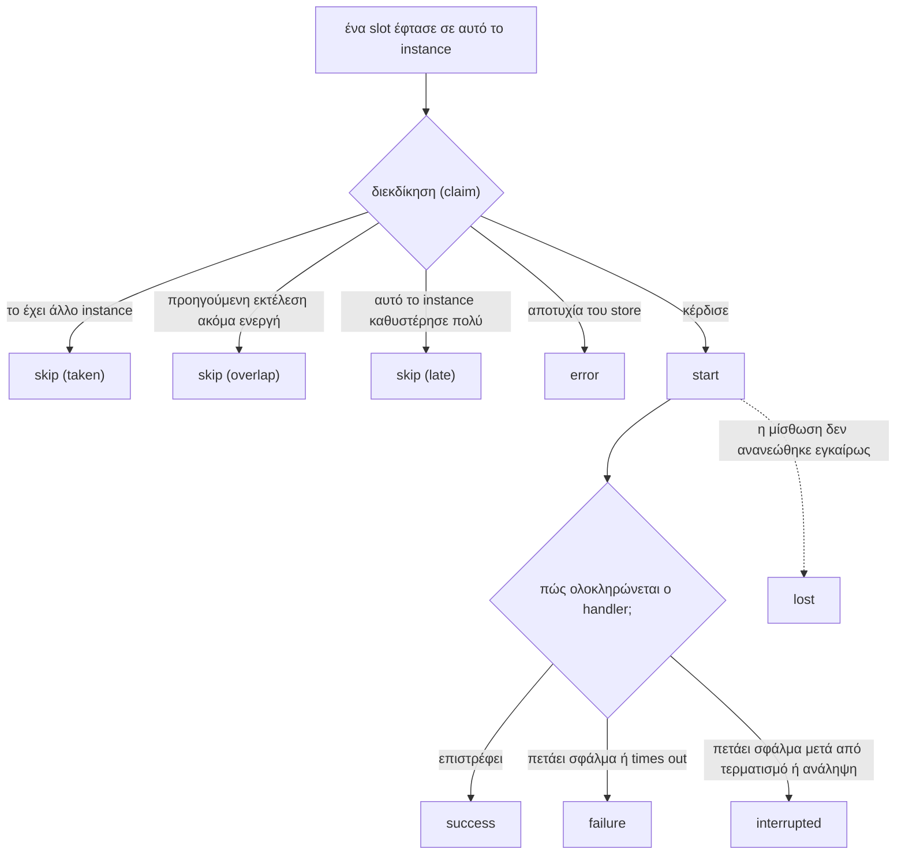

import { Tabs, TabItem } from '@astrojs/starlight/components';

Ο scheduler σας ενημερώνει για το τι συμβαίνει σε **αυτό το instance** μέσω events. Για μια συνολική εικόνα σε όλα τα instances, χρησιμοποιήστε το [ιστορικό](../history/).

<Tabs syncKey="language">
<TabItem label="Node.js">

```ts
scheduler.on('failure', (run) => {
  console.error(`${run.job} failed on ${run.instanceId}: ${run.error}`);
});
```

</TabItem>
<TabItem label=".NET">

```csharp
scheduler.Failed += (_, run) =>
    Console.Error.WriteLine($"{run.Job} failed on {run.InstanceId}: {run.Error}");
```

</TabItem>
</Tabs>

Στο Node.js, οι μέθοδοι `on()`, `once()` και `off()` λειτουργούν όπως στο `EventEmitter` του Node.js και είναι πλήρως typed: ο τύπος του payload προκύπτει από το όνομα του event. Στο .NET κάθε event είναι ένα event C# (`+=`, `-=`) με `EventHandler<T>`.

## Τα events

| Node.js | .NET | Πότε | Payload (τύπος .NET) |
| --- | --- | --- | --- |
| `start` | `Started` | Αυτό το instance κέρδισε μια εκτέλεση και πρόκειται να καλέσει τον handler | job, slot, attempt, reason (`RunStartEvent`) |
| `success` | `Succeeded` | Ο handler επέστρεψε | μια [εγγραφή εκτέλεσης](../history/#η-εγγραφή-εκτέλεσης) (`RunRecord`) |
| `failure` | `Failed` | Ο handler πέταξε σφάλμα ή πέρασε το timeout του | εγγραφή εκτέλεσης + cause (`RunFailureEvent`) |
| `interrupted` | `Interrupted` | Ένας τερματισμός ή μια ανάληψη ακύρωσε την εκτέλεση, και ο handler στη συνέχεια πέταξε σφάλμα | εγγραφή εκτέλεσης + cause, handed over (`RunInterruptedEvent`) |
| `skip` | `Skipped` | Μια εκτέλεση αναμενόταν και αυτό το instance δεν την εκτέλεσε | job, slot, reason (`SkipEvent`) |
| `lost` | `Lost` | Ένα εφεδρικό instance ανέλαβε μια εκτέλεση που αυτό το instance εκτελούσε, ή η μίσθωσή της δεν ανανεώθηκε εγκαίρως | job, slot, attempt (`LostEvent`) |
| `error` | `Error` | Πρόβλημα στο backend ή στη διαμόρφωση | error, και τα job και slot εφόσον είναι γνωστά (`SchedulerErrorEvent`) |



### Οι παραλείψεις (skips) είναι φυσιολογικές

Με τρία instances, κάθε εκτέλεση παράγει ένα event start και δύο events skip με αιτία taken. Αυτό δείχνει ότι το σύστημα λειτουργεί σωστά. Οι πιθανές αιτίες:

| Node.js | .NET | Σημασία |
| --- | --- | --- |
| `'taken'` | `SkipReason.Taken` | Κάποιο άλλο instance κέρδισε αυτή την εκτέλεση |
| `'overlap'` | `SkipReason.Overlap` | Η προηγούμενη εκτέλεση αυτής της εργασίας βρίσκεται ακόμη σε εξέλιξη (η προεπιλεγμένη αλληλεπικάλυψη, skip) |
| `'late'` | `SkipReason.Late` | Αυτό το instance έφτασε στην εκτέλεση αργότερα από το όριο καθυστέρησής της. Το `lateMs` (`Late`) αναφέρει πόσο καθυστέρησε |

### Αποτυχίες και η αιτία τους

Το `run.error` (`run.Error`) είναι το μήνυμα ως κείμενο, το ίδιο string που αποθηκεύεται στο ιστορικό. Το `run.cause` (`run.Cause`) είναι η τιμή που πέταξε στην πραγματικότητα ο handler, ώστε να μπορείτε να την εξετάσετε:

<Tabs syncKey="language">
<TabItem label="Node.js">

```ts
scheduler.on('failure', (run) => {
  if (run.cause instanceof RateLimitError) return; // αναμενόμενο, αγνόησέ το
  pager.notify(`${run.job} @ ${run.scheduledAt.toISOString()} failed: ${run.error}`);
});
```

</TabItem>
<TabItem label=".NET">

```csharp
scheduler.Failed += (_, run) =>
{
    if (run.Cause is RateLimitException) return; // αναμενόμενο, αγνόησέ το
    pager.Notify($"{run.Job} @ {run.ScheduledAt:O} failed: {run.Error}");
};
```

</TabItem>
</Tabs>

### Το interrupted δεν είναι αποτυχία

Μια εκτέλεση που διακόπηκε από ένα deploy ή έγινε ανάληψή της από άλλο instance δεν απέτυχε. Αναφέρεται ξεχωριστά ώστε οι ειδοποιήσεις σας (alerts) να μην ενεργοποιούνται άσκοπα κατά τη διάρκεια των deploys.

<Tabs syncKey="language">
<TabItem label="Node.js">

```ts
scheduler.on('interrupted', (run) => {
  logger.info(`${run.job} stopped mid-run, handed over: ${run.handedOver}`);
});
```

</TabItem>
<TabItem label=".NET">

```csharp
scheduler.Interrupted += (_, run) =>
    logger.LogInformation("{Job} stopped mid-run, handed over: {HandedOver}", run.Job, run.HandedOver);
```

</TabItem>
</Tabs>

### Lost

Αυτό το instance εκτελούσε μια εργασία και την εγκατέλειψε: ένα heartbeat διαπίστωσε ότι ένα εφεδρικό instance είχε αναλάβει την εκτέλεση, ή κανένα heartbeat δεν είχε επιβεβαιωθεί για μια ολόκληρη μίσθωση, οπότε ένα εφεδρικό μπορεί να την αναλαμβάνει. Αυτό συμβαίνει όταν το instance δεν μπόρεσε να ανανεώσει τη μίσθωσή του: είχε παγώσει ή είχε αποκοπεί από το store. Η εκτέλεση ακυρώνεται την ίδια στιγμή.

Ένα event lost που και που μετά από μια παρατεταμένη παύση είναι αναμενόμενο. Συχνά events lost σημαίνουν ότι η μίσθωση είναι υπερβολικά μικρή για το περιβάλλον σας.

### Σφάλματα (Errors)

Προβλήματα που δεν αφορούν την αποτυχία μιας εργασίας: το store δεν είναι προσβάσιμο, μια διεκδίκηση (claim) δεν μπόρεσε να σταλεί, ένα αποτέλεσμα δεν μπόρεσε να αποθηκευτεί.

<Tabs syncKey="language">
<TabItem label="Node.js">

```ts
scheduler.on('error', (e) => {
  logger.error({ err: e.error, job: e.job }, 'scheduler backend problem');
});
```

</TabItem>
<TabItem label=".NET">

```csharp
scheduler.Error += (_, e) =>
    logger.LogError(e.Error, "scheduler backend problem in {Job}", e.Job);
```

</TabItem>
</Tabs>

Αν κανείς δεν ακούει για σφάλματα, αυτά καταγράφονται στον logger. Δεν προκαλούν ποτέ κατάρρευση της διεργασίας.

## Μετρικές

Τα events αντιστοιχίζονται άμεσα σε μετρικές:

<Tabs syncKey="language">
<TabItem label="Node.js">

```ts
scheduler.on('start', (e) => metrics.increment('cron.start', { job: e.job }));
scheduler.on('success', (run) => metrics.timing('cron.duration', run.durationMs, { job: run.job }));
scheduler.on('failure', (run) => metrics.increment('cron.failure', { job: run.job }));
scheduler.on('skip', (e) => {
  if (e.reason !== 'taken') metrics.increment('cron.skip', { job: e.job, reason: e.reason });
});
scheduler.on('lost', (e) => metrics.increment('cron.lost', { job: e.job }));
```

</TabItem>
<TabItem label=".NET">

```csharp
// System.Diagnostics.Metrics: εξάγονται από OpenTelemetry, Prometheus, dotnet-counters
var meter = new Meter("MyService.Jobs");
var started = meter.CreateCounter<long>("cron.start");
var duration = meter.CreateHistogram<double>("cron.duration", unit: "ms");
var failed = meter.CreateCounter<long>("cron.failure");

scheduler.Started += (_, e) => started.Add(1, new KeyValuePair<string, object?>("job", e.Job));
scheduler.Succeeded += (_, run) => duration.Record(run.Duration?.TotalMilliseconds ?? 0, new KeyValuePair<string, object?>("job", run.Job));
scheduler.Failed += (_, run) => failed.Add(1, new KeyValuePair<string, object?>("job", run.Job));
```

</TabItem>
</Tabs>

Θυμηθείτε ότι αυτά καταμετρούν ό,τι συνέβη σε ένα μόνο instance. Αθροίστε τα σε όλα τα instances για να έχετε τη συνολική εικόνα της υπηρεσίας.

## Οι listeners δεν μπορούν να διακόψουν μια εκτέλεση

Ένας listener που πετάει εξαίρεση (στο Node.js επίσης ένας async listener του οποίου το promise απορρίπτεται) εντοπίζεται και καταγράφεται. Δεν επηρεάζει την εκτέλεση ούτε τους υπόλοιπους listeners.

## Ενσωματωμένη καταγραφή

<Tabs syncKey="language">
<TabItem label="Node.js">

Η επιλογή `log: true` καταγράφει μία γραμμή για καθένα από τα παραπάνω events, χωρίς να χρειάζεται πρόσθετος κώδικας:

```ts
new Scheduler({ backend, log: true });
```

</TabItem>
<TabItem label=".NET">

Ο scheduler καταγράφει καθένα από τα παραπάνω events μέσω του `ILogger`, στην κατηγορία `Anarchon.Scheduler`: οι εκτελέσεις σε επίπεδο Debug, οι αποτυχημένες και χαμένες εκτελέσεις σε Warning, τα σφάλματα που δεν χειρίζεται κανείς σε Error. Δώστε του ένα `LoggerFactory`, ή χρησιμοποιήστε έναν host, του οποίου το factory λαμβάνει το `AddAnarchon()`:

```json
{ "Logging": { "LogLevel": { "Anarchon": "Debug" } } }
```

```
dbug: Anarchon.Scheduler[1] sync @ 2026-10-10T12:00:10.0000000+00:00: started on api-2 (attempt 1, Scheduled)
dbug: Anarchon.Scheduler[2] sync @ 2026-10-10T12:00:10.0000000+00:00: finished in 203 ms
warn: Anarchon.Scheduler[3] report @ 2026-10-10T12:00:00.0000000+00:00: failed after 1204 ms: HttpRequestException: upstream returned 503
```

Τα μηνύματα καταγραφής έχουν αναγνωριστικά event (1 started, 2 finished, 3 failed, 4 interrupted, 5 skipped, 6 lost, 7 unhandled error), και οι τιμές τους είναι δομημένα πεδία (`Job`, `Due`, `Attempt`...) για συστήματα καταγραφής που τα ευρετηριάζουν. Το υπόλοιπο αυτής της ενότητας αφορά το Node.js.

</TabItem>
</Tabs>

```
[anarchon] sync @ 2026-10-10T12:00:10.000Z: started on api-2 (attempt 1, scheduled)
[anarchon] sync @ 2026-10-10T12:00:10.000Z: finished in 203 ms
[anarchon] sync @ 2026-10-10T12:00:20.000Z: skipped (taken)
[anarchon] report @ 2026-10-10T12:00:00.000Z: failed after 1204 ms: Error: upstream returned 503
[anarchon] report @ 2026-10-10T12:30:00.000Z: interrupted after 8012 ms, handed over to another instance
[anarchon] export @ 2026-10-10T12:00:00.000Z: attempt 1 was taken over by a backup
```

Οι αποτυχίες και οι χαμένες εκτελέσεις καταγράφονται στο `logger.warn`· τα υπόλοιπα πηγαίνουν στο `logger.info`.

### Ο δικός σας logger (Node.js)

Οποιοδήποτε αντικείμενο με μεθόδους `warn` και `error` είναι κατάλληλο. Η μέθοδος `info` είναι προαιρετική.

```ts
import pino from 'pino';
new Scheduler({ backend, log: true, logger: pino() });
```

```ts
new Scheduler({
  backend,
  logger: {
    info: (message) => myLog('info', message),
    warn: (message) => myLog('warn', message),
    error: (message) => myLog('error', message),
  },
});
```

Με `log: false` (η προεπιλογή), ο logger εξακολουθεί να χρησιμοποιείται για events `error` που δεν έχουν κανέναν listener.

## Επόμενα βήματα

- [Ιστορικό](../history/): η εικόνα σε όλα τα instances
- [Αναφορά events](../../reference/events/): κάθε πεδίο payload
