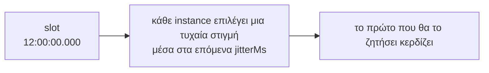

import { Tabs, TabItem } from '@astrojs/starlight/components';

Το τελευταίο όρισμα των `every()`, `cron()` και `at()` είναι ένα αντικείμενο επιλογών (στο .NET, `EveryJobOptions`, `CronJobOptions` ή `JobOptions`, συνήθως γραμμένο ως `new() { ... }`). Κάθε επιλογή έχει μια προεπιλεγμένη τιμή, επομένως ορίζετε μόνο ό,τι χρειάζεστε.

<Tabs syncKey="language">
<TabItem label="Node.js">

```ts
scheduler.every('report', '35m', buildReport, {
  timeoutMs: 20 * 60_000,
  maxAttempts: 2,
});
```

</TabItem>
<TabItem label=".NET">

```csharp
scheduler.Every("report", TimeSpan.FromMinutes(35), BuildReportAsync, new()
{
    Timeout = TimeSpan.FromMinutes(20),
    MaxAttempts = 2,
});
```

</TabItem>
</Tabs>

## Σύνοψη

| Node.js | .NET | Προεπιλογή | Απαιτεί lease backend | Τι ελέγχει |
| --- | --- | --- | --- | --- |
| [`jitterMs`](#jitterms) | `Jitter` | του scheduler (2 s), μειωμένο για μικρά διαστήματα | όχι | Την τυχαία καθυστέρηση πριν από τη διεκδίκηση (claim) |
| [`maxLateMs`](#maxlatems) | `MaxLate` | του scheduler (60 s) | όχι | Πόσο αργά επιτρέπεται σε ένα instance να ξεκινήσει μια εκτέλεση |
| [`timeoutMs`](#timeoutms) | `Timeout` | κανένα | όχι | Τον μέγιστο χρόνο που μπορεί να διαρκέσει μια εκτέλεση |
| [`overlap`](#overlap) | `Overlap` | skip | ναι | Αν μια εκτέλεση μπορεί να ξεκινήσει ενώ η προηγούμενη βρίσκεται σε εξέλιξη |
| [`maxAttempts`](#maxattempts) | `MaxAttempts` | `3` | ναι | Πόσες φορές μπορεί να ξεκινήσει μια εκτέλεση όταν καταρρέουν οι runners |
| [`catchUpMs`](#catchupms) | `CatchUp` | 5 λεπτά | ναι | Πόσο παλιά μπορεί να είναι μια χαμένη εκτέλεση και παρ' όλα αυτά να εκτελεστεί κατά την εκκίνηση |
| [`yieldAfterFailure`](#yieldafterfailure) | `YieldAfterFailure` | false | ναι | Αν ένα instance που μόλις απέτυχε την εργασία αφήνει ένα υγιές να διεκδικήσει πρώτο την επόμενη εκτέλεση |
| [`historySize`](#historysize-και-historyttlms) | `HistorySize` | του scheduler (1000) | όχι | Πόσες εκτελέσεις διατηρούνται στο ιστορικό |
| [`historyTtlMs`](#historysize-και-historyttlms) | `HistoryTtl` | του scheduler (κανένα) | όχι, αλλά όχι σε RabbitMQ ή NATS | Για πόσο χρονικό διάστημα διατηρούνται |
| `offsetMs` | `Offset` | `0` | όχι | Μόνο για εργασίες μεσοδιαστήματος: [μετατοπίζει το πλέγμα](../defining-jobs/#μετατόπιση-του-πλέγματος-offsetms-offset) |
| `timezone` | `TimeZone` | του scheduler | όχι | Μόνο για εργασίες cron: [τη ζώνη ώρας](../defining-jobs/#ζώνες-ώρας) |
| [`data`](../run-data/) | `Data` | κανένα | όχι | Δεδομένα για τις εκτελέσεις της εργασίας, που διαβάζονται στον handler ως `ctx.data` (`ctx.Data`) |

Οι διάρκειες είναι χιλιοστά του δευτερολέπτου (milliseconds) στο Node.js και τιμές `TimeSpan` στο .NET. «Του scheduler» σημαίνει την επιλογή με το ίδιο όνομα στον scheduler. Δείτε τις [Επιλογές scheduler](../scheduler-options/).

Μια επιλογή που απαιτεί lease backend δεν προσφέρεται σε άλλο backend: τα RabbitMQ, ή τα NATS, Redis ή Valkey χωρίς τη στρατηγική μίσθωσής τους (lease strategy), δεν δέχονται την αλληλεπικάλυψη (overlap), τις προσπάθειες (attempts), την ανάκτηση (catch-up) ή το yield-after-failure. Μια εφάπαξ εργασία δεν δέχεται ποτέ την αλληλεπικάλυψη, αφού δεν έχει προηγούμενη εκτέλεση.

<Tabs syncKey="language">
<TabItem label="Node.js">

Στην TypeScript, τα `every()`, `cron()` και `at()` δεν δέχονται αυτές τις επιλογές σε ένα τέτοιο backend: ο κώδικας δεν μεταγλωττίζεται. Οι decorators και η απλή JavaScript δεν μπορούν να ελεγχθούν έτσι, οπότε η εργασία απορρίπτεται όταν προστίθεται, με σφάλμα που ονομάζει την επιλογή και το backend.

```ts
const scheduler = new Scheduler({ backend: new RabbitMQBackend({ url }) });
scheduler.every('sync', '5m', sync, { timeoutMs: 60_000 });   // εντάξει
scheduler.every('sync', '5m', sync, { overlap: 'allow' });    // σφάλμα τύπου: το RabbitMQ δεν έχει μισθώσεις
```

</TabItem>
<TabItem label=".NET">

Η εργασία απορρίπτεται όταν προστίθεται, με ένα `AnarchonException` με κωδικό `Unsupported` που ονομάζει την επιλογή και το backend.

```csharp
var scheduler = new Scheduler(new SchedulerOptions { Backend = new RabbitMQBackend(rabbitUri) });
scheduler.Every("sync", TimeSpan.FromMinutes(5), SyncAsync, new() { Timeout = TimeSpan.FromMinutes(1) });    // εντάξει
scheduler.Every("sync", TimeSpan.FromMinutes(5), SyncAsync, new() { Overlap = OverlapPolicy.Allow });        // πετάει εξαίρεση: το RabbitMQ δεν έχει μισθώσεις
```

</TabItem>
</Tabs>

## `jitterMs`

Κάθε instance περιμένει ένα τυχαίο χρονικό διάστημα μεταξύ 0 και του jitter (`jitterMs`, `Jitter`) μετά το slot προτού διεκδικήσει (claim) την εκτέλεση. Με το [`yieldAfterFailure`](#yieldafterfailure), ένα instance του οποίου η τελευταία εκτέλεση της εργασίας απέτυχε περιμένει περισσότερο.



- **Μεγαλύτερο** jitter κατανέμει το φορτίο πιο ομοιόμορφα και καθιστά την ώρα έναρξης λιγότερο ακριβή.
- **`0`** σημαίνει καθόλου κατανομή: όλα τα instances κάνουν claim την ίδια ακριβώς στιγμή, και αυτό με το ταχύτερο ρολόι και σύνδεση συνήθως κερδίζει.

Πρέπει να είναι μικρότερο από το μισό του χρόνου μεταξύ των εκτελέσεων. Αν δεν το ορίσετε, η προεπιλογή είναι το jitter του scheduler (2 δευτερόλεπτα), ή το ένα τέταρτο του μεσοδιαστήματος όταν αυτό είναι μικρότερο. Έτσι, μια εργασία που εκτελείται κάθε δευτερόλεπτο παίρνει 250 ms.

<Tabs syncKey="language">
<TabItem label="Node.js">

```ts
scheduler.every('tick', '1s', tick);                       // jitter 250 ms, αυτόματα
scheduler.cron('nightly', '0 2 * * *', run, { jitterMs: 30_000 }); // ξεκινά μεταξύ 02:00:00 και 02:00:30
scheduler.every('precise', '1m', run, { jitterMs: 0 });    // ξεκινά ακριβώς στην ώρα του, πάντα από το ταχύτερο instance
```

</TabItem>
<TabItem label=".NET">

```csharp
scheduler.Every("tick", TimeSpan.FromSeconds(1), TickAsync);                                         // jitter 250 ms, αυτόματα
scheduler.Cron("nightly", "0 2 * * *", RunAsync, new() { Jitter = TimeSpan.FromSeconds(30) });          // ξεκινά μεταξύ 02:00:00 και 02:00:30
scheduler.Every("precise", TimeSpan.FromMinutes(1), RunAsync, new() { Jitter = TimeSpan.Zero });        // ξεκινά ακριβώς στην ώρα του, πάντα από το ταχύτερο instance
```

</TabItem>
</Tabs>

**Λειτουργεί** σε κάθε backend. **Χρησιμοποιήστε το όταν:**

- **Μια βαριά εργασία πρέπει να πέφτει σε τυχαίο instance:** μεγαλύτερο jitter μοιράζει τις εκτελέσεις, ώστε να μην κάνει ένα instance κάθε νυχτερινή ανακατασκευή.
- **Η ώρα έναρξης μετρά στο δευτερόλεπτο:** χωρίς jitter (`jitterMs: 0`, `Jitter = TimeSpan.Zero`). Τότε κερδίζει πάντα το ταχύτερο instance· αυτό είναι το τίμημα.
- **Πολλά instances καλούν μία εξάρτηση την ίδια στιγμή:** το jitter μοιράζει τα πρώτα αιτήματα σε λίγα δευτερόλεπτα.

<Tabs syncKey="language">
<TabItem label="Node.js">

```ts
scheduler.cron('rebuild-search-index', '0 3 * * *', rebuild, { jitterMs: 5 * 60_000 });           // μοιρασμένο σε 5 λεπτά
scheduler.cron('market-open', '30 9 * * 1-5', open, { timezone: 'America/New_York', jitterMs: 0 }); // στο δευτερόλεπτο
scheduler.every('poll-partner-api', '1m', poll, { jitterMs: 20_000 });                            // ήπια με το rate limit τους
```

</TabItem>
<TabItem label=".NET">

```csharp
scheduler.Cron("rebuild-search-index", "0 3 * * *", RebuildAsync, new() { Jitter = TimeSpan.FromMinutes(5) });     // μοιρασμένο σε 5 λεπτά
scheduler.Cron("market-open", "30 9 * * 1-5", OpenAsync, new() { TimeZone = newYork, Jitter = TimeSpan.Zero });      // στο δευτερόλεπτο
scheduler.Every("poll-partner-api", TimeSpan.FromMinutes(1), PollAsync, new() { Jitter = TimeSpan.FromSeconds(20) }); // ήπια με το rate limit τους
```

</TabItem>
</Tabs>

## `maxLateMs`

Όταν ένα instance φτάσει σε μια εκτέλεση με καθυστέρηση μεγαλύτερη από το όριο καθυστέρησης (`maxLateMs`, `MaxLate`) μετά το slot της, την παραλείπει και εκπέμπει ένα event παράλειψης με αιτία την καθυστέρηση (`skip` και `'late'` στο Node.js, `Skipped` και `SkipReason.Late` στο .NET).

Αυτό σας προστατεύει από παρωχημένες εκτελέσεις (stale runs). Μια διεργασία μπορεί να παγώσει για λεπτά: ένας φορητός υπολογιστής σε αναστολή λειτουργίας, μια παρατεταμένη παύση garbage collection, μια εικονική μηχανή που έχει κολλήσει. Όταν ξυπνήσει, τα timers της ενεργοποιούνται για εκτελέσεις που έπρεπε να είχαν γίνει πολύ νωρίτερα. Χωρίς αυτό το όριο, θα τις ξεκινούσε.

<Tabs syncKey="language">
<TabItem label="Node.js">

```ts
// Μια εκτέλεση που δεν μπορεί να ξεκινήσει εντός 10 δευτερολέπτων από την ώρα της δεν αξίζει να ξεκινήσει
scheduler.every('quote-refresh', '30s', refresh, { maxLateMs: 10_000 });
```

</TabItem>
<TabItem label=".NET">

```csharp
// Μια εκτέλεση που δεν μπορεί να ξεκινήσει εντός 10 δευτερολέπτων από την ώρα της δεν αξίζει να ξεκινήσει
scheduler.Every("quote-refresh", TimeSpan.FromSeconds(30), RefreshAsync, new() { MaxLate = TimeSpan.FromSeconds(10) });
```

</TabItem>
</Tabs>

Πρέπει να είναι μεγαλύτερο από το jitter.

**Λειτουργεί** σε κάθε backend. Σε RabbitMQ, και σε NATS, Redis ή Valkey χωρίς τη στρατηγική μίσθωσής τους, το jitter συν το όριο καθυστέρησης πρέπει επίσης να είναι μικρότερο από όσο το backend θυμάται μια διεκδικημένη εκτέλεση, αλλιώς ένα καθυστερημένο instance θα μπορούσε να κερδίσει ξανά την ίδια εκτέλεση· το anarchon το ελέγχει όταν προστίθεται η εργασία. **Χρησιμοποιήστε το όταν:**

- **Μια μπαγιάτικη εκτέλεση είναι χειρότερη από καμία:** τιμές, παρουσία, ό,τι παλιώνει σε δευτερόλεπτα. Κρατήστε το μικρό.
- **Μια καθυστερημένη εκτέλεση είναι ακόμα χρήσιμη:** ένας καθαρισμός ή μια αναφορά μπορεί να τρέξει μισή ώρα αργότερα. Αυξήστε το.

<Tabs syncKey="language">
<TabItem label="Node.js">

```ts
scheduler.every('presence-sweep', '10s', sweep, { maxLateMs: 5_000 });            // 5 s αργά σημαίνει μπαγιάτικη παρουσία: παραλείπεται
scheduler.cron('cleanup-temp', '0 4 * * *', cleanup, { maxLateMs: 30 * 60_000 }); // εντάξει και μισή ώρα αργά

// Στο RabbitMQ, αυξήστε πρώτα το slotTtlMs (5 λεπτά από προεπιλογή), ώστε ο broker να θυμάται αρκετά
new Scheduler({ backend: new RabbitMQBackend({ url, slotTtlMs: 20 * 60_000 }), maxLateMs: 15 * 60_000 });
```

</TabItem>
<TabItem label=".NET">

```csharp
scheduler.Every("presence-sweep", TimeSpan.FromSeconds(10), SweepAsync, new() { MaxLate = TimeSpan.FromSeconds(5) }); // 5 s αργά σημαίνει μπαγιάτικη παρουσία: παραλείπεται
scheduler.Cron("cleanup-temp", "0 4 * * *", CleanupAsync, new() { MaxLate = TimeSpan.FromMinutes(30) });              // εντάξει και μισή ώρα αργά

// Στο RabbitMQ, αυξήστε πρώτα το SlotTtl (5 λεπτά από προεπιλογή), ώστε ο broker να θυμάται αρκετά
new Scheduler(new SchedulerOptions
{
    Backend = new RabbitMQBackend(new RabbitMQBackendOptions { ConnectionString = rabbitUri, SlotTtl = TimeSpan.FromMinutes(20) }),
    MaxLate = TimeSpan.FromMinutes(15),
});
```

</TabItem>
</Tabs>

## `timeoutMs`

Μετά από αυτό το χρονικό διάστημα, ενεργοποιείται η ακύρωση της εκτέλεσης (το `ctx.signal` κάνει abort, το `ctx.CancellationToken` ακυρώνεται) και η εκτέλεση καταγράφεται ως **αποτυχημένη**, με το σφάλμα `TimeoutError: Timed out after N ms` (`TimeoutException: Timed out after N ms` στο .NET).

<Tabs syncKey="language">
<TabItem label="Node.js">

```ts
scheduler.every('export', '5m', exportAll, { timeoutMs: 4 * 60_000 });
```

</TabItem>
<TabItem label=".NET">

```csharp
scheduler.Every("export", TimeSpan.FromMinutes(5), ExportAllAsync, new() { Timeout = TimeSpan.FromMinutes(4) });
```

</TabItem>
</Tabs>

:::caution
Το timeout δεν τερματίζει βίαια τον handler σας. Ούτε η JavaScript ούτε το .NET μπορούν να διακόψουν μια συνάρτηση που εκτελείται από έξω. Ο handler πρέπει να παρακολουθεί το `ctx.signal` (`ctx.CancellationToken`), διαφορετικά συνεχίζει να εκτελείται στο παρασκήνιο αφού η εκτέλεση έχει ήδη καταγραφεί ως αποτυχημένη. Δείτε τη [Συγγραφή handlers](../writing-handlers/#διακοπή-όταν-ζητηθεί).
:::

Ορίστε ένα timeout σε κάθε εργασία που μπορεί να «κολλήσει». Με την προεπιλεγμένη αλληλεπικάλυψη (skip), μια κολλημένη εκτέλεση συνεχίζει να ανανεώνει τη μίσθωσή (lease) της και μπλοκάρει κάθε μεταγενέστερη εκτέλεση αυτής της εργασίας.

**Λειτουργεί** σε κάθε backend. **Χρησιμοποιήστε το όταν:**

- **Η εργασία καλεί οτιδήποτε μέσω δικτύου:** μια κολλημένη σύνδεση δεν πρέπει να κρατά την εργασία για πάντα. Περάστε το `ctx.signal` (`ctx.CancellationToken`).
- **Η εργασία πρέπει να τελειώνει πριν από την επόμενη εκτέλεσή της:** ορίστε το κάτω από το διάστημα, ώστε μια αργή εκτέλεση να αποτυγχάνει και η επόμενη να ξεκινά στην ώρα της.

<Tabs syncKey="language">
<TabItem label="Node.js">

```ts
scheduler.every('sync-crm', '15m', (ctx) => crm.sync({ signal: ctx.signal }), { timeoutMs: 10 * 60_000 });
scheduler.cron('send-digest', '0 8 * * *', sendDigest, { timeoutMs: 30 * 60_000 }); // ένας κολλημένος SMTP server δεν μπλοκάρει την αυριανή
```

</TabItem>
<TabItem label=".NET">

```csharp
scheduler.Every("sync-crm", TimeSpan.FromMinutes(15), ctx => crm.SyncAsync(ctx.CancellationToken), new() { Timeout = TimeSpan.FromMinutes(10) });
scheduler.Cron("send-digest", "0 8 * * *", SendDigestAsync, new() { Timeout = TimeSpan.FromMinutes(30) }); // ένας κολλημένος SMTP server δεν μπλοκάρει την αυριανή
```

</TabItem>
</Tabs>

## `overlap`

*Απαιτεί backend μίσθωσης.*

Τι συμβαίνει όταν μια εκτέλεση πρέπει να ξεκινήσει ενώ η προηγούμενη εκτέλεση της ίδιας εργασίας βρίσκεται ακόμη σε εξέλιξη:

- **Skip** (προεπιλογή· `'skip'`, `OverlapPolicy.Skip`): η νέα εκτέλεση παραλείπεται, με ένα event παράλειψης με αιτία την αλληλεπικάλυψη (overlap).
- **Allow** (`'allow'`, `OverlapPolicy.Allow`): εκτελούνται και οι δύο.

```
Μια εργασία διάρκειας 7 δευτ. κάθε 3 δευτ., με overlap 'skip'

χρόνος :00  :03  :06  :09  :12  :15  :18
εκτέλεση [======= 7 s =======]
            skip skip
                           [======= 7 s =======]
                                skip skip
```

Οι εκτελέσεις που παραλείπονται δεν μπαίνουν σε ουρά. Η εκτέλεση στο :03 δεν πραγματοποιείται ποτέ. Η επόμενη εκτέλεση που θα ξεκινήσει είναι η πρώτη που είναι προγραμματισμένη μετά τη λήξη της τρέχουσας εκτέλεσης.

<Tabs syncKey="language">
<TabItem label="Node.js">

```ts
// Ανεξάρτητη εργασία ανά εκτέλεση: επιτρέψτε την αλληλεπικάλυψή τους
scheduler.every('sample-metrics', '5s', sample, { overlap: 'allow' });
```

</TabItem>
<TabItem label=".NET">

```csharp
// Ανεξάρτητη εργασία ανά εκτέλεση: επιτρέψτε την αλληλεπικάλυψή τους
scheduler.Every("sample-metrics", TimeSpan.FromSeconds(5), SampleAsync, new() { Overlap = OverlapPolicy.Allow });
```

</TabItem>
</Tabs>

**Λειτουργεί** σε backends μίσθωσης: PostgreSQL, SQLite, Redis, Valkey ή NATS με τη στρατηγική μίσθωσής τους. Στα υπόλοιπα οι εκτελέσεις μπορούν πάντα να επικαλύπτονται· αν δύο δεν πρέπει, προστατέψτε το μέσα στην εργασία (για παράδειγμα με ένα κλείδωμα βάσης). **Χρησιμοποιήστε το όταν:**

- **Skip:** οι εκτελέσεις της εργασίας γράφουν τα ίδια δεδομένα: συγχρονισμός, εξαγωγή, επαναδημιουργία ευρετηρίου. Δύο μαζί θα συγκρούονταν.
- **Allow:** κάθε εκτέλεση είναι αυτοτελής: ένα ping, ένα δείγμα μετρικών, ένας έλεγχος που απλώς καταγράφεται.

<Tabs syncKey="language">
<TabItem label="Node.js">

```ts
scheduler.every('reindex', '5m', reindex);                              // 'skip': δύο reindex θα συγκρούονταν
scheduler.every('ping-endpoints', '30s', ping, { overlap: 'allow' });    // κάθε ping είναι αυτοτελές
```

</TabItem>
<TabItem label=".NET">

```csharp
scheduler.Every("reindex", TimeSpan.FromMinutes(5), ReindexAsync);                                                  // skip: δύο reindex θα συγκρούονταν
scheduler.Every("ping-endpoints", TimeSpan.FromSeconds(30), PingAsync, new() { Overlap = OverlapPolicy.Allow });    // κάθε ping είναι αυτοτελές
```

</TabItem>
</Tabs>

## `maxAttempts`

*Απαιτεί backend μίσθωσης.*

Πόσες φορές μπορεί να **ξεκινήσει** μία εκτέλεση όταν ο runner της πεθάνει (καταρρεύσει), συμπεριλαμβανομένης της πρώτης προσπάθειας. Η προεπιλογή είναι 3.

- Μια εκτέλεση επαναλαμβάνεται μόνο όταν ο runner της σταμάτησε να ανανεώνει τη μίσθωση: κατέρρευσε, πάγωσε ή έχασε τη σύνδεση δικτύου.
- Μια εκτέλεση που **αποτυγχάνει** (ο handler πετάει exception) **δεν** επαναλαμβάνεται. Οι επαναλήψεις προορίζονται για νεκρούς runners, όχι για σφάλματα. Αν θέλετε να κάνετε retry σε σφάλματα, υλοποιήστε το μέσα στον handler.
- Μια παράδοση (hand-over) κατά τη διακοπή δεν προσμετράται στο όριο.

<Tabs syncKey="language">
<TabItem label="Node.js">

```ts
scheduler.cron('charge-cards', '0 6 * * *', charge, { maxAttempts: 1 }); // δεν ξεκινά ποτέ δεύτερη φορά
```

</TabItem>
<TabItem label=".NET">

```csharp
scheduler.Cron("charge-cards", "0 6 * * *", ChargeAsync, new() { MaxAttempts = 1 }); // δεν ξεκινά ποτέ δεύτερη φορά
```

</TabItem>
</Tabs>

Όταν το όριο εξαντληθεί, η εκτέλεση επισημαίνεται ως `interrupted` και εγκαταλείπεται.

**Λειτουργεί** σε backends μίσθωσης. **Χρησιμοποιήστε το όταν:**

- **`1`:** το αποτέλεσμα δεν πρέπει ποτέ να γίνει δύο φορές και δεν είναι idempotent: πληρωμές, μηνύματα χωρίς κλειδί αποφυγής διπλότυπων. Μια εκτέλεση που σταμάτησε στη μέση θέλει άνθρωπο, όχι επανάληψη.
- **`3` (η προεπιλογή):** η εργασία μπορεί να ξαναγίνει με ασφάλεια, ή συνεχίζει από checkpoint.
- **Περισσότερες:** μια μεγάλη, idempotent εργασία σε υποδομή όπου τα instances έρχονται και φεύγουν.

<Tabs syncKey="language">
<TabItem label="Node.js">

```ts
scheduler.cron('charge-cards', '0 6 * * *', charge, { maxAttempts: 1 });   // μια μισή χρέωση θέλει άνθρωπο
scheduler.every('rebuild-cache', '1h', rebuild, { maxAttempts: 5 });        // ασφαλές να ξαναγίνει: συνεχίζει αλλού
```

</TabItem>
<TabItem label=".NET">

```csharp
scheduler.Cron("charge-cards", "0 6 * * *", ChargeAsync, new() { MaxAttempts = 1 });                  // μια μισή χρέωση θέλει άνθρωπο
scheduler.Every("rebuild-cache", TimeSpan.FromHours(1), RebuildAsync, new() { MaxAttempts = 5 });     // ασφαλές να ξαναγίνει: συνεχίζει αλλού
```

</TabItem>
</Tabs>

## `catchUpMs`

*Απαιτεί backend μίσθωσης.*

Κατά την εκκίνηση, ένα instance ελέγχει το πιο πρόσφατο slot κάθε εργασίας. Αν κανείς δεν το εκτέλεσε και η προγραμματισμένη ώρα του ήταν πριν από λιγότερο από το παράθυρο ανάκτησης (catch-up window), το instance το εκτελεί τώρα, με αιτία την ανάκτηση (`ctx.reason === 'catch-up'`, `ctx.Reason == RunReason.CatchUp`).

Αυτό καλύπτει μια εκτέλεση που έπρεπε να τρέξει ενώ όλα τα instances ήταν εκτός λειτουργίας, για παράδειγμα κατά τη διάρκεια μιας πλήρους επανεκκίνησης.

<Tabs syncKey="language">
<TabItem label="Node.js">

```ts
scheduler.cron('daily-report', '0 6 * * *', report, { catchUpMs: 6 * 60 * 60_000 }); // έως και 6 ώρες καθυστέρηση
scheduler.every('refresh-cache', '5s', refresh, { catchUpMs: 0 });                    // ποτέ ανάκτηση
```

</TabItem>
<TabItem label=".NET">

```csharp
scheduler.Cron("daily-report", "0 6 * * *", ReportAsync, new() { CatchUp = TimeSpan.FromHours(6) });            // έως και 6 ώρες καθυστέρηση
scheduler.Every("refresh-cache", TimeSpan.FromSeconds(5), RefreshAsync, new() { CatchUp = TimeSpan.Zero });       // ποτέ ανάκτηση
```

</TabItem>
</Tabs>

Μόνο η **πιο πρόσφατη** εκτέλεση ανακτάται, όχι κάθε εκτέλεση που χάθηκε.

**Λειτουργεί** σε backends μίσθωσης. **Χρησιμοποιήστε το όταν:**

- **Μια ημερήσια ή μηνιαία εργασία πρέπει να γίνει και μετά από μεγάλη διακοπή:** ώρες, ή μια ημέρα.
- **Μια ωριαία εργασία:** έως περίπου το διάστημα, ώστε μια εκτέλεση catch-up να μην πέφτει ακριβώς πριν από την επόμενη.
- **Μια συχνή εργασία:** μηδέν, αφού η επόμενη εκτέλεση είναι σε λίγο.

<Tabs syncKey="language">
<TabItem label="Node.js">

```ts
scheduler.cron('monthly-invoices', '0 6 1 * *', invoice, { catchUpMs: 24 * 60 * 60_000 }); // μια ολόκληρη ημέρα για ανάκτηση
scheduler.every('hourly-rollup', '1h', rollup, { catchUpMs: 50 * 60_000 });                 // ως λίγο πριν από την επόμενη
scheduler.every('heartbeat', '10s', beat, { catchUpMs: 0 });                                 // ποτέ
```

</TabItem>
<TabItem label=".NET">

```csharp
scheduler.Cron("monthly-invoices", "0 6 1 * *", InvoiceAsync, new() { CatchUp = TimeSpan.FromDays(1) });        // μια ολόκληρη ημέρα για ανάκτηση
scheduler.Every("hourly-rollup", TimeSpan.FromHours(1), RollupAsync, new() { CatchUp = TimeSpan.FromMinutes(50) }); // ως λίγο πριν από την επόμενη
scheduler.Every("heartbeat", TimeSpan.FromSeconds(10), BeatAsync, new() { CatchUp = TimeSpan.Zero });           // ποτέ
```

</TabItem>
</Tabs>

## `yieldAfterFailure`

*Απαιτεί backend μίσθωσης.*

Κάθε εκτέλεση πηγαίνει στο instance που τη διεκδικεί πρώτο, υγιές ή όχι. Ένα σφάλμα που μένει σε ένα instance (ένα χαλασμένο connection pool, ένας γεμάτος δίσκος, μια εξάρτηση που μόνο αυτό το instance δεν φτάνει) αποτυγχάνει κάθε εκτέλεση που κερδίζει αυτό το instance, ενώ ένα υγιές θα μπορούσε να τις εκτελέσει. Μια εκτέλεση που πετάει σφάλμα δεν επαναλαμβάνεται.

Με το yield-after-failure ενεργοποιημένο (`yieldAfterFailure: true`, `YieldAfterFailure = true`), ένα instance του οποίου η τελευταία εκτέλεση της εργασίας απέτυχε (πέταξε σφάλμα ή έληξε ο χρόνος της) περιμένει προτού διεκδικήσει την επόμενη προγραμματισμένη εκτέλεση της εργασίας:

- **Πρώτα τα υγιή instances.** Διεκδικούν έως το slot + jitter. Το instance που απέτυχε περιμένει έως το slot + jitter + heartbeat, οπότε κερδίζει ένα από αυτά.
- **Εκτελεί όταν δεν εκτελεί κανένα άλλο.** Αν κανένα άλλο instance δεν έχει διεκδικήσει την εκτέλεση έως τότε, το instance που απέτυχε τη διεκδικεί και την εκτελεί. Ένα μοναδικό instance συνεχίζει να εκτελεί τις εργασίες του.
- **Επανέρχεται μόνο του.** Μια εκτέλεση που πετυχαίνει σε αυτό το instance τερματίζει την αναμονή.
- **Ποτέ δεν απορρίπτεται ως καθυστερημένη.** Η αναμονή δεν τελειώνει ποτέ πέρα από το όριο καθυστέρησης μετά το slot.

<Tabs syncKey="language">
<TabItem label="Node.js">

```ts
scheduler.every('sync-orders', '1m', syncOrders, { yieldAfterFailure: true });
```

</TabItem>
<TabItem label=".NET">

```csharp
scheduler.Every("sync-orders", TimeSpan.FromMinutes(1), SyncOrdersAsync, new() { YieldAfterFailure = true });
```

</TabItem>
</Tabs>

**Τι κοστίζει.** Όταν απομένουν μόνο instances που αποτυγχάνουν, μια εκτέλεση ξεκινά έως και ένα heartbeat αργότερα από το συνηθισμένο: μεταξύ slot + jitter και slot + jitter + heartbeat. Με τους προεπιλεγμένους χρόνους (jitter 2 s, heartbeat 5 s), αυτό σημαίνει έως 7 s μετά το slot αντί για 2 s. Οι χειροκίνητες εκτελέσεις, οι αναλήψεις και το catch-up δεν περιμένουν ποτέ.

**Τι δεν κάνει.** Η εκτέλεση που απέτυχε δεν επαναλαμβάνεται, και ένας handler που κόλλησε συνεχίζει να τρέχει στο instance του (δείτε το [timeout](#timeoutms)). Κάθε instance θυμάται μόνο τη δική του τελευταία εκτέλεση, οπότε μετά από αποτυχία σε κάθε instance, όλα περιμένουν το ίδιο και ο αγώνας συνεχίζεται όπως πριν, ένα heartbeat αργότερα.

**Λειτουργεί σε** backends μίσθωσης. **Χρησιμοποιήστε το όταν:**

- **Τα instances μπορεί να αρρωστήσουν μεμονωμένα:** εργασίες που χρησιμοποιούν μια σύνδεση ή έναν πόρο ανά instance.
- **Μια εργασία είναι αρκετά συχνή ώστε μια καθυστέρηση λίγων δευτερολέπτων να μην έχει σημασία.** Αφήστε το απενεργοποιημένο όπου η ώρα εκκίνησης μετράει περισσότερο από το instance.

## `historySize` και `historyTtlMs`

Το μέγεθος ιστορικού (`historySize`, `HistorySize`) αφορά το πόσες εκτελέσεις διατηρούνται ανά εργασία, ενώ το όριο ηλικίας ιστορικού (`historyTtlMs`, `HistoryTtl`) απορρίπτει επιπλέον εγγραφές παλαιότερες από μια συγκεκριμένη διάρκεια.

<Tabs syncKey="language">
<TabItem label="Node.js">

```ts
scheduler.every('heartbeat', '5s', ping, { historySize: 100 });
scheduler.cron('audit', '0 * * * *', audit, { historyTtlMs: 30 * 24 * 60 * 60_000 }); // 30 ημέρες
```

</TabItem>
<TabItem label=".NET">

```csharp
scheduler.Every("heartbeat", TimeSpan.FromSeconds(5), PingAsync, new() { HistorySize = 100 });
scheduler.Cron("audit", "0 * * * *", AuditAsync, new() { HistoryTtl = TimeSpan.FromDays(30) }); // 30 ημέρες
```

</TabItem>
</Tabs>

Τα RabbitMQ και NATS περικόπτουν το ιστορικό μόνο βάσει πλήθους, οπότε απορρίπτουν το όριο ηλικίας. Το NATS κρατά ένα μέγεθος ιστορικού για όλες τις εργασίες του: το μεγαλύτερο ανάμεσα σε εκείνο του backend και σε εκείνο κάθε εργασίας.

Στα backends μίσθωσης ένα μικρό `historySize` είναι πάντα ασφαλές: μια εκτέλεση δεν ξεχνιέται ποτέ όσο ένα καθυστερημένο claim θα μπορούσε ακόμα να τη ζητήσει. Στα backends μόνο διεκδίκησης (claim-only backends), η μνήμη του store για τις διεκδικημένες εκτελέσεις πρέπει επίσης να καλύπτει τα καθυστερημένα instances· το anarchon το ελέγχει αυτό όταν προσθέτετε την εργασία και αποτυγχάνει με σφάλμα (throws) αν οι ρυθμίσεις δεν είναι ασφαλείς. Δείτε το [Χρονισμός και ρολόγια](../../internals/timing-and-clocks/).

**Λειτουργεί** σε κάθε backend· το όριο ηλικίας όχι σε RabbitMQ ή NATS. **Χρησιμοποιήστε το όταν:**

- **Μια συχνή εργασία:** κρατήστε το πολύ μερικές εκατοντάδες εκτελέσεις· κανείς δεν διαβάζει περισσότερες.
- **Έλεγχοι ή κανονιστική συμμόρφωση:** κρατήστε έναν χρόνο βάσει ηλικίας, με πλήθος αρκετό για να τον χωρά.

<Tabs syncKey="language">
<TabItem label="Node.js">

```ts
scheduler.every('heartbeat', '10s', beat, { historySize: 60 });  // τα τελευταία 10 λεπτά
scheduler.cron('payouts', '0 7 * * *', payout, { historySize: 400, historyTtlMs: 365 * 24 * 60 * 60_000 }); // ένας χρόνος
```

</TabItem>
<TabItem label=".NET">

```csharp
scheduler.Every("heartbeat", TimeSpan.FromSeconds(10), BeatAsync, new() { HistorySize = 60 });                       // τα τελευταία 10 λεπτά
scheduler.Cron("payouts", "0 7 * * *", PayoutAsync, new() { HistorySize = 400, HistoryTtl = TimeSpan.FromDays(365) }); // ένας χρόνος
```

</TabItem>
</Tabs>

## Τιμές ανά είδος εργασίας

Ένα σημείο εκκίνησης για συνηθισμένες εργασίες. «προεπιλογή» σημαίνει αφήστε το χωρίς τιμή.

| Είδος εργασίας | Jitter | Όριο καθυστέρησης | Timeout | Αλληλεπικάλυψη | Προσπάθειες | Ανάκτηση | Εκτελέσιμο παράδειγμα |
| --- | --- | --- | --- | --- | --- | --- | --- |
| Πληρωμές, χρεώσεις | προεπιλογή | προεπιλογή | ναι | προεπιλογή | `1` | ώρες | [`billing.ts`](https://github.com/aristoteliss/anarchon/blob/main/examples/billing.ts), [`Billing`](https://github.com/aristoteliss/anarchon-dotnet/tree/main/examples/Billing) |
| Ημερήσια αναφορά ή σύνοψη | λεπτά | 30 λεπτά | ναι | προεπιλογή | προεπιλογή | ώρες | |
| Εξαγωγή ή ETL μεγαλύτερη από το διάστημά της | προεπιλογή | προεπιλογή | κάτω από το διάστημα | προεπιλογή | προεπιλογή | έως το διάστημα | [`nightly-export.ts`](https://github.com/aristoteliss/anarchon/blob/main/examples/nightly-export.ts), [`NightlyExport`](https://github.com/aristoteliss/anarchon-dotnet/tree/main/examples/NightlyExport) |
| Ανανέωση cache κάθε λίγα δευτερόλεπτα | περίπου το ένα τρίτο του διαστήματος | μικρό | μικρό | προεπιλογή | προεπιλογή | μηδέν | [`cache-refresh.ts`](https://github.com/aristoteliss/anarchon/blob/main/examples/cache-refresh.ts), [`CacheRefresh`](https://github.com/aristoteliss/anarchon-dotnet/tree/main/examples/CacheRefresh) |
| Δείγμα μετρικών, ping | μηδέν | μικρό | μικρό | allow | `1` | μηδέν | |
| Αποστολή ό,τι κρατά ένα outbox | προεπιλογή | κάτω από τη μνήμη του backend | ναι | | | | [`broker-notifications.ts`](https://github.com/aristoteliss/anarchon/blob/main/examples/broker-notifications.ts), [`BrokerNotifications`](https://github.com/aristoteliss/anarchon-dotnet/tree/main/examples/BrokerNotifications) |
| Εφάπαξ μετάπτωση (`at()`, `At()`) | μηδέν | μεγάλο | μεγάλο | | `1` | μεγάλο | |

Ένα κενό κελί σημαίνει ότι η εργασία δεν χρειάζεται την επιλογή. Η εργασία του outbox δεν χρειάζεται καμία επιλογή μίσθωσης, οπότε τρέχει σε κάθε backend, και σε RabbitMQ και NATS· η αλληλεπικάλυψη δεν αφορά τις εφάπαξ εργασίες.


<Tabs syncKey="language">
<TabItem label="Node.js">

```ts
// Μια βαριά νυχτερινή εργασία: το πολύ 2 ώρες, ξεκινά το πολύ δύο φορές, ποτέ δύο ταυτόχρονα
scheduler.cron('rebuild-index', '0 2 * * *', rebuild, {
  timeoutMs: 2 * 60 * 60_000,
  maxAttempts: 2,
});

// Μια ελαφριά, συχνή εργασία όπου μια χαμένη εκτέλεση δεν έχει σημασία
scheduler.every('refresh-cache', '5s', refresh, { catchUpMs: 0, historySize: 50 });

// Μια εργασία που δεν πρέπει να ξεκινήσει δύο φορές για το ίδιο slot
scheduler.cron('send-invoices', '0 9 1 * *', send, { maxAttempts: 1, catchUpMs: 12 * 60 * 60_000 });
```

</TabItem>
<TabItem label=".NET">

```csharp
// Μια βαριά νυχτερινή εργασία: το πολύ 2 ώρες, ξεκινά το πολύ δύο φορές, ποτέ δύο ταυτόχρονα
scheduler.Cron("rebuild-index", "0 2 * * *", RebuildAsync, new()
{
    Timeout = TimeSpan.FromHours(2),
    MaxAttempts = 2,
});

// Μια ελαφριά, συχνή εργασία όπου μια χαμένη εκτέλεση δεν έχει σημασία
scheduler.Every("refresh-cache", TimeSpan.FromSeconds(5), RefreshAsync, new() { CatchUp = TimeSpan.Zero, HistorySize = 50 });

// Μια εργασία που δεν πρέπει να ξεκινήσει δύο φορές για το ίδιο slot
scheduler.Cron("send-invoices", "0 9 1 * *", SendAsync, new() { MaxAttempts = 1, CatchUp = TimeSpan.FromHours(12) });
```

</TabItem>
</Tabs>

## Επόμενα βήματα

- [Επιλογές scheduler](../scheduler-options/)
- [Συγγραφή handlers](../writing-handlers/)
