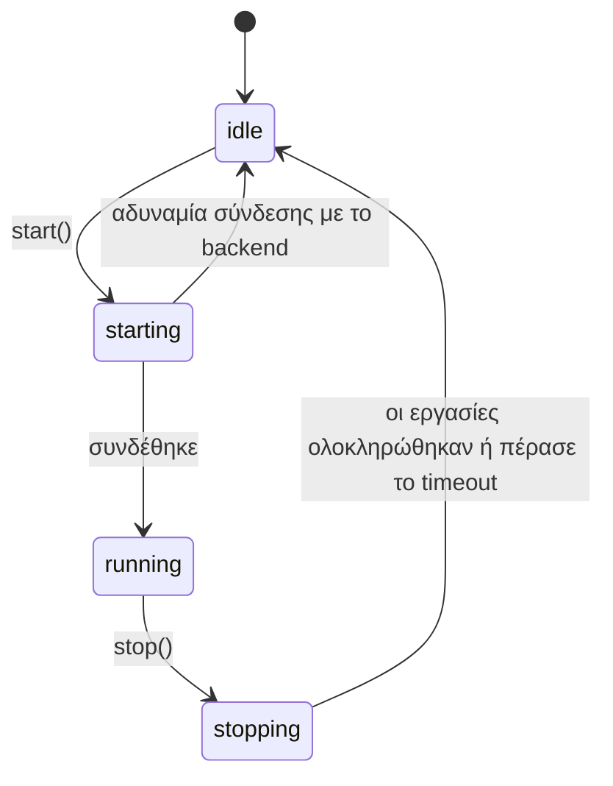
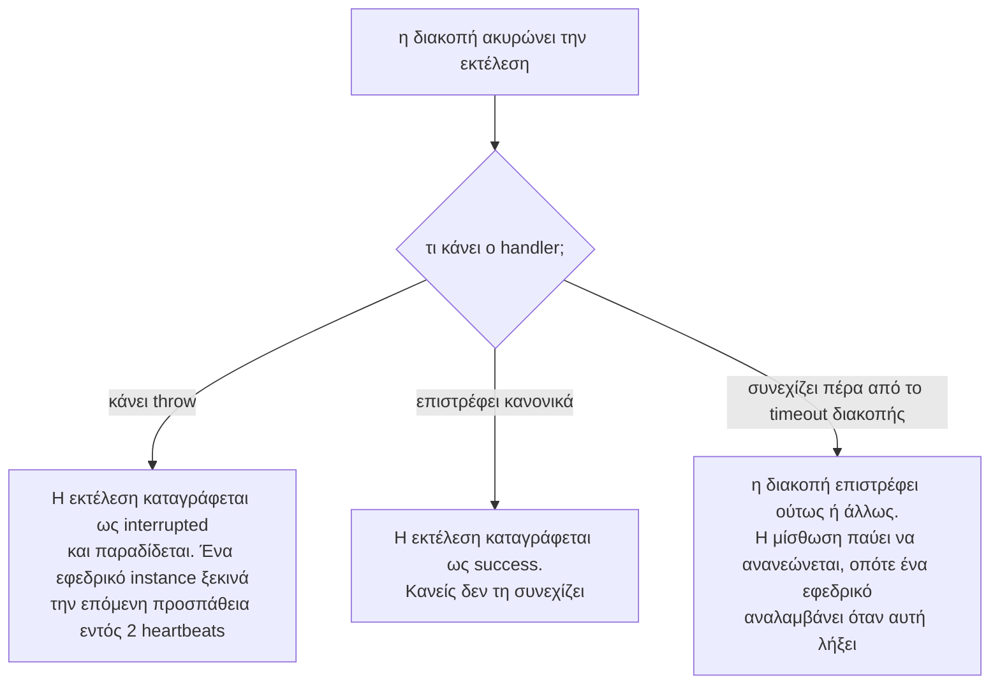

import { Tabs, TabItem } from '@astrojs/starlight/components';

Ένας scheduler βρίσκεται σε μία από τέσσερις καταστάσεις.



Τίποτα δεν συνδέεται και τίποτα δεν εκτελείται μέχρι να εκκινήσει ο scheduler. Στο .NET οι μέθοδοι είναι `StartAsync()`, `StopAsync()`, `RunNowAsync()` και `Remove()`· με έναν host, ο host ξεκινά και σταματά τον scheduler για εσάς.

## `start()`, `StartAsync()`

<Tabs syncKey="language">
<TabItem label="Node.js">

```ts
await scheduler.start();
```

</TabItem>
<TabItem label=".NET">

```csharp
await scheduler.StartAsync();
```

</TabItem>
</Tabs>

Με τη σειρά, η εκκίνηση:

1. **Συνδέεται** στο backend και ελέγχει ότι η έκδοση του διακομιστή είναι επαρκώς πρόσφατη.
2. **Προετοιμάζει κάθε εργασία**: δημιουργεί ό,τι χρειάζεται το backend (πίνακες, streams, ουρές).
3. **Ρυθμίζει ένα timer** για το επόμενο slot κάθε εργασίας.
4. Σε ένα backend μίσθωσης, **ανακτά** ό,τι έμεινε πίσω:
   - μια εκτέλεση της οποίας ο runner πέθανε αναλαμβάνεται (takeover)·
   - μια εκτέλεση που είναι ενεργή σε άλλο instance αποκτά αυτό το instance ως εφεδρικό (backup)·
   - η πιο πρόσφατη εκτέλεση ανακτάται (catch-up), αν κανείς δεν την εκτέλεσε και η προγραμματισμένη ώρα της ήταν πριν από λιγότερο από το παράθυρο ανάκτησης (catch-up window).

Αν η σύνδεση με το backend δεν είναι εφικτή, η εκκίνηση αποτυγχάνει και ο scheduler παραμένει σε κατάσταση idle· κλείνει ό,τι άνοιξε και μπορεί να ξεκινήσει ξανά. Διαχειριστείτε το κατά την εκκίνηση της εφαρμογής:

<Tabs syncKey="language">
<TabItem label="Node.js">

```ts
try {
  await scheduler.start();
} catch (error) {
  console.error('scheduler could not start', error);
  process.exit(1);
}
```

</TabItem>
<TabItem label=".NET">

```csharp
try
{
    await scheduler.StartAsync();
}
catch (Exception error)
{
    logger.LogCritical(error, "scheduler could not start");
    return 1;
}
// Με έναν host, ένα αποτυχημένο StartAsync ενός hosted service εμποδίζει την εκκίνηση του host.
```

</TabItem>
</Tabs>

Η εκκίνηση ενός scheduler που εκτελείται ήδη δεν κάνει τίποτα. Οι εργασίες μπορούν να προστεθούν πριν ή μετά από αυτό.

## `stop()`, `StopAsync()`

<Tabs syncKey="language">
<TabItem label="Node.js">

```ts
await scheduler.stop();                    // περιμένει έως και 30 δευτ. για τις εκτελούμενες εργασίες
await scheduler.stop({ timeoutMs: 10_000 });
```

</TabItem>
<TabItem label=".NET">

```csharp
await scheduler.StopAsync();   // περιμένει έως το StopTimeout (30 δευτ. από προεπιλογή) για τις εκτελούμενες εργασίες
await scheduler.DisposeAsync(); // το ίδιο, για το await using
```

</TabItem>
</Tabs>

Με τη σειρά, η διακοπή:

1. **Σταματά τον προγραμματισμό.** Καμία νέα εκτέλεση δεν ξεκινά σε αυτό το instance.
2. **Ακυρώνει** κάθε εργασία που εκτελείται εδώ (το `ctx.signal` κάνει abort, το `ctx.CancellationToken` ακυρώνεται).
3. **Περιμένει** να ολοκληρωθούν αυτές οι εργασίες, καθώς και οι διεκδικήσεις που βρίσκονται σε εξέλιξη, έως το timeout διακοπής (`stop({ timeoutMs })` στο Node.js, `StopTimeout` στο .NET· προεπιλογή 30 δευτερόλεπτα). Μια εκτέλεση της οποίας η διεκδίκηση κερδίζεται αφού ξεκίνησε η διακοπή δεν ξεκινά· καταγράφεται ως interrupted.
4. **Κλείνει τη σύνδεση**, εφόσον την άνοιξε το anarchon. Ένας client που περάσατε εσείς παραμένει ανοιχτός.

Αφού ολοκληρωθεί η διακοπή, το anarchon δεν στέλνει τίποτα άλλο στο store. Μπορείτε να τον εκκινήσετε ξανά αργότερα. Η ανάγνωση του ιστορικού λειτουργεί ακόμα: μετά από μια διακοπή, κάθε ανάγνωση ανοίγει τη σύνδεση για τον εαυτό της και την κλείνει όταν τελειώσει, ώστε η διεργασία να μπορεί να τερματίσει.

### Τι συμβαίνει σε μια εργασία που εκτελούνταν

Εξαρτάται από το τι κάνει ο handler μόλις ακυρωθεί το signal του.



Η παράδοση (hand-over) απαιτεί backend μίσθωσης. Στα backends μόνο διεκδίκησης, μια διακοπείσα εκτέλεση απλώς καταγράφεται ως interrupted.

Μια παράδοση δεν προσμετράται στις προσπάθειες, επομένως τα rolling deploys δεν μπορούν να εξαντλήσουν τις διαθέσιμες επαναλήψεις μιας εκτέλεσης.

## Ομαλός τερματισμός

Σταματήστε τον scheduler όταν ζητηθεί ο τερματισμός της διεργασίας. Οι orchestrators στέλνουν `SIGTERM`· το Ctrl+C στέλνει `SIGINT`.

<Tabs syncKey="language">
<TabItem label="Node.js">

```ts
async function shutdown() {
  await scheduler.stop({ timeoutMs: 20_000 });
  process.exit(0);
}
process.on('SIGTERM', shutdown);
process.on('SIGINT', shutdown);
```

</TabItem>
<TabItem label=".NET">

```csharp
// Με έναν host (ASP.NET Core, worker service), δεν χρειάζεται να γράψετε τίποτα: στο SIGTERM ή Ctrl+C ο host σταματά
// τα hosted services του, μεταξύ αυτών και τον scheduler, εντός του HostOptions.ShutdownTimeout.
builder.Services.AddAnarchon(options => options.StopTimeout = TimeSpan.FromSeconds(20)).UseRedis(redisUrl);

// Χωρίς host:
Console.CancelKeyPress += (_, e) => { e.Cancel = true; stopping.TrySetResult(); };
AppDomain.CurrentDomain.ProcessExit += (_, _) => scheduler.StopAsync().GetAwaiter().GetResult(); // SIGTERM
```

</TabItem>
</Tabs>

Διατηρήστε το timeout διακοπής **μικρότερο** από τον χρόνο που επιτρέπει η πλατφόρμα σας πριν τερματίσει βίαια τη διεργασία. Στο Kubernetes αυτό είναι το `terminationGracePeriodSeconds`, 30 δευτερόλεπτα από προεπιλογή. Αν η διεργασία τερματιστεί βίαια ενώ ο scheduler ακόμη σταματά, μια εκτελούμενη εργασία δεν παραδίδεται· ένα εφεδρικό instance την αναλαμβάνει μόνο αφού λήξει η μίσθωση.

Σε έναν διακομιστή HTTP, σταματήστε πρώτα να δέχεστε νέα αιτήματα, και μετά σταματήστε τον scheduler:

<Tabs syncKey="language">
<TabItem label="Node.js">

```ts
process.on('SIGTERM', async () => {
  server.close();
  await scheduler.stop({ timeoutMs: 20_000 });
  process.exit(0);
});
```

</TabItem>
<TabItem label=".NET">

```csharp
// Το ASP.NET Core τηρεί αυτή τη σειρά για εσάς: ο διακομιστής σταματά να δέχεται αιτήματα (ApplicationStopping),
// και μετά σταματούν τα hosted services, μεταξύ αυτών και ο scheduler.
var app = builder.Build();
await app.RunAsync();
```

</TabItem>
</Tabs>

Το άρθρο [Rolling deploys στο Kubernetes](../../recipes/kubernetes/) καλύπτει αυτή τη διαδικασία από την αρχή ως το τέλος.

## `runNow()`, `RunNowAsync()`

<Tabs syncKey="language">
<TabItem label="Node.js">

```ts
const run = await scheduler.runNow('sync');
console.log(run.status, run.durationMs);
```

</TabItem>
<TabItem label=".NET">

```csharp
var run = await scheduler.RunNowAsync("sync");
Console.WriteLine($"{run.Status} {run.Duration}");
```

</TabItem>
</Tabs>

Εκτελεί μια εργασία αμέσως σε αυτό το instance, ανεξάρτητα από το πρόγραμμά της, και επιλύεται με την [εγγραφή εκτέλεσης](../history/#η-εγγραφή-εκτέλεσης) όταν ο handler ολοκληρωθεί. Εάν ο scheduler σταματήσει πριν ξεκινήσει ο handler, επιλύεται με κατάσταση interrupted και η εργασία δεν εκτελείται.

Μια χειροκίνητη εκτέλεση διαφέρει από μια προγραμματισμένη:

| | Προγραμματισμένη εκτέλεση | Χειροκίνητη εκτέλεση |
| --- | --- | --- |
| Αποφυγή διπλότυπων μεταξύ instances | Ναι | Όχι: η κλήση της σε δύο instances την εκτελεί δύο φορές |
| Μπλοκάρεται από εκτέλεση σε εξέλιξη | Ναι, με την προεπιλεγμένη αλληλεπικάλυψη (skip) | Όχι |
| Επανάληψη από εφεδρικό instance αν ο runner καταρρεύσει | Ναι | Όχι |
| Στο ιστορικό | Ναι | Ναι, με ένδειξη χειροκίνητης εκτέλεσης (`manual`, `IsManual`) |
| Η αιτία | scheduled | manual |

Παράγει σφάλμα (throws) αν η εργασία δεν έχει καταχωριστεί σε αυτό το instance, ή αν ο scheduler δεν έχει εκκινήσει.

Μια τυπική χρήση είναι σε ένα admin endpoint:

<Tabs syncKey="language">
<TabItem label="Node.js">

```ts
app.post('/jobs/:name/run', async (req, res) => {
  const run = await scheduler.runNow(req.params.name);
  res.json({ status: run.status, ms: run.durationMs, error: run.error });
});
```

</TabItem>
<TabItem label=".NET">

```csharp
app.MapPost("/jobs/{name}/run", async (string name, Scheduler scheduler) =>
{
    var run = await scheduler.RunNowAsync(name);
    return new { status = run.Status.ToString(), ms = run.Duration?.TotalMilliseconds, error = run.Error };
});
```

</TabItem>
</Tabs>

## `remove()`, `Remove()`

<Tabs syncKey="language">
<TabItem label="Node.js">

```ts
scheduler.remove('sync'); // true αν η εργασία υπήρχε
```

</TabItem>
<TabItem label=".NET">

```csharp
scheduler.Remove("sync"); // true αν η εργασία υπήρχε
```

</TabItem>
</Tabs>

Σταματά τον προγραμματισμό μιας εργασίας σε αυτό το instance. Τα υπόλοιπα instances συνεχίζουν να την εκτελούν, το ιστορικό της διατηρείται, και μια εκτέλεση που βρίσκεται ήδη σε εξέλιξη εδώ ολοκληρώνεται κανονικά. Δείτε την [Προσθήκη και αφαίρεση εργασιών](../defining-jobs/#προσθήκη-και-αφαίρεση-εργασιών-κατά-τον-χρόνο-εκτέλεσης).

## Ο πλήρης κύκλος ζωής μιας υπηρεσίας

<Tabs syncKey="language">
<TabItem label="Node.js">

```ts
import { RedisBackend, Scheduler } from 'anarchon';

const scheduler = new Scheduler({ backend: new RedisBackend({ redis: process.env.REDIS_URL }), log: true });

scheduler
  .every('sync', '10s', (ctx) => syncCustomers({ signal: ctx.signal }))
  .cron('digest', '0 8 * * 1-5', () => sendDigest(), { timezone: 'Europe/Athens' });

scheduler.on('failure', (run) => console.error(`${run.job} failed: ${run.error}`));

async function main() {
  await scheduler.start();

  const shutdown = async () => {
    await scheduler.stop({ timeoutMs: 20_000 });
    process.exit(0);
  };
  process.on('SIGTERM', shutdown);
  process.on('SIGINT', shutdown);
}

main().catch((error) => {
  console.error(error);
  process.exit(1);
});
```

</TabItem>
<TabItem label=".NET">

```csharp
// Program.cs μιας worker service (dotnet new worker)· το ASP.NET Core είναι το ίδιο με WebApplication
using Anarchon;

var builder = Host.CreateApplicationBuilder(args);
builder.Services
    .AddAnarchon(options => options.StopTimeout = TimeSpan.FromSeconds(20))
    .UseRedis(builder.Configuration.GetConnectionString("redis")!);

var host = builder.Build();
var scheduler = host.Services.GetRequiredService<Scheduler>();
scheduler
    .Every("sync", TimeSpan.FromSeconds(10), ctx => SyncCustomersAsync(ctx.CancellationToken))
    .Cron("digest", "0 8 * * 1-5", _ => SendDigestAsync(), new() { TimeZone = TimeZoneInfo.FindSystemTimeZoneById("Europe/Athens") });
scheduler.Failed += (_, run) => Console.Error.WriteLine($"{run.Job} failed: {run.Error}");

await host.RunAsync(); // ξεκινά τον scheduler, και τον σταματά στο SIGTERM ή Ctrl+C
```

</TabItem>
</Tabs>

## Επόμενα βήματα

- [Events και καταγραφή](../events-and-logging/)
- [Ιστορικό](../history/)
