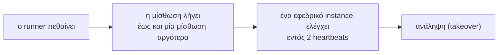

import { Tabs, TabItem } from '@astrojs/starlight/components';

Ο scheduler δέχεται ένα αντικείμενο επιλογών: `new Scheduler({ ... })` στο Node.js, `new Scheduler(new SchedulerOptions { ... })` στο .NET, ή `AddAnarchon(options => ...)` με έναν .NET host. Ένα πράγμα σε αυτό είναι υποχρεωτικό: πού αποθηκεύονται οι εκτελέσεις, το backend. Δεν υποτίθεται κανένα store, οπότε ένας scheduler χωρίς store ρίχνει σφάλμα. Όλα τα υπόλοιπα είναι προαιρετικά.

Δώστε σε κάθε instance μιας υπηρεσίας τις ίδιες επιλογές, εκτός από το αναγνωριστικό του instance (instance ID).

## Πού αποθηκεύονται οι εκτελέσεις

Το backend (`backend`, `Backend`) είναι το store: ένα `RedisBackend` για Redis και Valkey, ή οποιοδήποτε άλλο backend.

<Tabs syncKey="language">
<TabItem label="Node.js">

```ts
import { PostgresBackend, RedisBackend, Scheduler, SqliteBackend } from 'anarchon';

new Scheduler({ backend: new RedisBackend({ redis: 'redis://localhost:6379' }) });
new Scheduler({ backend: new RedisBackend({ redis: process.env.REDIS_URL }) });             // rediss:// για TLS· χρήστης, κωδικός και βάση δεδομένων μπαίνουν στο URL
new Scheduler({ backend: new RedisBackend({ redis: { host: 'localhost', port: 6390 } }) });  // το Valkey λειτουργεί με τον ίδιο τρόπο
new Scheduler({ backend: new RedisBackend({ redis: existingIoredisClient }) });              // δικός σας client· το stop() τον αφήνει ανοιχτό
new Scheduler({ backend: new PostgresBackend({ connection: process.env.DATABASE_URL }) });
new Scheduler({ backend: new SqliteBackend({ database: './jobs.db' }) });
```

</TabItem>
<TabItem label=".NET">

```csharp
using Anarchon;
using Anarchon.Postgres;
using Anarchon.Redis;
using Anarchon.Sqlite;

new Scheduler(new SchedulerOptions { Backend = new RedisBackend("localhost:6379") });
new Scheduler(new SchedulerOptions { Backend = new RedisBackend("cache:6380,password=...,ssl=true") });    // ένα string διαμόρφωσης StackExchange.Redis
new Scheduler(new SchedulerOptions { Backend = new RedisBackend("localhost:6390") });                      // το Valkey λειτουργεί με τον ίδιο τρόπο
new Scheduler(new SchedulerOptions { Backend = new RedisBackend(new RedisBackendOptions { Connection = existingMultiplexer }) }); // δικός σας· η διακοπή τον αφήνει ανοιχτό
new Scheduler(new SchedulerOptions { Backend = new PostgresBackend(connectionString) });                   // ένα connection string του Npgsql
new Scheduler(new SchedulerOptions { Backend = new SqliteBackend("Data Source=jobs.db") });
```

</TabItem>
</Tabs>

Η σύνδεση Redis, η στρατηγική και το πρόθεμα κλειδιών είναι επιλογές του backend: δείτε το [Redis και Valkey](../../backends/redis/).

## Ταυτότητα

### `instanceId`, `InstanceId`

Το όνομα αυτού του instance στο ιστορικό και στα events. Η προεπιλογή είναι `hostname:pid`.

Πρέπει να διαφέρει μεταξύ των instances, διαφορετικά το ιστορικό δεν μπορεί να τα ξεχωρίσει. Ένα όνομα pod είναι πιο ευανάγνωστο από ένα αναγνωριστικό διεργασίας (process id):

<Tabs syncKey="language">
<TabItem label="Node.js">

```ts
new Scheduler({ backend, instanceId: process.env.POD_NAME });                              // Kubernetes: 'billing-7d9f8c-x2x4q'
new Scheduler({ backend, instanceId: `${os.hostname()}-${process.env.pm_id}` });           // cluster PM2: ένα ανά διεργασία
new Scheduler({ backend, instanceId: process.env.HOSTNAME });                              // Docker: το id του container
```

</TabItem>
<TabItem label=".NET">

```csharp
new Scheduler(new SchedulerOptions { Backend = backend, InstanceId = Environment.GetEnvironmentVariable("POD_NAME") }); // Kubernetes: "billing-7d9f8c-x2x4q"
new Scheduler(new SchedulerOptions { Backend = backend, InstanceId = Environment.MachineName });                        // Docker: το id του container
```

</TabItem>
</Tabs>

Χρησιμοποιήστε το για να απαντάτε στο «ποιο instance το εκτέλεσε;» στο ιστορικό, στα logs και στις μετρικές. Δύο instances με το ίδιο id λειτουργούν κανονικά, αλλά το ιστορικό τους δεν ξεχωρίζει.

## Προεπιλογές για κάθε εργασία

Αυτές ορίζουν την προεπιλεγμένη τιμή της [επιλογής εργασίας](../job-options/) με το ίδιο όνομα. Κάθε εργασία μπορεί παρ' όλα αυτά να παρακάμψει την αντίστοιχη επιλογή.

| Node.js | .NET | Προεπιλογή | Σημασία |
| --- | --- | --- | --- |
| `jitterMs` | `Jitter` | 2 s | Μέγιστη τυχαία καθυστέρηση πριν από τη διεκδίκηση (claim). Μειώνεται αυτόματα για μικρά μεσοδιαστήματα |
| `maxLateMs` | `MaxLate` | 60 s | Παράλειψη μιας εκτέλεσης αν αυτό το instance τη φτάσει αργότερα από αυτό το όριο |
| `historySize` | `HistorySize` | `1000` | Εκτελέσεις που διατηρούνται ανά εργασία |
| `historyTtlMs` | `HistoryTtl` | κανένα | Απόρριψη επιπλέον ιστορικού παλαιότερου από αυτό το διάστημα |
| `timezone` | `TimeZone` | του διακομιστή | Ζώνη ώρας για τις εκφράσεις cron |

<Tabs syncKey="language">
<TabItem label="Node.js">

```ts
new Scheduler({
  backend,
  timezone: 'Europe/Athens',
  historySize: 200,
  historyTtlMs: 7 * 24 * 60 * 60_000, // μία εβδομάδα
});
```

</TabItem>
<TabItem label=".NET">

```csharp
new Scheduler(new SchedulerOptions
{
    Backend = backend,
    TimeZone = TimeZoneInfo.FindSystemTimeZoneById("Europe/Athens"),
    HistorySize = 200,
    HistoryTtl = TimeSpan.FromDays(7), // μία εβδομάδα
});
```

</TabItem>
</Tabs>

Διαφορετικές υπηρεσίες θέλουν διαφορετικές προεπιλογές:

<Tabs syncKey="language">
<TabItem label="Node.js">

```ts
// Υπηρεσία για μία χώρα: οι ώρες cron είναι τοπικές
new Scheduler({ backend, timezone: 'Europe/Athens' });

// Παγκόσμια υπηρεσία: cron σε UTC, και κάθε εργασία μιας περιοχής ορίζει τη δική της ζώνη
const scheduler = new Scheduler({ backend, timezone: 'UTC' });
scheduler.cron('eu-digest', '0 8 * * *', euDigest, { timezone: 'Europe/Berlin' });

// Πολλές φθηνές εργασίες: μικρότερο ιστορικό, και γρήγορη απόρριψη όταν ένα instance μένει πίσω
new Scheduler({ backend, historySize: 100, maxLateMs: 10_000, jitterMs: 500 });

// Εργασίες υπό έλεγχο: ένας χρόνος ιστορικού βάσει ηλικίας
new Scheduler({ backend, historySize: 5_000, historyTtlMs: 365 * 24 * 60 * 60_000 });
```

</TabItem>
<TabItem label=".NET">

```csharp
// Υπηρεσία για μία χώρα: οι ώρες cron είναι τοπικές
new Scheduler(new SchedulerOptions { Backend = backend, TimeZone = TimeZoneInfo.FindSystemTimeZoneById("Europe/Athens") });

// Παγκόσμια υπηρεσία: cron σε UTC, και κάθε εργασία μιας περιοχής ορίζει τη δική της ζώνη
var scheduler = new Scheduler(new SchedulerOptions { Backend = backend, TimeZone = TimeZoneInfo.Utc });
scheduler.Cron("eu-digest", "0 8 * * *", EuDigestAsync, new() { TimeZone = TimeZoneInfo.FindSystemTimeZoneById("Europe/Berlin") });

// Πολλές φθηνές εργασίες: μικρότερο ιστορικό, και γρήγορη απόρριψη όταν ένα instance μένει πίσω
new Scheduler(new SchedulerOptions { Backend = backend, HistorySize = 100, MaxLate = TimeSpan.FromSeconds(10), Jitter = TimeSpan.FromMilliseconds(500) });

// Εργασίες υπό έλεγχο: ένας χρόνος ιστορικού βάσει ηλικίας
new Scheduler(new SchedulerOptions { Backend = backend, HistorySize = 5_000, HistoryTtl = TimeSpan.FromDays(365) });
```

</TabItem>
</Tabs>

:::tip
Ορίζετε πάντα τη ζώνη ώρας αν χρησιμοποιείτε εργασίες cron. Η προεπιλογή είναι η τοπική ζώνη του διακομιστή, η οποία μπορεί να διαφέρει μεταξύ του φορητού σας υπολογιστή, του περιβάλλοντος CI και του production.
:::

## Όνομα και δεδομένα

| Node.js | .NET | Προεπιλογή | Σημασία |
| --- | --- | --- | --- |
| `name` | `AddAnarchon(name)` | κανένα | Ένα όνομα για τον scheduler. Στο Node.js είναι μοναδικό μέσα στη διεργασία, και οι εργασίες με decorators επιλέγουν scheduler με αυτό ([Decorators](../decorators/#επιλογή-scheduler-για-μια-εργασία)). Στο .NET ένας επώνυμος scheduler είναι keyed service ([Hosting](../../reference/dotnet/hosting/)) |
| `data` | `Data` | κανένα | Δεδομένα για τις εκτελέσεις κάθε εργασίας, που διαβάζονται στον handler ως `ctx.data` (`ctx.Data`): μια τιμή, ή μια συνάρτηση (`JobDataProvider`) που καλείται όταν ξεκινά μια εκτέλεση. Δείτε [Δεδομένα εκτέλεσης](../run-data/) |

<Tabs syncKey="language">
<TabItem label="Node.js">

```ts
// Δύο schedulers σε μία διεργασία: οι εργασίες με decorators επιλέγουν έναν με το όνομα
new Scheduler({ name: 'billing', backend: new PostgresBackend({ connection: billingPool }) });
new Scheduler({ name: 'reports', backend: new RedisBackend({ redis: process.env.REDIS_URL, prefix: 'reports:cron:' }) });

// Κοινές εξαρτήσεις για κάθε handler, χωρίς globals
new Scheduler({ backend, data: { db, mailer, environment: process.env.APP_ENV } });

// Δεδομένα που διαβάζονται στην αρχή κάθε εκτέλεσης: ένα feature flag όπως είναι τώρα
new Scheduler({ backend, data: async () => ({ dryRun: await flags.isOn('jobs-dry-run') }) });
```

</TabItem>
<TabItem label=".NET">

```csharp
// Δύο schedulers σε μία εφαρμογή: ο προεπιλεγμένος, και το "reports" ως keyed service
builder.Services.AddAnarchon().UsePostgres(billingConnectionString);
builder.Services.AddAnarchon("reports", options => options.TimeZone = TimeZoneInfo.Utc)
    .UseRedis(options => { options.Configuration = redisUrl; options.Prefix = "reports:cron:"; });
// ... public sealed class ReportsApi([FromKeyedServices("reports")] Scheduler reports)

// Δεδομένα για κάθε handler (με έναν host, προτιμήστε services: το AddJobs<T>() δίνει σε κάθε εκτέλεση ένα scope)
new Scheduler(new SchedulerOptions { Backend = backend, Data = new Dictionary<string, object?> { ["environment"] = appEnvironment } });

// Δεδομένα που διαβάζονται στην αρχή κάθε εκτέλεσης: ένα feature flag όπως είναι τώρα
new Scheduler(new SchedulerOptions
{
    Backend = backend,
    Data = new JobDataProvider(async _ => new Dictionary<string, object?> { ["dryRun"] = await flags.IsOnAsync("jobs-dry-run") }),
});
```

</TabItem>
</Tabs>

## Χρονισμός μίσθωσης

*Μόνο για backends μίσθωσης.* Με RabbitMQ, ή NATS, Redis ή Valkey χωρίς τη στρατηγική μίσθωσής τους, ο scheduler απορρίπτει τη μίσθωση (lease) και το heartbeat: στην TypeScript δεν μεταγλωττίζονται, και αν οριστούν παρ' όλα αυτά ο scheduler πετάει σφάλμα (στο .NET, ένα `AnarchonException` με κωδικό `Unsupported`).

| Node.js | .NET | Προεπιλογή | Σημασία |
| --- | --- | --- | --- |
| `leaseMs` | `Lease` | 30 s | Πόσο διαρκεί η μίσθωση μιας εκτελούμενης εργασίας χωρίς heartbeat |
| `heartbeatMs` | `Heartbeat` | 5 s, ή το ένα έκτο της μίσθωσης αν είναι μικρότερο | Πόσο συχνά ανανεώνει τη μίσθωσή του ο runner, και πόσο συχνά τα εφεδρικά instances τον ελέγχουν (κάθε 1 έως 2 heartbeats) |

Το heartbeat πρέπει να είναι μικρότερο από το μισό της μίσθωσης, ώστε μια μίσθωση να ανανεώνεται τουλάχιστον δύο φορές πριν λήξει.

Αυτοί οι δύο αριθμοί καθορίζουν πόσο γρήγορα αντικαθίσταται ένας νεκρός runner:



Επομένως, μια εκτέλεση που κατέρρευσε αναλαμβάνεται το πολύ μία μίσθωση συν δύο heartbeats μετά το τελευταίο heartbeat του runner. Με τις προεπιλεγμένες τιμές αυτό είναι 40 δευτερόλεπτα.

| Στόχος | Ρύθμιση | Συμβιβασμός |
| --- | --- | --- |
| Ταχύτερο failover | μίσθωση 6 s, heartbeat 1 s | Περισσότερη κίνηση heartbeats. Μια παύση μεγαλύτερη από 6 δευτερόλεπτα (ένα παρατεταμένο GC, μια σύντομη διακοπή δικτύου) προκαλεί ανάληψη (takeover) ενώ ο αρχικός runner είναι ακόμη ζωντανός |
| Ανοχή σε παρατεταμένες παύσεις | μίσθωση 2 λεπτών | Ένας πραγματικά νεκρός runner αντικαθίσταται μόνο μετά από 2 λεπτά |

<Tabs syncKey="language">
<TabItem label="Node.js">

```ts
new Scheduler({ backend, leaseMs: 10_000, heartbeatMs: 2_000 }); // ένας νεκρός runner αντικαθίσταται εντός περίπου 14 δευτ.
new Scheduler({ backend, leaseMs: 60_000 });                     // εργασίες που μπλοκάρουν το event loop για δευτερόλεπτα
new Scheduler({ backend, leaseMs: 6_000, heartbeatMs: 1_000 });  // σύντομες εργασίες όπου μετρά η γρήγορη ανάληψη
```

</TabItem>
<TabItem label=".NET">

```csharp
new Scheduler(new SchedulerOptions { Backend = backend, Lease = TimeSpan.FromSeconds(10), Heartbeat = TimeSpan.FromSeconds(2) }); // ένας νεκρός runner αντικαθίσταται εντός περίπου 14 δευτ.
new Scheduler(new SchedulerOptions { Backend = backend, Lease = TimeSpan.FromMinutes(1) });                                           // ένα store μακριά, παρατεταμένες παύσεις GC
new Scheduler(new SchedulerOptions { Backend = backend, Lease = TimeSpan.FromSeconds(6), Heartbeat = TimeSpan.FromSeconds(1) });   // σύντομες εργασίες όπου μετρά η γρήγορη ανάληψη
```

</TabItem>
</Tabs>

Αυξήστε τη μίσθωση όταν ένας υγιής runner μπορεί να σωπαίνει για λίγο: handlers βαριοί σε CPU που μπλοκάρουν το event loop του Node.js ή εξαντλούν το thread pool του .NET, ένα store μακριά, ένας debugger. Μειώστε την όταν ένας νεκρός runner πρέπει να αντικαθίσταται γρήγορα και οι παύσεις είναι σπάνιες.

Το άρθρο [Μισθώσεις](../../internals/leases/) εξηγεί τον μηχανισμό.

## Καταγραφή

<Tabs syncKey="language">
<TabItem label="Node.js">

| Επιλογή | Προεπιλογή | Σημασία |
| --- | --- | --- |
| `log` | `false` | Εγγραφή μίας γραμμής ανά έναρξη, ολοκλήρωση, αποτυχία, διακοπή, παράλειψη και χαμένη εκτέλεση |
| `logger` | `console` | Πού καταγράφονται αυτές οι γραμμές και τα σφάλματα για τα οποία δεν υπάρχει listener |

```ts
import pino from 'pino';

new Scheduler({ backend, log: true, logger: pino() });
new Scheduler({ backend, log: true, logger: pino().child({ component: 'scheduler' }) });     // γραμμές με ετικέτα
new Scheduler({ backend, logger: winston.createLogger({ transports: [new winston.transports.Console()] }) }); // μόνο σφάλματα
new Scheduler({ backend, log: process.env.NODE_ENV !== 'production' });                    // γραμμές εκτελέσεων μόνο στην ανάπτυξη
```

Ένας logger χρειάζεται τις μεθόδους `warn` και `error`. Η μέθοδος `info` είναι προαιρετική· χωρίς αυτήν, τα μηνύματα εκτέλεσης πηγαίνουν στο `console.log`.

</TabItem>
<TabItem label=".NET">

Ο scheduler καταγράφει μέσω του `ILoggerFactory` (`LoggerFactory`), στην κατηγορία `Anarchon.Scheduler`: κάθε εκτέλεση σε επίπεδο Debug, αποτυχημένες και χαμένες εκτελέσεις σε επίπεδο Warning, σφάλματα που δεν διαχειρίζεται κανείς σε επίπεδο Error. Με έναν host, το `AddAnarchon()` χρησιμοποιεί το factory του host, επομένως ισχύει η συνήθης ρύθμιση.

```csharp
using var logging = LoggerFactory.Create(builder => builder.AddConsole().AddFilter("Anarchon", LogLevel.Debug));
new Scheduler(new SchedulerOptions { Backend = backend, LoggerFactory = logging });
```

```json
{ "Logging": { "LogLevel": { "Anarchon": "Debug" } } }
```

</TabItem>
</Tabs>

Δείτε τα [Events και καταγραφή](../events-and-logging/).

## Συμπεριφορά διεργασίας

### `unrefTimers` (Node.js)

Από προεπιλογή, τα timers του scheduler διατηρούν τη διεργασία Node ενεργή, κάτι που είναι επιθυμητό για μια υπηρεσία. Ορίστε `unrefTimers: true` για να επιτρέψετε στη διεργασία να τερματίσει ακόμα και όταν υπάρχουν προγραμματισμένες εκτελέσεις. Αυτό είναι χρήσιμο σε scripts και δοκιμές.

```ts
new Scheduler({ backend, unrefTimers: true });
```

```ts
// Ένα script μίας χρήσης: εκτελεί την εργασία μία φορά τώρα, και η διεργασία τερματίζει μόνη της
const scheduler = new Scheduler({ backend, unrefTimers: true });
scheduler.every('backfill', '1d', backfill);
await scheduler.start();
await scheduler.runNow('backfill');
await scheduler.stop();
```

Στο .NET, τα timers δεν διατηρούν ποτέ μια διεργασία ενεργή: η διεργασία ολοκληρώνεται όταν επιστρέψει η `Main` ή σταματήσει ο host.

### `StopTimeout` (.NET)

Πόσο περιμένει το `StopAsync()` τις εκτελούμενες εργασίες προτού επιστρέψει και τις αφήσει πίσω (η μίσθωσή τους τότε λήγει και αναλαμβάνει ένα εφεδρικό instance). Προεπιλογή 30 δευτερόλεπτα. Με έναν host, διατηρήστε το κάτω από το shutdown timeout του host (`HostOptions.ShutdownTimeout`, επίσης 30 δευτερόλεπτα από προεπιλογή). Στο Node.js είναι το `stop({ timeoutMs })`: δείτε τον [Κύκλο ζωής](../lifecycle/).

```csharp
new Scheduler(new SchedulerOptions { Backend = backend, StopTimeout = TimeSpan.FromSeconds(20) }); // μέσα σε grace period 30 δευτ.
```

### `TimeProvider` (.NET)

Το ρολόι και τα timers που χρησιμοποιεί ο scheduler· προεπιλογή `TimeProvider.System`. Οι δοκιμές μπορούν να περάσουν ένα `FakeTimeProvider` για να προχωρούν τον χρόνο χειροκίνητα.

## Διαμορφώσεις ανά περιβάλλον

Πλήρεις διαμορφώσεις για συνηθισμένα μέρη όπου τρέχει μια υπηρεσία. Όλα τα instances της υπηρεσίας χρησιμοποιούν την ίδια.

### Παραγωγή σε Kubernetes, με Redis

<Tabs syncKey="language">
<TabItem label="Node.js">

```ts
import pino from 'pino';
import { RedisBackend, Scheduler } from 'anarchon';

export const scheduler = new Scheduler({
  backend: new RedisBackend({ redis: process.env.REDIS_URL, prefix: 'billing:cron:' }), // τα κλειδιά αυτής της ίδιας της υπηρεσίας
  instanceId: process.env.POD_NAME, // ευανάγνωστα ονόματα στο ιστορικό
  timezone: 'Europe/Athens',
  logger: pino(),
  log: true,
});
// Στο SIGTERM: await scheduler.stop({ timeoutMs: 20_000 }), μέσα στο grace period του pod
```

</TabItem>
<TabItem label=".NET">

```csharp
builder.Services
    .AddAnarchon(options =>
    {
        options.InstanceId = Environment.GetEnvironmentVariable("POD_NAME"); // ευανάγνωστα ονόματα στο ιστορικό
        options.TimeZone = TimeZoneInfo.FindSystemTimeZoneById("Europe/Athens");
        options.StopTimeout = TimeSpan.FromSeconds(20);                     // μέσα στο grace period του pod
    })
    .UseRedis(options =>
    {
        options.Configuration = builder.Configuration.GetConnectionString("redis");
        options.Prefix = "billing:cron:"; // τα κλειδιά αυτής της ίδιας της υπηρεσίας
    });
// Ο host σταματά τον scheduler στο SIGTERM· τα logs πηγαίνουν στους loggers του host
```

</TabItem>
</Tabs>

### Παραγωγή με PostgreSQL, δίπλα στα δεδομένα της εφαρμογής

<Tabs syncKey="language">
<TabItem label="Node.js">

```ts
export const scheduler = new Scheduler({
  backend: new PostgresBackend({ connection: pool, table: 'scheduler.runs' }), // το pool της εφαρμογής· πίνακες σε δικό τους schema
  instanceId: process.env.HOSTNAME,
  timezone: 'UTC',
  historyTtlMs: 90 * 24 * 60 * 60_000, // 90 ημέρες ιστορικού, με ερωτήματα SQL
});
```

</TabItem>
<TabItem label=".NET">

```csharp
builder.Services.AddNpgsqlDataSource(builder.Configuration.GetConnectionString("postgres")!);
builder.Services
    .AddAnarchon(options =>
    {
        options.TimeZone = TimeZoneInfo.Utc;
        options.HistoryTtl = TimeSpan.FromDays(90); // 90 ημέρες ιστορικού, με ερωτήματα SQL
    })
    .UsePostgres((services, options) =>
    {
        options.DataSource = services.GetRequiredService<NpgsqlDataSource>(); // το pool της εφαρμογής
        options.Table = "scheduler.runs";                                     // πίνακες σε δικό τους schema
    });
```

</TabItem>
</Tabs>

### Ένα μηχάνημα, πολλές διεργασίες, με SQLite

<Tabs syncKey="language">
<TabItem label="Node.js">

```ts
export const scheduler = new Scheduler({
  backend: new SqliteBackend({ database: '/var/lib/app/jobs.db', busyTimeoutMs: 10_000 }),
  instanceId: `${os.hostname()}-${process.env.pm_id ?? process.pid}`,
  timezone: 'Europe/Athens',
});
```

</TabItem>
<TabItem label=".NET">

```csharp
var scheduler = new Scheduler(new SchedulerOptions
{
    Backend = new SqliteBackend("Data Source=/var/lib/app/jobs.db;Default Timeout=10"), // περιμένει έως 10 s για εγγραφή άλλης διεργασίας
    TimeZone = TimeZoneInfo.FindSystemTimeZoneById("Europe/Athens"),
});
```

</TabItem>
</Tabs>

### Ένα stack μόνο με RabbitMQ ή NATS

<Tabs syncKey="language">
<TabItem label="Node.js">

```ts
export const scheduler = new Scheduler({
  backend: new NatsBackend({ servers: process.env.NATS_URL, replicas: 3 }),
  instanceId: process.env.POD_NAME,
  maxLateMs: 60_000, // κάτω από το duplicateWindowMs (5 λεπτά από προεπιλογή)
  historySize: 200,  // το ιστορικό κρατιέται μόνο βάσει πλήθους
  // χωρίς leaseMs ή heartbeatMs: η προεπιλεγμένη στρατηγική 'msg-id' δεν έχει μισθώσεις
});
```

</TabItem>
<TabItem label=".NET">

```csharp
var scheduler = new Scheduler(new SchedulerOptions
{
    Backend = new NatsBackend(new NatsBackendOptions { ConnectionString = natsUrl, Replicas = 3 }),
    InstanceId = Environment.GetEnvironmentVariable("POD_NAME"),
    MaxLate = TimeSpan.FromMinutes(1), // κάτω από το DuplicateWindow (5 λεπτά από προεπιλογή)
    HistorySize = 200,                 // το ιστορικό κρατιέται μόνο βάσει πλήθους
    // χωρίς Lease ή Heartbeat: η προεπιλεγμένη στρατηγική MsgId δεν έχει μισθώσεις
});
```

</TabItem>
</Tabs>

Με το NATS, η στρατηγική μίσθωσης (lease strategy) δίνει το πλήρες σύνολο δυνατοτήτων, και δέχεται τη μίσθωση και το heartbeat:

<Tabs syncKey="language">
<TabItem label="Node.js">

```ts
export const scheduler = new Scheduler({
  backend: new NatsBackend({ servers: process.env.NATS_URL, replicas: 3, strategy: 'lease' }),
  instanceId: process.env.POD_NAME,
  leaseMs: 30_000,
  historySize: 200, // το ιστορικό κρατιέται μόνο βάσει πλήθους
});
```

</TabItem>
<TabItem label=".NET">

```csharp
var scheduler = new Scheduler(new SchedulerOptions
{
    Backend = new NatsBackend(new NatsBackendOptions { ConnectionString = natsUrl, Replicas = 3, Strategy = NatsStrategy.Lease }),
    InstanceId = Environment.GetEnvironmentVariable("POD_NAME"),
    Lease = TimeSpan.FromSeconds(30),
    HistorySize = 200, // το ιστορικό κρατιέται μόνο βάσει πλήθους
});
```

</TabItem>
</Tabs>

### Τοπική ανάπτυξη

<Tabs syncKey="language">
<TabItem label="Node.js">

```ts
export const scheduler = new Scheduler({
  backend: new SqliteBackend({ database: './dev-jobs.db' }), // κανένας server
  timezone: 'Europe/Athens',
  log: true,                      // μία γραμμή ανά εκτέλεση στο τερματικό
  leaseMs: 10 * 60_000,           // ένα breakpoint δεν κάνει έναν εφεδρικό να αναλάβει την εκτέλεση
});
```

</TabItem>
<TabItem label=".NET">

```csharp
var scheduler = new Scheduler(new SchedulerOptions
{
    Backend = new SqliteBackend("Data Source=dev-jobs.db"), // κανένας server
    TimeZone = TimeZoneInfo.FindSystemTimeZoneById("Europe/Athens"),
    LoggerFactory = logging,                                // με το "Anarchon" σε Debug: μία γραμμή ανά εκτέλεση
    Lease = TimeSpan.FromMinutes(10),                       // ένα breakpoint δεν κάνει έναν εφεδρικό να αναλάβει την εκτέλεση
});
```

</TabItem>
</Tabs>

### Δοκιμές

<Tabs syncKey="language">
<TabItem label="Node.js">

```ts
const scheduler = new Scheduler({
  backend: new SqliteBackend({ database: ':memory:' }),
  unrefTimers: true, // ο test runner μπορεί να τερματίσει
  jitterMs: 0,       // οι εκτελέσεις ξεκινούν στην ώρα τους
});
afterEach(() => scheduler.stop());
```

</TabItem>
<TabItem label=".NET">

```csharp
await using var scheduler = new Scheduler(new SchedulerOptions
{
    Backend = new SqliteBackend($"Data Source={Path.Combine(Path.GetTempPath(), $"jobs-{Guid.NewGuid():N}.db")}"), // ένα αρχείο ανά δοκιμή
    Jitter = TimeSpan.Zero,                                                                                           // οι εκτελέσεις ξεκινούν στην ώρα τους
    TimeProvider = fakeTime, // προαιρετικό: το FakeTimeProvider του Microsoft.Extensions.TimeProvider.Testing
});
```

</TabItem>
</Tabs>

Οι φάκελοι παραδειγμάτων έχουν εκτελέσιμες διαμορφώσεις για πραγματικές καταστάσεις: [Node.js](https://github.com/aristoteliss/anarchon/tree/main/examples) (`billing.ts`, `cache-refresh.ts`, `nightly-export.ts`, `tenants.ts`, `broker-notifications.ts`) και [.NET](https://github.com/aristoteliss/anarchon-dotnet/tree/main/examples) (`Billing`, `CacheRefresh`, `NightlyExport`, `Tenants`, `BrokerNotifications`).

## Πότε προκαλούνται σφάλματα

Ο constructor επικυρώνει τις επιλογές του και παράγει άμεσα εξαίρεση (throws), ώστε μια εσφαλμένη ρύθμιση να μην μπορεί να περάσει σιωπηλά στο production:

| Πρόβλημα | Node.js | .NET |
| --- | --- | --- |
| Χωρίς backend | `TypeError` | `ArgumentException` |
| Το αναγνωριστικό του instance είναι κενό string | `TypeError` | `ArgumentException` |
| Ένας αριθμός ή μια διάρκεια είναι αρνητικός, ή μηδέν όπου δεν επιτρέπεται | `RangeError` | `ArgumentOutOfRangeException` |
| Το heartbeat δεν είναι μικρότερο από το μισό της μίσθωσης | `RangeError` | `ArgumentOutOfRangeException` |
| Μίσθωση ή heartbeat με backend χωρίς μισθώσεις | `TypeError` | `AnarchonException` (`Unsupported`) |

Τίποτα δεν συνδέεται κατά την εκτέλεση του constructor. Τα προβλήματα σύνδεσης εμφανίζονται όταν ξεκινά ο scheduler.

## Επόμενα βήματα

- [Συγγραφή handlers](../writing-handlers/)
- [Κύκλος ζωής](../lifecycle/)
