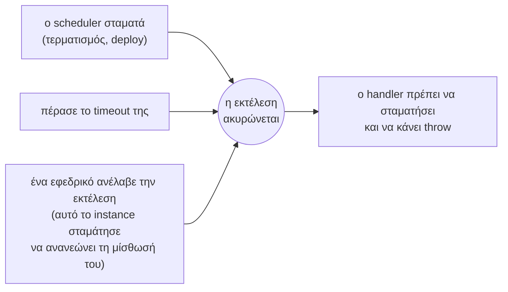

import { Tabs, TabItem } from '@astrojs/starlight/components';

Ο handler είναι η συνάρτηση που εκτελεί μια εργασία. Στο Node.js μπορεί να είναι σύγχρονος (sync) ή ασύγχρονος (async)· στο .NET επιστρέφει ένα `Task` (`Func<JobContext, Task>`).

<Tabs syncKey="language">
<TabItem label="Node.js">

```ts
scheduler.every('sync', '10s', async (ctx) => {
  await syncCustomers();
});
```

</TabItem>
<TabItem label=".NET">

```csharp
scheduler.Every("sync", TimeSpan.FromSeconds(10), async ctx =>
{
    await SyncCustomersAsync(ctx.CancellationToken);
});
```

</TabItem>
</Tabs>

Ο τρόπος με τον οποίο ολοκληρώνεται ο handler καθορίζει πώς καταγράφεται η εκτέλεση:

| Ο handler | Η εκτέλεση καταγράφεται ως |
| --- | --- |
| Επιστρέφει (οποιαδήποτε τιμή) | success |
| Πετάει σφάλμα (throws) | failed, με το μήνυμα σφάλματος |
| Υπερβαίνει το timeout της | failed, με `TimeoutError` (`TimeoutException` στο .NET) |
| Πετάει σφάλμα αφού μια διακοπή ή μια ανάληψη ακύρωσε την εκτέλεση (`ctx.signal`, `ctx.CancellationToken`) | interrupted (όχι αποτυχία) |

## Το context: `ctx`

Κάθε handler δέχεται ένα όρισμα: το context της εκτέλεσης (`JobContext` και στις δύο γλώσσες).

| Node.js | .NET | Σημασία |
| --- | --- | --- |
| `name` | `Name` | Το όνομα της εργασίας |
| `slot` | `Slot` (`long`) | Η προγραμματισμένη ώρα σε ms από το 1970. Η ίδια σε κάθε instance και σε κάθε προσπάθεια |
| `scheduledAt` (`Date`) | `ScheduledAt` (`DateTimeOffset`) | Το slot ως ώρα. Η ώρα που αναμενόταν η εκτέλεση, όχι πότε ξεκίνησε |
| `instanceId` | `InstanceId` | Το instance που την εκτελεί (εσείς) |
| `attempt` | `Attempt` | `1` για την πρώτη προσπάθεια· `2` ή περισσότερο όταν ένα εφεδρικό instance ανέλαβε την εκτέλεση |
| `reason` | `Reason` (`RunReason`) | Γιατί ξεκίνησε αυτή η εκτέλεση: scheduled, manual, catch-up ή takeover |
| `manual` | `IsManual` | true όταν ξεκίνησε με `runNow()`, `RunNowAsync()` |
| `signal` (`AbortSignal`) | `CancellationToken` | Ενεργοποιείται όταν η εκτέλεση πρέπει να σταματήσει |
| `data` | `Data`, `GetData<T>()` | Τα δεδομένα που δώσατε στον scheduler, στην εργασία ή στη χειροκίνητη εκτέλεση. Δείτε [Δεδομένα εκτέλεσης](../run-data/) |

## Διακοπή όταν ζητηθεί

Η ακύρωση της εκτέλεσης (το `ctx.signal` κάνει abort, το `ctx.CancellationToken` ακυρώνεται) ενεργοποιείται σε τρεις περιπτώσεις:



Το anarchon δεν μπορεί να διακόψει τη συνάρτησή σας από έξω· ούτε η JavaScript ούτε το .NET παρέχουν τέτοιο τρόπο. Το signal ή το token είναι ένα αίτημα διακοπής και ο handler πρέπει να το σεβαστεί.

### Μέσα σε βρόχο

Ελέγχετε ανάμεσα σε επιμέρους μονάδες εργασίας. Τα `ctx.signal.throwIfAborted()` και `ctx.CancellationToken.ThrowIfCancellationRequested()` παράγουν σφάλμα (throw) αν η εκτέλεση ακυρώθηκε, και δεν κάνουν τίποτα σε αντίθετη περίπτωση:

<Tabs syncKey="language">
<TabItem label="Node.js">

```ts
scheduler.every('export', '10m', async (ctx) => {
  for (const batch of await loadBatches()) {
    ctx.signal.throwIfAborted();
    await exportBatch(batch);
  }
});
```

</TabItem>
<TabItem label=".NET">

```csharp
scheduler.Every("export", TimeSpan.FromMinutes(10), async ctx =>
{
    foreach (var batch in await LoadBatchesAsync())
    {
        ctx.CancellationToken.ThrowIfCancellationRequested();
        await ExportBatchAsync(batch);
    }
});
```

</TabItem>
</Tabs>

### Μεταβίβαση

Πολλά APIs δέχονται ένα signal ή ένα token και διακόπτονται μόνα τους:

<Tabs syncKey="language">
<TabItem label="Node.js">

```ts
scheduler.every('fetch-rates', '1m', async (ctx) => {
  const response = await fetch('https://rates.example.com/latest', { signal: ctx.signal });
  await saveRates(await response.json());
});
```

</TabItem>
<TabItem label=".NET">

```csharp
scheduler.Every("fetch-rates", TimeSpan.FromMinutes(1), async ctx =>
{
    var rates = await http.GetFromJsonAsync<Rates>("https://rates.example.com/latest", ctx.CancellationToken);
    await SaveRatesAsync(rates!, ctx.CancellationToken);
});
```

</TabItem>
</Tabs>

### Αναμονή

Οι αναμονές το δέχονται επίσης:

<Tabs syncKey="language">
<TabItem label="Node.js">

```ts
import { setTimeout as delay } from 'node:timers/promises';

await delay(5_000, undefined, { signal: ctx.signal }); // απορρίπτεται (rejects) μόλις ακυρωθεί το signal
```

</TabItem>
<TabItem label=".NET">

```csharp
await Task.Delay(TimeSpan.FromSeconds(5), ctx.CancellationToken); // πετάει εξαίρεση μόλις ακυρωθεί η εκτέλεση
```

</TabItem>
</Tabs>

### Γιατί throw και όχι απλό return;

Σε ένα backend μίσθωσης η διαφορά είναι ουσιαστική:

- Αν ο handler **πετάξει σφάλμα (throws)** αφού μια διακοπή ακύρωσε την εκτέλεση, η εκτέλεση καταγράφεται ως `interrupted` και **παραδίδεται σε ένα άλλο instance**, το οποίο την ξεκινά ξανά ως την επόμενη προσπάθεια.
- Αν ο handler **επιστρέψει (returns)**, η εκτέλεση θεωρείται **ολοκληρωμένη**. Κανείς δεν τη συνεχίζει.

Επομένως: κάντε throw όταν η εργασία δεν έχει ολοκληρωθεί, και return όταν έχει τελειώσει.

<Tabs syncKey="language">
<TabItem label="Node.js">

```ts
scheduler.every('reindex', '1h', async (ctx) => {
  for (const page of pages) {
    if (ctx.signal.aborted) {
      await saveProgress(page);      // προαιρετικά: σημειώστε την πρόοδο για την επόμενη προσπάθεια
      ctx.signal.throwIfAborted();   // στη συνέχεια παραδώστε την εκτέλεση
    }
    await indexPage(page);
  }
});
```

</TabItem>
<TabItem label=".NET">

```csharp
scheduler.Every("reindex", TimeSpan.FromHours(1), async ctx =>
{
    foreach (var page in pages)
    {
        if (ctx.CancellationToken.IsCancellationRequested)
        {
            await SaveProgressAsync(page);                         // προαιρετικά: σημειώστε την πρόοδο για την επόμενη προσπάθεια
            ctx.CancellationToken.ThrowIfCancellationRequested();  // στη συνέχεια παραδώστε την εκτέλεση
        }

        await IndexPageAsync(page);
    }
});
```

</TabItem>
</Tabs>

## Κάντε τις εργασίες ασφαλείς για διπλή εκτέλεση

Το anarchon εγγυάται έναν νικητή ανά **προσπάθεια**, όχι μία και μοναδική εκτέλεση ανά εργασία. Μια εκτέλεση μπορεί να τρέξει περισσότερες από μία φορές:

- Ο runner καταρρέει στη μέση. Ένα εφεδρικό instance ξεκινά την εκτέλεση ξανά από την αρχή.
- Ο runner παγώνει για διάστημα μεγαλύτερο από τη μίσθωσή του. Ένα εφεδρικό instance αναλαμβάνει την εκτέλεση, και όταν το παγωμένο instance ξυπνήσει, εκτελείται για λίγο προτού αντιληφθεί ότι έχασε την εκτέλεση.

Η λύση είναι να γράφετε εργασίες που είναι **idempotent** (αυτοδύναμες): η εκτέλεσή τους δύο φορές έχει το ίδιο αποτέλεσμα με την εκτέλεσή τους μία φορά. Το slot (`ctx.slot`, `ctx.Slot`) είναι το εργαλείο γι' αυτό, επειδή είναι ο ίδιος ακριβώς αριθμός σε κάθε προσπάθεια της ίδιας εκτέλεσης.

### Χρήση του slot ως κλειδί

<Tabs syncKey="language">
<TabItem label="Node.js">

```ts
scheduler.cron('monthly-invoices', '0 6 1 * *', async (ctx) => {
  for (const customer of await customers()) {
    // Το μοναδικό κλειδί (customer, period) καθιστά μια δεύτερη προσπάθεια no-op
    await db.query(
      `INSERT INTO invoices (customer_id, period, amount) VALUES ($1, $2, $3)
       ON CONFLICT (customer_id, period) DO NOTHING`,
      [customer.id, ctx.slot, await amountFor(customer)],
    );
  }
});
```

</TabItem>
<TabItem label=".NET">

```csharp
scheduler.Cron("monthly-invoices", "0 6 1 * *", async ctx =>
{
    foreach (var customer in await CustomersAsync())
    {
        // Το μοναδικό κλειδί (customer, period) καθιστά μια δεύτερη προσπάθεια no-op
        await using var insert = dataSource.CreateCommand(
            "INSERT INTO invoices (customer_id, period, amount) VALUES ($1, $2, $3) ON CONFLICT (customer_id, period) DO NOTHING");
        insert.Parameters.AddWithValue(customer.Id);
        insert.Parameters.AddWithValue(ctx.Slot);
        insert.Parameters.AddWithValue(await AmountForAsync(customer));
        await insert.ExecuteNonQueryAsync(ctx.CancellationToken);
    }
});
```

</TabItem>
</Tabs>

### Χρήση του slot ως κλειδί idempotency για άλλες υπηρεσίες

<Tabs syncKey="language">
<TabItem label="Node.js">

```ts
scheduler.every('payouts', '1h', async (ctx) => {
  await paymentProvider.createPayout(
    { amount, destination },
    { idempotencyKey: `payout-${ctx.slot}` },
  );
});
```

</TabItem>
<TabItem label=".NET">

```csharp
scheduler.Every("payouts", TimeSpan.FromHours(1), async ctx =>
{
    await paymentProvider.CreatePayoutAsync(new Payout(amount, destination), idempotencyKey: $"payout-{ctx.Slot}", ctx.CancellationToken);
});
```

</TabItem>
</Tabs>

### Εργασία σε χρονικό παράθυρο, όχι στο «τώρα»

Μια ανάληψη (takeover) μπορεί να ξεκινήσει λεπτά μετά το slot. Αν η εργασία ρωτήσει «τι συνέβη την τελευταία ώρα» χρησιμοποιώντας την τρέχουσα ώρα, μια καθυστερημένη προσπάθεια θα καλύψει διαφορετική ώρα. Χρησιμοποιήστε το slot:

<Tabs syncKey="language">
<TabItem label="Node.js">

```ts
scheduler.every('hourly-rollup', '1h', async (ctx) => {
  const to = ctx.slot;
  const from = to - 60 * 60_000;
  await rollUp({ from, to }); // το ίδιο παράθυρο σε κάθε προσπάθεια
});
```

</TabItem>
<TabItem label=".NET">

```csharp
scheduler.Every("hourly-rollup", TimeSpan.FromHours(1), async ctx =>
{
    var to = ctx.ScheduledAt;
    var from = to.AddHours(-1);
    await RollUpAsync(from, to, ctx.CancellationToken); // το ίδιο παράθυρο σε κάθε προσπάθεια
});
```

</TabItem>
</Tabs>

Ένα παράθυρο δεμένο σε ένα slot γίνεται μόνο εάν εκτελεστεί αυτό το slot, και μια εκτέλεση μπορεί να παραλειφθεί (δείτε [Εγγυήσεις και όρια](../../reference/guarantees/#ότι-κάθε-θυρίδα-θα-εκτελεστεί)). Εάν κάθε ώρα πρέπει να συγκεντρωθεί, κάθε εκτέλεση ας κάνει και τις προηγούμενες ώρες που λείπουν ακόμη:

<Tabs syncKey="language">
<TabItem label="Node.js">

```ts
scheduler.every('hourly-rollup', '1h', async (ctx) => {
  for (const hour of await hoursNotRolledUp({ before: ctx.slot })) {
    ctx.signal.throwIfAborted();
    await rollUp({ from: hour, to: hour + 60 * 60_000 });
  }
});
```

</TabItem>
<TabItem label=".NET">

```csharp
scheduler.Every("hourly-rollup", TimeSpan.FromHours(1), async ctx =>
{
    foreach (var hour in await HoursNotRolledUpAsync(before: ctx.ScheduledAt))
    {
        ctx.CancellationToken.ThrowIfCancellationRequested();
        await RollUpAsync(hour, hour.AddHours(1), ctx.CancellationToken);
    }
});
```

</TabItem>
</Tabs>

### Απόρριψη εγγραφών από παλαιότερη προσπάθεια

Μια idempotent εγγραφή κάνει μια δεύτερη προσπάθεια αβλαβή όταν οι προσπάθειες τρέχουν η μία μετά την άλλη. Όταν επικαλύπτονται (ένας παγωμένος runner ξυπνά και γράφει πριν μάθει ότι ένα backup ανέλαβε), η παλαιότερη προσπάθεια μπορεί να αντικαταστήσει ό,τι έγραψε η νεότερη. Σε ένα backend μίσθωσης, κάθε προσπάθεια μιας εκτέλεσης έχει μεγαλύτερο αριθμό προσπάθειας από την προηγούμενη, οπότε το slot και η προσπάθεια μαζί λειτουργούν ως fencing token: αποθηκεύστε την προσπάθεια μαζί με τη γραμμή, και αφήστε μια εγγραφή να εφαρμοστεί μόνο αν η προσπάθειά της δεν είναι παλαιότερη.

<Tabs syncKey="language">
<TabItem label="Node.js">

```ts
scheduler.every('daily-totals', '1d', async (ctx) => {
  const total = await computeTotal(ctx.slot);
  await db.query(
    `INSERT INTO daily_totals (day, total, attempt) VALUES ($1, $2, $3)
     ON CONFLICT (day) DO UPDATE SET total = EXCLUDED.total, attempt = EXCLUDED.attempt
     WHERE daily_totals.attempt <= EXCLUDED.attempt`,
    [ctx.slot, total, ctx.attempt],
  );
});
```

</TabItem>
<TabItem label=".NET">

```csharp
scheduler.Every("daily-totals", TimeSpan.FromDays(1), async ctx =>
{
    var total = await ComputeTotalAsync(ctx.Slot);
    await using var upsert = dataSource.CreateCommand(
        """
        INSERT INTO daily_totals (day, total, attempt) VALUES ($1, $2, $3)
        ON CONFLICT (day) DO UPDATE SET total = EXCLUDED.total, attempt = EXCLUDED.attempt
        WHERE daily_totals.attempt <= EXCLUDED.attempt
        """);
    upsert.Parameters.AddWithValue(ctx.Slot);
    upsert.Parameters.AddWithValue(total);
    upsert.Parameters.AddWithValue(ctx.Attempt);
    await upsert.ExecuteNonQueryAsync(ctx.CancellationToken);
});
```

</TabItem>
</Tabs>

Το ίδιο ζεύγος πηγαίνει σε μια άλλη υπηρεσία ως έκδοση: απορρίψτε ένα αίτημα του οποίου το `(slot, attempt)` είναι μικρότερο από κάποιο που έχει ήδη εμφανιστεί. Σε ένα backend μόνο διεκδίκησης, η προσπάθεια είναι πάντα 1 και κανείς δεν αναλαμβάνει μια εκτέλεση, οπότε δεν υπάρχει τίποτα να προστατευτεί με fencing.

## Αναγνώριση επανάληψης

Η προσπάθεια και η αιτία σας ενημερώνουν ότι μια προηγούμενη προσπάθεια ξεκίνησε και δεν ολοκληρώθηκε:

<Tabs syncKey="language">
<TabItem label="Node.js">

```ts
scheduler.every('import', '30m', async (ctx) => {
  if (ctx.attempt > 1) {
    logger.warn(`import ${ctx.scheduledAt.toISOString()}: attempt ${ctx.attempt} after a ${ctx.reason}`);
    await cleanUpPartialImport(ctx.slot);
  }
  await runImport(ctx.slot);
});
```

</TabItem>
<TabItem label=".NET">

```csharp
scheduler.Every("import", TimeSpan.FromMinutes(30), async ctx =>
{
    if (ctx.Attempt > 1)
    {
        logger.LogWarning("import {Due:O}: attempt {Attempt} after a {Reason}", ctx.ScheduledAt, ctx.Attempt, ctx.Reason);
        await CleanUpPartialImportAsync(ctx.Slot);
    }

    await RunImportAsync(ctx.Slot);
});
```

</TabItem>
</Tabs>

## Σφάλματα

Ένας handler που πετάει σφάλμα (throws) καταγράφεται ως αποτυχημένος. Το anarchon **δεν** επαναλαμβάνει τις αποτυχημένες εκτελέσεις: η επόμενη εκτέλεση θα είναι το επόμενο προγραμματισμένο slot.

Αν θέλετε επαναλήψεις (retries) για σφάλματα, υλοποιήστε τις μέσα στον handler:

<Tabs syncKey="language">
<TabItem label="Node.js">

```ts
scheduler.every('sync', '1m', async (ctx) => {
  for (let tries = 1; ; tries++) {
    try {
      return await syncCustomers({ signal: ctx.signal });
    } catch (error) {
      if (tries === 3 || ctx.signal.aborted) throw error;
      await delay(1_000 * tries, undefined, { signal: ctx.signal });
    }
  }
});
```

</TabItem>
<TabItem label=".NET">

```csharp
scheduler.Every("sync", TimeSpan.FromMinutes(1), async ctx =>
{
    for (var tries = 1; ; tries++)
    {
        try
        {
            await SyncCustomersAsync(ctx.CancellationToken);
            return;
        }
        catch (HttpRequestException) when (tries < 3 && !ctx.CancellationToken.IsCancellationRequested)
        {
            await Task.Delay(TimeSpan.FromSeconds(tries), ctx.CancellationToken);
        }
    }
});
```

</TabItem>
</Tabs>

Για να ειδοποιείστε για αποτυχίες, ακούστε το [event αποτυχίας](../events-and-logging/) (`failure`, `Failed`).

## Μακροχρόνιες εργασίες

Μια εργασία μπορεί να διαρκέσει περισσότερο από το μεσοδιάστημά της. Με την προεπιλεγμένη αλληλεπικάλυψη (skip), οι εκτελέσεις που συμπίπτουν εν τω μεταξύ παραλείπονται, οπότε εκτελείται μία μόνο κάθε φορά. Για μακροχρόνιες εργασίες:

- Ορίστε ένα timeout, ώστε μια κολλημένη εκτέλεση να μην μπορεί να μπλοκάρει την εργασία επ' αόριστον.
- Ελέγχετε συχνά την ακύρωση της εκτέλεσης, ώστε οι τερματισμοί να είναι γρήγοροι.
- Διατηρήστε την εργασία idempotent, επειδή μια μακροχρόνια εργασία είναι πιο πιθανό να διακοπεί.

Το άρθρο [Μακροχρόνιες εργασίες](../../recipes/long-running-jobs/) περιέχει ένα πλήρες παράδειγμα με checkpoints.

## Επόμενα βήματα

- [Κύκλος ζωής](../lifecycle/): start, stop και ομαλός τερματισμός
- [Events και καταγραφή](../events-and-logging/)
