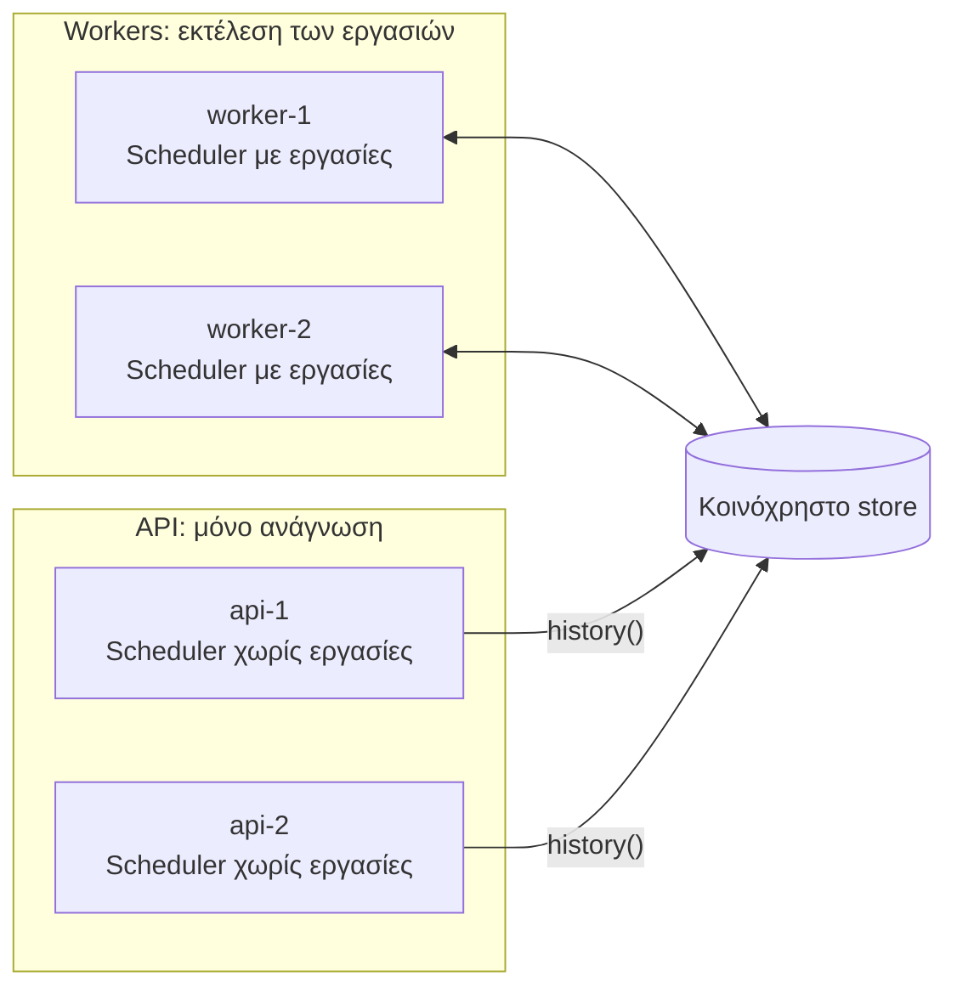

import { Tabs, TabItem } from '@astrojs/starlight/components';

Δεν χρειάζεται να εκτελείτε εργασίες στις ίδιες διεργασίες που εξυπηρετούν αιτήματα. Ένας συνηθισμένος διαχωρισμός:

- **Workers**: καταχωρούν τις εργασίες και τις εκτελούν. Τρέξτε δύο ή περισσότερα για διαθεσιμότητα.
- **Διεργασίες API**: δεν καταχωρούν τίποτα. Διαβάζουν μόνο το ιστορικό και, αν θέλετε, ξεκινούν χειροκίνητες εκτελέσεις μέσω ενός worker.



## Γιατί να γίνει διαχωρισμός

- Μια βαριά εργασία δεν μπορεί να επιβραδύνει την εξυπηρέτηση αιτημάτων.
- Οι workers μπορούν να διαστασιολογηθούν, κλιμακωθούν και αναπτυχθούν (deployed) ανεξάρτητα.
- Οι διεργασίες web δεν χρειάζονται κώδικα εργασιών ή εξαρτήσεις εργασιών.

## Η κοινόχρηστη παραμετροποίηση

Και οι δύο πλευρές πρέπει να στοχεύουν στο ίδιο store και namespace. Διατηρήστε το σε ένα μόνο σημείο:

<Tabs syncKey="language">
<TabItem label="Node.js">

```ts
// cron/config.ts
import { RedisBackend, type SchedulerOptions } from 'anarchon';

export const cronOptions: SchedulerOptions = {
  backend: new RedisBackend({ redis: process.env.REDIS_URL, prefix: 'billing:cron:' }),
  timezone: 'Europe/Athens',
};
```

</TabItem>
<TabItem label=".NET">

```csharp
// Cron/CronSetup.cs, σε μια βιβλιοθήκη στην οποία αναφέρονται και τα δύο projects
public static class CronSetup
{
    public static AnarchonBuilder AddBillingCron(this IServiceCollection services, IConfiguration configuration) =>
        services
            .AddAnarchon(options => options.TimeZone = TimeZoneInfo.FindSystemTimeZoneById("Europe/Athens"))
            .UseRedis(options =>
            {
                options.Configuration = configuration.GetConnectionString("redis");
                options.Prefix = "billing:cron:";
            });
}
```

</TabItem>
</Tabs>

## Ο worker

<Tabs syncKey="language">
<TabItem label="Node.js">

```ts
// worker.ts
import { Scheduler } from 'anarchon';
import { cronOptions } from './cron/config';

const scheduler = new Scheduler({ ...cronOptions, instanceId: process.env.POD_NAME, log: true });

scheduler
  .every('sync', '10s', (ctx) => syncCustomers({ signal: ctx.signal }))
  .every('export', '15m', (ctx) => exportAll(ctx), { timeoutMs: 10 * 60_000 })
  .cron('digest', '0 8 * * 1-5', () => sendDigest());

async function main() {
  await scheduler.start();
  const shutdown = async () => {
    await scheduler.stop({ timeoutMs: 25_000 });
    process.exit(0);
  };
  process.on('SIGTERM', shutdown);
  process.on('SIGINT', shutdown);
}

main().catch((error) => {
  console.error(error);
  process.exit(1);
});
```

</TabItem>
<TabItem label=".NET">

```csharp
// Worker/Program.cs: ένα worker service (dotnet new worker)
var builder = Host.CreateApplicationBuilder(args);
builder.Services.AddBillingCron(builder.Configuration)
    .AddJobs<BillingJobs>();
builder.Services.Configure<SchedulerOptions>(options =>
{
    options.InstanceId = Environment.GetEnvironmentVariable("POD_NAME");
    options.StopTimeout = TimeSpan.FromSeconds(25);
});

// Ο host εκκινεί τον scheduler, και τον σταματά στα SIGTERM και Ctrl+C.
await builder.Build().RunAsync();

public sealed class BillingJobs(CustomerSync sync, Exporter exporter, Mailer mailer)
{
    [Every("10s", Name = "sync")]
    public Task SyncAsync(CancellationToken cancellationToken) => sync.RunAsync(cancellationToken);

    [Every("15m", Name = "export", Timeout = "10m")]
    public Task ExportAsync(JobContext ctx) => exporter.ExportAllAsync(ctx);

    [Cron("0 8 * * 1-5", Name = "digest")]
    public Task DigestAsync(CancellationToken cancellationToken) => mailer.SendDigestAsync(cancellationToken);
}
```

</TabItem>
</Tabs>

Εκτελέστε τουλάχιστον δύο workers. Με έναν μόνο, μια κατάρρευση σημαίνει ότι κανείς δεν απομένει για να αναλάβει την εκτέλεση (takeover) μέχρι να επανεκκινήσει. Σε ένα lease backend, ο επανεκκινημένος worker εξακολουθεί να ανακτά την εκτέλεση κατά την εκκίνηση, επομένως τίποτα δεν χάνεται, μόνο καθυστερεί.

## Το API

Η διεργασία API δημιουργεί έναν scheduler **χωρίς εργασίες** και δεν καλεί ποτέ το `start()`. Οι συναρτήσεις `history()` και `lastRun()` συνδέονται αυτόνομα. Στο .NET ο host εκκινεί τον scheduler, κάτι που είναι ακίνδυνο: χωρίς εργασίες δεν διεκδικεί τίποτα, και μόνο διαβάζει.

<Tabs syncKey="language">
<TabItem label="Node.js">

```ts
// api.ts
import express from 'express';
import { Scheduler } from 'anarchon';
import { cronOptions } from './cron/config';

const reader = new Scheduler(cronOptions);
const app = express();

app.get('/jobs/:name/runs', async (req, res) => {
  res.json(await reader.history(req.params.name, Number(req.query.limit ?? 20)));
});

app.get('/jobs/:name/last', async (req, res) => {
  res.json(await reader.lastRun(req.params.name));
});

const server = app.listen(3000);

process.on('SIGTERM', async () => {
  server.close();
  await reader.stop(); // κλείνει τη σύνδεσή του
  process.exit(0);
});
```

</TabItem>
<TabItem label=".NET">

```csharp
// Api/Program.cs
var builder = WebApplication.CreateBuilder(args);
builder.Services.AddBillingCron(builder.Configuration); // χωρίς AddJobs: ένας reader

var app = builder.Build();
app.MapGet("/jobs/{name}/runs", (string name, int? limit, Scheduler reader) => reader.HistoryAsync(name, limit ?? 20));
app.MapGet("/jobs/{name}/last", (string name, Scheduler reader) => reader.LastRunAsync(name));

await app.RunAsync(); // ο τερματισμός του host κλείνει τη σύνδεση του scheduler
```

</TabItem>
</Tabs>

Τι μπορεί και τι δεν μπορεί να κάνει ένας reader:

| Μέθοδος | Σε reader χωρίς εργασίες |
| --- | --- |
| `history(name)`, `lastRun(name)`· `HistoryAsync`, `LastRunAsync` | Λειτουργεί για οποιοδήποτε όνομα εργασίας |
| `jobs()`, `GetJobs()` | Άδειο: παραθέτει τις εργασίες που έχουν καταχωρηθεί σε *αυτό* το instance |
| `nextRun(name)`, `GetNextRun(name)` | Πετάει σφάλμα (throws): η εργασία δεν έχει καταχωρηθεί εδώ (`UnknownJob` στο .NET) |
| `runNow(name)`, `RunNowAsync(name)` | Πετάει σφάλμα (throws): η εργασία δεν έχει καταχωρηθεί εδώ (`UnknownJob` στο .NET) |

## Προβολή του προγράμματος στο API

Το API δεν γνωρίζει τα χρονοδιαγράμματα, καθώς δεν καταχωρεί εργασίες. Δύο τρόποι για να τα προβάλετε:

**Κοινή χρήση των ορισμών.** Τοποθετήστε ονόματα και προγράμματα σε ένα module που κάνουν import και οι δύο πλευρές. Ο worker συνδέει handlers· το API διαβάζει μόνο τη λίστα.

<Tabs syncKey="language">
<TabItem label="Node.js">

```ts
// cron/definitions.ts
export const JOBS = [
  { name: 'sync', kind: 'every', schedule: '10s' },
  { name: 'export', kind: 'every', schedule: '15m' },
  { name: 'digest', kind: 'cron', schedule: '0 8 * * 1-5' },
] as const;
```

</TabItem>
<TabItem label=".NET">

```csharp
// Cron/Definitions.cs
public static class Definitions
{
    public static readonly IReadOnlyList<(string Name, string Kind, string Schedule)> Jobs =
    [
        ("sync", "every", "10s"),
        ("export", "every", "15m"),
        ("digest", "cron", "0 8 * * 1-5"),
    ];
}
```

</TabItem>
</Tabs>

**Ή ρωτήστε έναν worker.** Δώστε στους workers ένα μικρό εσωτερικό HTTP endpoint που επιστρέφει το `scheduler.jobs()` (`GetJobs()`).

## Χειροκίνητες εκτελέσεις από το API

Η μέθοδος `runNow()` (`RunNowAsync()`) εκτελείται στο instance στο οποίο καλείται, και το API δεν έχει κώδικα εργασιών. Προωθήστε το αίτημα σε έναν worker:

<Tabs syncKey="language">
<TabItem label="Node.js">

```ts
// στον worker: ένας μικρός εσωτερικός server
import { createServer } from 'node:http';

createServer(async (req, res) => {
  const match = /^\/run\/([\w-]+)$/.exec(req.url ?? '');
  if (req.method !== 'POST' || !match) return res.writeHead(404).end();
  try {
    const run = await scheduler.runNow(match[1]);
    res.writeHead(200, { 'content-type': 'application/json' }).end(JSON.stringify(run));
  } catch (error) {
    res.writeHead(400).end(String(error));
  }
}).listen(9100);
```

</TabItem>
<TabItem label=".NET">

```csharp
// στον worker, μετατρεπόμενος σε web app (WebApplication.CreateBuilder) που ακούει σε εσωτερική θύρα
app.MapPost("/run/{name}", async (string name, Scheduler scheduler) =>
{
    try
    {
        return Results.Ok(await scheduler.RunNowAsync(name));
    }
    catch (AnarchonException error) when (error.Code == AnarchonErrorCode.UnknownJob)
    {
        return Results.BadRequest(error.Message);
    }
});
```

</TabItem>
</Tabs>

<Tabs syncKey="language">
<TabItem label="Node.js">

```ts
// στο API
app.post('/jobs/:name/run', requireAdmin, async (req, res) => {
  const response = await fetch(`http://cron-worker:9100/run/${req.params.name}`, { method: 'POST' });
  res.status(response.status).send(await response.text());
});
```

</TabItem>
<TabItem label=".NET">

```csharp
// στο API
builder.Services.AddHttpClient("worker", client => client.BaseAddress = new Uri("http://cron-worker:9100"));

app.MapPost("/jobs/{name}/run", async (string name, IHttpClientFactory clients) =>
{
    var response = await clients.CreateClient("worker").PostAsync($"/run/{Uri.EscapeDataString(name)}", null);
    return Results.Content(await response.Content.ReadAsStringAsync(), "application/json", statusCode: (int)response.StatusCode);
}).RequireAuthorization("admin");
```

</TabItem>
</Tabs>

## Μία βάση κώδικα, δύο λειτουργίες

Αν προτιμάτε να διανέμετε μία εικόνα (image), επιλέξτε τη λειτουργία μέσω μιας μεταβλητής περιβάλλοντος:

<Tabs syncKey="language">
<TabItem label="Node.js">

```ts
const scheduler = new Scheduler({ ...cronOptions, instanceId: process.env.POD_NAME });

if (process.env.RUN_JOBS === 'true') {
  registerJobs(scheduler);
  await scheduler.start();
}
```

</TabItem>
<TabItem label=".NET">

```csharp
var cron = builder.Services.AddBillingCron(builder.Configuration);

if (builder.Configuration.GetValue<bool>("RUN_JOBS"))
{
    cron.AddJobs<BillingJobs>();
}
```

</TabItem>
</Tabs>

Οι διεργασίες όπου η μεταβλητή `RUN_JOBS` δεν έχει οριστεί συμπεριφέρονται ως readers.

## Επόμενα βήματα

- [Rolling deploys στο Kubernetes](../kubernetes/)
- [Ιστορικό](../../guides/history/)
