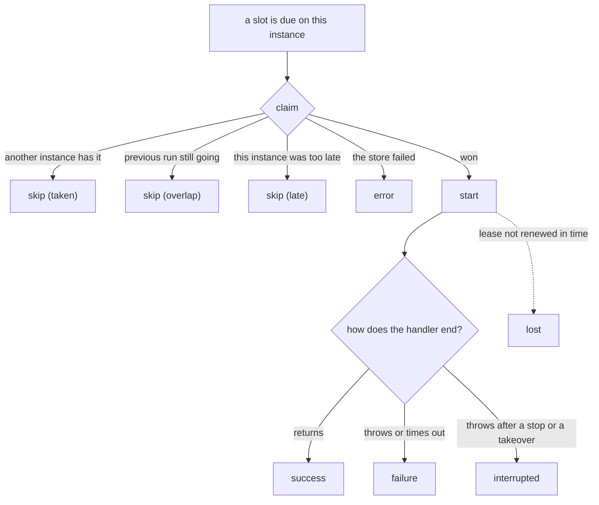

import { Tabs, TabItem } from '@astrojs/starlight/components';

The scheduler tells you what happens on **this instance** through events. For the view across all instances, use [history](../history/).

<Tabs syncKey="language">
<TabItem label="Node.js">

```ts
scheduler.on('failure', (run) => {
  console.error(`${run.job} failed on ${run.instanceId}: ${run.error}`);
});
```

</TabItem>
<TabItem label=".NET">

```csharp
scheduler.Failed += (_, run) =>
    Console.Error.WriteLine($"{run.Job} failed on {run.InstanceId}: {run.Error}");
```

</TabItem>
</Tabs>

In Node.js, `on()`, `once()` and `off()` work like Node's `EventEmitter`, and are typed: the payload type follows from the event name. In .NET each event is a C# event (`+=`, `-=`) with an `EventHandler<T>`.

## The events

| Node.js | .NET | When | Payload (.NET type) |
| --- | --- | --- | --- |
| `start` | `Started` | This instance won a run and is about to call the handler | job, slot, attempt, reason (`RunStartEvent`) |
| `success` | `Succeeded` | The handler returned | a [run record](../history/#the-run-record) (`RunRecord`) |
| `failure` | `Failed` | The handler threw, or its timeout passed | run record + cause (`RunFailureEvent`) |
| `interrupted` | `Interrupted` | A stop or a takeover cancelled the run, and the handler then threw | run record + cause, handed over (`RunInterruptedEvent`) |
| `skip` | `Skipped` | A run was due and this instance didn't run it | job, slot, reason (`SkipEvent`) |
| `lost` | `Lost` | A backup took over a run this instance was executing, or its lease couldn't be renewed in time | job, slot, attempt (`LostEvent`) |
| `error` | `Error` | A backend or setup problem | error, and the job and slot if known (`SchedulerErrorEvent`) |



### Skips are normal

With three instances, every run produces one start and two skip events with reason taken. That is the system working. The reasons:

| Node.js | .NET | Meaning |
| --- | --- | --- |
| `'taken'` | `SkipReason.Taken` | Another instance won this run |
| `'overlap'` | `SkipReason.Overlap` | The previous run of this job is still going (the default overlap, skip) |
| `'late'` | `SkipReason.Late` | This instance reached the run later than its lateness limit. `lateMs` (`Late`) says how late |

### Failures and their cause

`run.error` (`run.Error`) is the message as text, the same string that is stored in history. `run.cause` (`run.Cause`) is what the handler actually threw, so you can inspect it:

<Tabs syncKey="language">
<TabItem label="Node.js">

```ts
scheduler.on('failure', (run) => {
  if (run.cause instanceof RateLimitError) return; // expected, ignore
  pager.notify(`${run.job} @ ${run.scheduledAt.toISOString()} failed: ${run.error}`);
});
```

</TabItem>
<TabItem label=".NET">

```csharp
scheduler.Failed += (_, run) =>
{
    if (run.Cause is RateLimitException) return; // expected, ignore
    pager.Notify($"{run.Job} @ {run.ScheduledAt:O} failed: {run.Error}");
};
```

</TabItem>
</Tabs>

### Interrupted is not a failure

A run that was stopped by a deploy, or taken over, didn't fail. It is reported separately so your alerts stay quiet during deploys.

<Tabs syncKey="language">
<TabItem label="Node.js">

```ts
scheduler.on('interrupted', (run) => {
  logger.info(`${run.job} stopped mid-run, handed over: ${run.handedOver}`);
});
```

</TabItem>
<TabItem label=".NET">

```csharp
scheduler.Interrupted += (_, run) =>
    logger.LogInformation("{Job} stopped mid-run, handed over: {HandedOver}", run.Job, run.HandedOver);
```

</TabItem>
</Tabs>

### Lost

This instance was running a job and gave it up: a heartbeat found that a backup had taken the run over, or no heartbeat had been confirmed for a whole lease, so a backup may be taking it over. That happens when the instance couldn't renew its lease: it was frozen, or cut off from the store. The run is cancelled at the same moment.

A lost event now and then after a long pause is expected. Frequent ones mean the lease is too short for your environment.

### Errors

Problems that are not a job failing: the store is unreachable, a claim couldn't be sent, a result couldn't be saved.

<Tabs syncKey="language">
<TabItem label="Node.js">

```ts
scheduler.on('error', (e) => {
  logger.error({ err: e.error, job: e.job }, 'scheduler backend problem');
});
```

</TabItem>
<TabItem label=".NET">

```csharp
scheduler.Error += (_, e) =>
    logger.LogError(e.Error, "scheduler backend problem in {Job}", e.Job);
```

</TabItem>
</Tabs>

If nobody listens for errors, they are written to the logger. They never crash the process.

## Metrics

Events map directly onto metrics:

<Tabs syncKey="language">
<TabItem label="Node.js">

```ts
scheduler.on('start', (e) => metrics.increment('cron.start', { job: e.job }));
scheduler.on('success', (run) => metrics.timing('cron.duration', run.durationMs, { job: run.job }));
scheduler.on('failure', (run) => metrics.increment('cron.failure', { job: run.job }));
scheduler.on('skip', (e) => {
  if (e.reason !== 'taken') metrics.increment('cron.skip', { job: e.job, reason: e.reason });
});
scheduler.on('lost', (e) => metrics.increment('cron.lost', { job: e.job }));
```

</TabItem>
<TabItem label=".NET">

```csharp
// System.Diagnostics.Metrics: exported by OpenTelemetry, Prometheus, dotnet-counters
var meter = new Meter("MyService.Jobs");
var started = meter.CreateCounter<long>("cron.start");
var duration = meter.CreateHistogram<double>("cron.duration", unit: "ms");
var failed = meter.CreateCounter<long>("cron.failure");

scheduler.Started += (_, e) => started.Add(1, new KeyValuePair<string, object?>("job", e.Job));
scheduler.Succeeded += (_, run) => duration.Record(run.Duration?.TotalMilliseconds ?? 0, new KeyValuePair<string, object?>("job", run.Job));
scheduler.Failed += (_, run) => failed.Add(1, new KeyValuePair<string, object?>("job", run.Job));
```

</TabItem>
</Tabs>

Remember that these count what happened on one instance. Sum them across instances for the whole service.

## Listeners can't break a run

A listener that throws (in Node.js also an async listener whose promise rejects) is caught and logged. It doesn't affect the run or the other listeners.

## Built-in logging

<Tabs syncKey="language">
<TabItem label="Node.js">

`log: true` writes one line for each of the events above, without any code:

```ts
new Scheduler({ backend, log: true });
```

</TabItem>
<TabItem label=".NET">

The scheduler logs each of the events above through `ILogger`, under the category `Anarchon.Scheduler`: runs at Debug, failed and lost runs at Warning, errors nobody handles at Error. Give it a `LoggerFactory`, or use a host, whose factory `AddAnarchon()` takes:

```json
{ "Logging": { "LogLevel": { "Anarchon": "Debug" } } }
```

```
dbug: Anarchon.Scheduler[1] sync @ 2026-10-10T12:00:10.0000000+00:00: started on api-2 (attempt 1, Scheduled)
dbug: Anarchon.Scheduler[2] sync @ 2026-10-10T12:00:10.0000000+00:00: finished in 203 ms
warn: Anarchon.Scheduler[3] report @ 2026-10-10T12:00:00.0000000+00:00: failed after 1204 ms: HttpRequestException: upstream returned 503
```

The log messages have event IDs (1 started, 2 finished, 3 failed, 4 interrupted, 5 skipped, 6 lost, 7 unhandled error), and their values are structured fields (`Job`, `Due`, `Attempt`...) for log stores that index them. The rest of this section is about Node.js.

</TabItem>
</Tabs>

```
[anarchon] sync @ 2026-10-10T12:00:10.000Z: started on api-2 (attempt 1, scheduled)
[anarchon] sync @ 2026-10-10T12:00:10.000Z: finished in 203 ms
[anarchon] sync @ 2026-10-10T12:00:20.000Z: skipped (taken)
[anarchon] report @ 2026-10-10T12:00:00.000Z: failed after 1204 ms: Error: upstream returned 503
[anarchon] report @ 2026-10-10T12:30:00.000Z: interrupted after 8012 ms, handed over to another instance
[anarchon] export @ 2026-10-10T12:00:00.000Z: attempt 1 was taken over by a backup
```

Failures and lost runs go to `logger.warn`; the rest go to `logger.info`.

### Your own logger (Node.js)

Any object with `warn` and `error` methods works. `info` is optional.

```ts
import pino from 'pino';
new Scheduler({ backend, log: true, logger: pino() });
```

```ts
new Scheduler({
  backend,
  logger: {
    info: (message) => myLog('info', message),
    warn: (message) => myLog('warn', message),
    error: (message) => myLog('error', message),
  },
});
```

With `log: false` (the default) the logger is still used for `error` events nobody listens for.

## Next

- [History](../history/): the view across all instances
- [Events reference](../../reference/events/): every payload field
