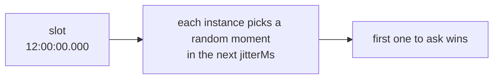

import { Tabs, TabItem } from '@astrojs/starlight/components';

The last argument of `every()`, `cron()` and `at()` is an options object (in .NET, `EveryJobOptions`, `CronJobOptions` or `JobOptions`, usually written `new() { ... }`). Every option has a default, so you only set what you need.

<Tabs syncKey="language">
<TabItem label="Node.js">

```ts
scheduler.every('report', '35m', buildReport, {
  timeoutMs: 20 * 60_000,
  maxAttempts: 2,
});
```

</TabItem>
<TabItem label=".NET">

```csharp
scheduler.Every("report", TimeSpan.FromMinutes(35), BuildReportAsync, new()
{
    Timeout = TimeSpan.FromMinutes(20),
    MaxAttempts = 2,
});
```

</TabItem>
</Tabs>

## Summary

| Node.js | .NET | Default | Needs a lease backend | What it controls |
| --- | --- | --- | --- | --- |
| [`jitterMs`](#jitterms) | `Jitter` | scheduler's (2 s), lowered for short intervals | no | The random delay before claiming |
| [`maxLateMs`](#maxlatems) | `MaxLate` | scheduler's (60 s) | no | How late an instance may start a run |
| [`timeoutMs`](#timeoutms) | `Timeout` | none | no | The longest a run may take |
| [`overlap`](#overlap) | `Overlap` | skip | yes | Whether a run may start while the previous one is going |
| [`maxAttempts`](#maxattempts) | `MaxAttempts` | `3` | yes | How many times a run may be started when runners die |
| [`catchUpMs`](#catchupms) | `CatchUp` | 5 min | yes | How old a missed run may be and still run on start |
| [`yieldAfterFailure`](#yieldafterfailure) | `YieldAfterFailure` | false | yes | Whether an instance that just failed the job lets a healthy one claim the next run first |
| [`historySize`](#historysize-and-historyttlms) | `HistorySize` | scheduler's (1000) | no | How many runs to remember |
| [`historyTtlMs`](#historysize-and-historyttlms) | `HistoryTtl` | scheduler's (none) | no, but not RabbitMQ or NATS | How long to remember them |
| `offsetMs` | `Offset` | `0` | no | Interval jobs only: [shifts the grid](../defining-jobs/#shifting-the-grid-offsetms-offset) |
| `timezone` | `TimeZone` | scheduler's | no | Cron jobs only: [the time zone](../defining-jobs/#time-zones) |
| [`data`](../run-data/) | `Data` | none | no | Data for the job's runs, read in the handler as `ctx.data` (`ctx.Data`) |

Durations are milliseconds in Node.js and `TimeSpan` values in .NET. "Scheduler's" means the option of the same name on the scheduler. See [Scheduler options](../scheduler-options/).

An option that needs a lease backend isn't offered on another one: RabbitMQ, or NATS, Redis or Valkey without their lease strategy, don't take the overlap, the attempts, the catch-up or yield-after-failure. A one-off job never takes the overlap, since it has no previous run.

<Tabs syncKey="language">
<TabItem label="Node.js">

In TypeScript, `every()`, `cron()` and `at()` don't accept those options on such a backend: the code doesn't compile. Decorators and plain JavaScript can't be checked that way, so the job is refused when it is added, with an error that names the option and the backend.

```ts
const scheduler = new Scheduler({ backend: new RabbitMQBackend({ url }) });
scheduler.every('sync', '5m', sync, { timeoutMs: 60_000 });   // fine
scheduler.every('sync', '5m', sync, { overlap: 'allow' });    // type error: RabbitMQ has no leases
```

</TabItem>
<TabItem label=".NET">

The job is refused when it is added, with an `AnarchonException` of code `Unsupported` that names the option and the backend.

```csharp
var scheduler = new Scheduler(new SchedulerOptions { Backend = new RabbitMQBackend(rabbitUri) });
scheduler.Every("sync", TimeSpan.FromMinutes(5), SyncAsync, new() { Timeout = TimeSpan.FromMinutes(1) });    // fine
scheduler.Every("sync", TimeSpan.FromMinutes(5), SyncAsync, new() { Overlap = OverlapPolicy.Allow });        // throws: RabbitMQ has no leases
```

</TabItem>
</Tabs>

## `jitterMs`

Each instance waits a random time between 0 and the jitter (`jitterMs`, `Jitter`) after the slot before it claims the run. With [`yieldAfterFailure`](#yieldafterfailure), an instance whose last run of the job failed waits longer.



- **Larger** jitter spreads work more evenly and makes the start time less exact.
- **`0`** means no spreading: all instances claim at the same instant, and the one with the fastest clock and connection usually wins.

It must be under half the time between runs. If you don't set it, the default is the scheduler's jitter (2 seconds), or a quarter of the interval when that is smaller. So a job that runs every second gets 250 ms.

<Tabs syncKey="language">
<TabItem label="Node.js">

```ts
scheduler.every('tick', '1s', tick);                       // jitter 250 ms, automatically
scheduler.cron('nightly', '0 2 * * *', run, { jitterMs: 30_000 }); // starts between 02:00:00 and 02:00:30
scheduler.every('precise', '1m', run, { jitterMs: 0 });    // starts on the dot, always the fastest instance
```

</TabItem>
<TabItem label=".NET">

```csharp
scheduler.Every("tick", TimeSpan.FromSeconds(1), TickAsync);                                         // jitter 250 ms, automatically
scheduler.Cron("nightly", "0 2 * * *", RunAsync, new() { Jitter = TimeSpan.FromSeconds(30) });          // starts between 02:00:00 and 02:00:30
scheduler.Every("precise", TimeSpan.FromMinutes(1), RunAsync, new() { Jitter = TimeSpan.Zero });        // starts on the dot, always the fastest instance
```

</TabItem>
</Tabs>

**Works on** every backend. **Use it when:**

- **A heavy job should land on a random instance:** a larger jitter spreads the runs, so one instance doesn't do every nightly rebuild.
- **The start time matters to the second:** no jitter (`jitterMs: 0`, `Jitter = TimeSpan.Zero`). The fastest instance then wins every time; that is the price.
- **Many instances call one dependency at the same moment:** jitter spreads the first requests over a few seconds.

<Tabs syncKey="language">
<TabItem label="Node.js">

```ts
scheduler.cron('rebuild-search-index', '0 3 * * *', rebuild, { jitterMs: 5 * 60_000 });           // spread over 5 min
scheduler.cron('market-open', '30 9 * * 1-5', open, { timezone: 'America/New_York', jitterMs: 0 }); // on the second
scheduler.every('poll-partner-api', '1m', poll, { jitterMs: 20_000 });                            // gentle on their rate limit
```

</TabItem>
<TabItem label=".NET">

```csharp
scheduler.Cron("rebuild-search-index", "0 3 * * *", RebuildAsync, new() { Jitter = TimeSpan.FromMinutes(5) });     // spread over 5 min
scheduler.Cron("market-open", "30 9 * * 1-5", OpenAsync, new() { TimeZone = newYork, Jitter = TimeSpan.Zero });      // on the second
scheduler.Every("poll-partner-api", TimeSpan.FromMinutes(1), PollAsync, new() { Jitter = TimeSpan.FromSeconds(20) }); // gentle on their rate limit
```

</TabItem>
</Tabs>

## `maxLateMs`

When an instance gets to a run more than the lateness limit (`maxLateMs`, `MaxLate`) after its slot, it skips it and emits a skip event with reason late (`skip` and `'late'` in Node.js, `Skipped` and `SkipReason.Late` in .NET).

This protects you from stale runs. A process can be frozen for minutes: a suspended laptop, a long garbage-collection pause, a stalled virtual machine. When it wakes, its timers fire for runs that were due long ago. Without this limit it would start them.

<Tabs syncKey="language">
<TabItem label="Node.js">

```ts
// A run that can't start within 10 s of its time isn't worth starting
scheduler.every('quote-refresh', '30s', refresh, { maxLateMs: 10_000 });
```

</TabItem>
<TabItem label=".NET">

```csharp
// A run that can't start within 10 s of its time isn't worth starting
scheduler.Every("quote-refresh", TimeSpan.FromSeconds(30), RefreshAsync, new() { MaxLate = TimeSpan.FromSeconds(10) });
```

</TabItem>
</Tabs>

It must be bigger than the jitter.

**Works on** every backend. On RabbitMQ, and NATS, Redis or Valkey without their lease strategy, the jitter plus the lateness limit must also be shorter than how long the backend remembers a claimed run, or a late instance could win the same run again; anarchon checks it when the job is added. **Use it when:**

- **A stale run is worse than none:** quotes, presence, anything whose inputs age in seconds. Keep it short.
- **A late run is still useful:** a cleanup or a report can run half an hour late. Raise it.

<Tabs syncKey="language">
<TabItem label="Node.js">

```ts
scheduler.every('presence-sweep', '10s', sweep, { maxLateMs: 5_000 });            // 5 s late means stale presence: drop it
scheduler.cron('cleanup-temp', '0 4 * * *', cleanup, { maxLateMs: 30 * 60_000 }); // fine half an hour late

// On RabbitMQ, raise slotTtlMs (5 min by default) first, so the broker remembers runs long enough
new Scheduler({ backend: new RabbitMQBackend({ url, slotTtlMs: 20 * 60_000 }), maxLateMs: 15 * 60_000 });
```

</TabItem>
<TabItem label=".NET">

```csharp
scheduler.Every("presence-sweep", TimeSpan.FromSeconds(10), SweepAsync, new() { MaxLate = TimeSpan.FromSeconds(5) }); // 5 s late means stale presence: drop it
scheduler.Cron("cleanup-temp", "0 4 * * *", CleanupAsync, new() { MaxLate = TimeSpan.FromMinutes(30) });              // fine half an hour late

// On RabbitMQ, raise SlotTtl (5 min by default) first, so the broker remembers runs long enough
new Scheduler(new SchedulerOptions
{
    Backend = new RabbitMQBackend(new RabbitMQBackendOptions { ConnectionString = rabbitUri, SlotTtl = TimeSpan.FromMinutes(20) }),
    MaxLate = TimeSpan.FromMinutes(15),
});
```

</TabItem>
</Tabs>

## `timeoutMs`

After this long, the run's cancellation fires (`ctx.signal` aborts, `ctx.CancellationToken` is cancelled) and the run is recorded as **failed**, with the error `TimeoutError: Timed out after N ms` (`TimeoutException: Timed out after N ms` in .NET).

<Tabs syncKey="language">
<TabItem label="Node.js">

```ts
scheduler.every('export', '5m', exportAll, { timeoutMs: 4 * 60_000 });
```

</TabItem>
<TabItem label=".NET">

```csharp
scheduler.Every("export", TimeSpan.FromMinutes(5), ExportAllAsync, new() { Timeout = TimeSpan.FromMinutes(4) });
```

</TabItem>
</Tabs>

:::caution
The timeout doesn't kill your handler. Neither JavaScript nor .NET can stop a running function from outside. The handler must watch `ctx.signal` (`ctx.CancellationToken`), or it keeps going in the background after the run was recorded as failed. See [Writing handlers](../writing-handlers/#stopping-when-asked).
:::

Set a timeout on any job that can hang. With the default overlap (skip), a hung run keeps renewing its lease and blocks every later run of that job.

**Works on** every backend. **Use it when:**

- **The job calls anything over the network:** a hung connection must not hold the job forever. Pass `ctx.signal` (`ctx.CancellationToken`) along.
- **The job must end before its next run is due:** set it below the interval, so a slow run fails and the next one starts on time.

<Tabs syncKey="language">
<TabItem label="Node.js">

```ts
scheduler.every('sync-crm', '15m', (ctx) => crm.sync({ signal: ctx.signal }), { timeoutMs: 10 * 60_000 });
scheduler.cron('send-digest', '0 8 * * *', sendDigest, { timeoutMs: 30 * 60_000 }); // a stuck SMTP server can't block tomorrow
```

</TabItem>
<TabItem label=".NET">

```csharp
scheduler.Every("sync-crm", TimeSpan.FromMinutes(15), ctx => crm.SyncAsync(ctx.CancellationToken), new() { Timeout = TimeSpan.FromMinutes(10) });
scheduler.Cron("send-digest", "0 8 * * *", SendDigestAsync, new() { Timeout = TimeSpan.FromMinutes(30) }); // a stuck SMTP server can't block tomorrow
```

</TabItem>
</Tabs>

## `overlap`

*Needs a lease backend.*

What happens when a run is due while the previous run of the same job is still going:

- **Skip** (default; `'skip'`, `OverlapPolicy.Skip`): the new run is skipped, with a skip event of reason overlap.
- **Allow** (`'allow'`, `OverlapPolicy.Allow`): both run.

```
A 7 s job every 3 s, overlap 'skip'

time   :00  :03  :06  :09  :12  :15  :18
run    [======= 7 s =======]
            skip skip
                           [======= 7 s =======]
                                skip skip
```

Skipped runs are not queued. The run at :03 never happens; the next run to start is the first one due after the current run ends.

<Tabs syncKey="language">
<TabItem label="Node.js">

```ts
// Independent work per run: let them overlap
scheduler.every('sample-metrics', '5s', sample, { overlap: 'allow' });
```

</TabItem>
<TabItem label=".NET">

```csharp
// Independent work per run: let them overlap
scheduler.Every("sample-metrics", TimeSpan.FromSeconds(5), SampleAsync, new() { Overlap = OverlapPolicy.Allow });
```

</TabItem>
</Tabs>

**Works on** lease backends: PostgreSQL, SQLite, Redis, Valkey or NATS with their lease strategy. On the others, runs can always overlap; if two must not, guard inside the job (a database lock, for example). **Use it when:**

- **Skip:** runs of the job write the same data: a sync, an export, a reindex. Two at once would fight.
- **Allow:** each run stands alone: a ping, a metrics sample, a check whose result is only logged.

<Tabs syncKey="language">
<TabItem label="Node.js">

```ts
scheduler.every('reindex', '5m', reindex);                              // 'skip': two reindexes would fight
scheduler.every('ping-endpoints', '30s', ping, { overlap: 'allow' });    // each ping stands alone
```

</TabItem>
<TabItem label=".NET">

```csharp
scheduler.Every("reindex", TimeSpan.FromMinutes(5), ReindexAsync);                                                  // skip: two reindexes would fight
scheduler.Every("ping-endpoints", TimeSpan.FromSeconds(30), PingAsync, new() { Overlap = OverlapPolicy.Allow });    // each ping stands alone
```

</TabItem>
</Tabs>

## `maxAttempts`

*Needs a lease backend.*

How many times one run may be **started** when its runner dies, counting the first try. The default is 3.

- A run is retried only when its runner stopped renewing the lease: it crashed, froze or lost the network.
- A run that **fails** (the handler throws) is **not** retried. Retries are for dead runners, not for errors. If you want to retry errors, do it inside the handler.
- A hand-over on stop doesn't count against the limit.

<Tabs syncKey="language">
<TabItem label="Node.js">

```ts
scheduler.cron('charge-cards', '0 6 * * *', charge, { maxAttempts: 1 }); // never started twice
```

</TabItem>
<TabItem label=".NET">

```csharp
scheduler.Cron("charge-cards", "0 6 * * *", ChargeAsync, new() { MaxAttempts = 1 }); // never started twice
```

</TabItem>
</Tabs>

When the limit is used up, the run is marked `interrupted` and left.

**Works on** lease backends. **Use it when:**

- **`1`:** the side effect must never happen twice and isn't idempotent: payments, messages without a deduplication key. A run that stopped halfway needs a person, not a retry.
- **`3` (the default):** the job is safe to redo, or resumes from a checkpoint.
- **More:** a long, idempotent job on infrastructure where instances come and go.

<Tabs syncKey="language">
<TabItem label="Node.js">

```ts
scheduler.cron('charge-cards', '0 6 * * *', charge, { maxAttempts: 1 });   // a half-done charge needs a person
scheduler.every('rebuild-cache', '1h', rebuild, { maxAttempts: 5 });        // safe to redo: keep trying elsewhere
```

</TabItem>
<TabItem label=".NET">

```csharp
scheduler.Cron("charge-cards", "0 6 * * *", ChargeAsync, new() { MaxAttempts = 1 });                  // a half-done charge needs a person
scheduler.Every("rebuild-cache", TimeSpan.FromHours(1), RebuildAsync, new() { MaxAttempts = 5 });     // safe to redo: keep trying elsewhere
```

</TabItem>
</Tabs>

## `catchUpMs`

*Needs a lease backend.*

On start, an instance checks the latest slot of each job. If nobody ran it and it was due less than the catch-up window ago, the instance runs it now, with the reason catch-up (`ctx.reason === 'catch-up'`, `ctx.Reason == RunReason.CatchUp`).

This covers a run that was due while every instance was down, for example during a full restart.

<Tabs syncKey="language">
<TabItem label="Node.js">

```ts
scheduler.cron('daily-report', '0 6 * * *', report, { catchUpMs: 6 * 60 * 60_000 }); // up to 6 h late
scheduler.every('refresh-cache', '5s', refresh, { catchUpMs: 0 });                    // never catch up
```

</TabItem>
<TabItem label=".NET">

```csharp
scheduler.Cron("daily-report", "0 6 * * *", ReportAsync, new() { CatchUp = TimeSpan.FromHours(6) });            // up to 6 h late
scheduler.Every("refresh-cache", TimeSpan.FromSeconds(5), RefreshAsync, new() { CatchUp = TimeSpan.Zero });       // never catch up
```

</TabItem>
</Tabs>

Only the **latest** run is caught up, not every run that was missed.

**Works on** lease backends. **Use it when:**

- **A daily or monthly business job must happen even after a long outage:** hours, or a day.
- **An hourly job:** up to about the interval, so a caught-up run doesn't land right before the next one.
- **A frequent job:** zero, since the next run is moments away.

<Tabs syncKey="language">
<TabItem label="Node.js">

```ts
scheduler.cron('monthly-invoices', '0 6 1 * *', invoice, { catchUpMs: 24 * 60 * 60_000 }); // a whole day to recover
scheduler.every('hourly-rollup', '1h', rollup, { catchUpMs: 50 * 60_000 });                 // until the next is nearly due
scheduler.every('heartbeat', '10s', beat, { catchUpMs: 0 });                                 // never
```

</TabItem>
<TabItem label=".NET">

```csharp
scheduler.Cron("monthly-invoices", "0 6 1 * *", InvoiceAsync, new() { CatchUp = TimeSpan.FromDays(1) });        // a whole day to recover
scheduler.Every("hourly-rollup", TimeSpan.FromHours(1), RollupAsync, new() { CatchUp = TimeSpan.FromMinutes(50) }); // until the next is nearly due
scheduler.Every("heartbeat", TimeSpan.FromSeconds(10), BeatAsync, new() { CatchUp = TimeSpan.Zero });           // never
```

</TabItem>
</Tabs>

## `yieldAfterFailure`

*Needs a lease backend.*

Each run goes to the instance that claims it first, healthy or not. A fault that stays with one instance (a broken connection pool, a full disk, a dependency only that instance can't reach) fails every run that instance wins, while a healthy instance could have run them. A run that throws isn't retried.

With yield-after-failure on (`yieldAfterFailure: true`, `YieldAfterFailure = true`), an instance whose last run of the job failed (it threw or timed out) waits before claiming the job's next scheduled run:

- **Healthy instances first.** They claim by slot + jitter. The instance that failed waits until slot + jitter + heartbeat, so one of them wins.
- **It still runs when no one else does.** If no other instance has claimed the run by then, the instance that failed claims and runs it. A single instance keeps running its jobs.
- **It recovers by itself.** A run that succeeds on that instance ends the waiting.
- **Never refused as late.** The wait never ends past the lateness limit after the slot.

<Tabs syncKey="language">
<TabItem label="Node.js">

```ts
scheduler.every('sync-orders', '1m', syncOrders, { yieldAfterFailure: true });
```

</TabItem>
<TabItem label=".NET">

```csharp
scheduler.Every("sync-orders", TimeSpan.FromMinutes(1), SyncOrdersAsync, new() { YieldAfterFailure = true });
```

</TabItem>
</Tabs>

**What it costs.** When only failing instances are left, a run starts up to one heartbeat later than usual: between slot + jitter and slot + jitter + heartbeat. With the default timings (jitter 2 s, heartbeat 5 s), that is up to 7 s after the slot instead of 2 s. Manual runs, takeovers and catch-up never wait.

**What it doesn't do.** The run that failed isn't retried, and a handler that hung keeps running on its instance (see [the timeout](#timeoutms)). Every instance remembers only its own last run, so after a failure on every instance, all of them wait the same and the race goes on as before, one heartbeat later.

**Works on** lease backends. **Use it when:**

- **Instances can be sick on their own:** jobs that use a connection or resource per instance.
- **A job is frequent enough that a few seconds' delay doesn't matter.** Leave it off where the start time matters more than the instance.

## `historySize` and `historyTtlMs`

The history size (`historySize`, `HistorySize`) is about how many runs to keep per job, and the history age limit (`historyTtlMs`, `HistoryTtl`) also drops records older than a given age.

<Tabs syncKey="language">
<TabItem label="Node.js">

```ts
scheduler.every('heartbeat', '5s', ping, { historySize: 100 });
scheduler.cron('audit', '0 * * * *', audit, { historyTtlMs: 30 * 24 * 60 * 60_000 }); // 30 days
```

</TabItem>
<TabItem label=".NET">

```csharp
scheduler.Every("heartbeat", TimeSpan.FromSeconds(5), PingAsync, new() { HistorySize = 100 });
scheduler.Cron("audit", "0 * * * *", AuditAsync, new() { HistoryTtl = TimeSpan.FromDays(30) }); // 30 days
```

</TabItem>
</Tabs>

RabbitMQ and NATS trim history by count only, so they refuse an age limit. NATS keeps one history size for all its jobs: the largest of the backend's and every job's.

On lease backends a small `historySize` is always safe: a run is never forgotten while a late claim could still ask for it. On claim-only backends the store's memory of claimed runs also has to cover late instances; anarchon checks this when you add the job and throws if the settings are unsafe. See [Timing and clocks](../../internals/timing-and-clocks/).

**Works on** every backend; the age limit not on RabbitMQ or NATS. **Use it when:**

- **A frequent job:** keep a few hundred runs at most; nobody reads more.
- **Audits or compliance:** keep a year by age, with a count large enough to hold it.

<Tabs syncKey="language">
<TabItem label="Node.js">

```ts
scheduler.every('heartbeat', '10s', beat, { historySize: 60 });  // the last 10 minutes
scheduler.cron('payouts', '0 7 * * *', payout, { historySize: 400, historyTtlMs: 365 * 24 * 60 * 60_000 }); // a year
```

</TabItem>
<TabItem label=".NET">

```csharp
scheduler.Every("heartbeat", TimeSpan.FromSeconds(10), BeatAsync, new() { HistorySize = 60 });                       // the last 10 minutes
scheduler.Cron("payouts", "0 7 * * *", PayoutAsync, new() { HistorySize = 400, HistoryTtl = TimeSpan.FromDays(365) }); // a year
```

</TabItem>
</Tabs>

## Values by kind of job

A starting point for common jobs. "default" means leave it unset.

| Kind of job | Jitter | Lateness limit | Timeout | Overlap | Attempts | Catch-up | Runnable example |
| --- | --- | --- | --- | --- | --- | --- | --- |
| Payments, billing | default | default | yes | default | `1` | hours | [`billing.ts`](https://github.com/aristoteliss/anarchon/blob/main/examples/billing.ts), [`Billing`](https://github.com/aristoteliss/anarchon-dotnet/tree/main/examples/Billing) |
| Daily report or digest | minutes | 30 min | yes | default | default | hours | |
| Export or ETL longer than its interval | default | default | under the interval | default | default | up to the interval | [`nightly-export.ts`](https://github.com/aristoteliss/anarchon/blob/main/examples/nightly-export.ts), [`NightlyExport`](https://github.com/aristoteliss/anarchon-dotnet/tree/main/examples/NightlyExport) |
| Cache refresh every few seconds | about a third of the interval | short | short | default | default | zero | [`cache-refresh.ts`](https://github.com/aristoteliss/anarchon/blob/main/examples/cache-refresh.ts), [`CacheRefresh`](https://github.com/aristoteliss/anarchon-dotnet/tree/main/examples/CacheRefresh) |
| Metrics sample, ping | zero | short | short | allow | `1` | zero | |
| Sending what an outbox holds | default | under the backend's memory | yes | | | | [`broker-notifications.ts`](https://github.com/aristoteliss/anarchon/blob/main/examples/broker-notifications.ts), [`BrokerNotifications`](https://github.com/aristoteliss/anarchon-dotnet/tree/main/examples/BrokerNotifications) |
| One-off migration (`at()`, `At()`) | zero | long | long | | `1` | long | |

An empty cell means the job doesn't need the option. The outbox job needs no lease option at all, so it runs on any backend, RabbitMQ and NATS included; the overlap doesn't apply to one-off jobs.


<Tabs syncKey="language">
<TabItem label="Node.js">

```ts
// A heavy nightly job: at most 2 h, started at most twice, never two at once
scheduler.cron('rebuild-index', '0 2 * * *', rebuild, {
  timeoutMs: 2 * 60 * 60_000,
  maxAttempts: 2,
});

// A cheap, frequent job where a missed run doesn't matter
scheduler.every('refresh-cache', '5s', refresh, { catchUpMs: 0, historySize: 50 });

// A job that must not be started twice for the same slot
scheduler.cron('send-invoices', '0 9 1 * *', send, { maxAttempts: 1, catchUpMs: 12 * 60 * 60_000 });
```

</TabItem>
<TabItem label=".NET">

```csharp
// A heavy nightly job: at most 2 h, started at most twice, never two at once
scheduler.Cron("rebuild-index", "0 2 * * *", RebuildAsync, new()
{
    Timeout = TimeSpan.FromHours(2),
    MaxAttempts = 2,
});

// A cheap, frequent job where a missed run doesn't matter
scheduler.Every("refresh-cache", TimeSpan.FromSeconds(5), RefreshAsync, new() { CatchUp = TimeSpan.Zero, HistorySize = 50 });

// A job that must not be started twice for the same slot
scheduler.Cron("send-invoices", "0 9 1 * *", SendAsync, new() { MaxAttempts = 1, CatchUp = TimeSpan.FromHours(12) });
```

</TabItem>
</Tabs>

## Next

- [Scheduler options](../scheduler-options/)
- [Writing handlers](../writing-handlers/)
