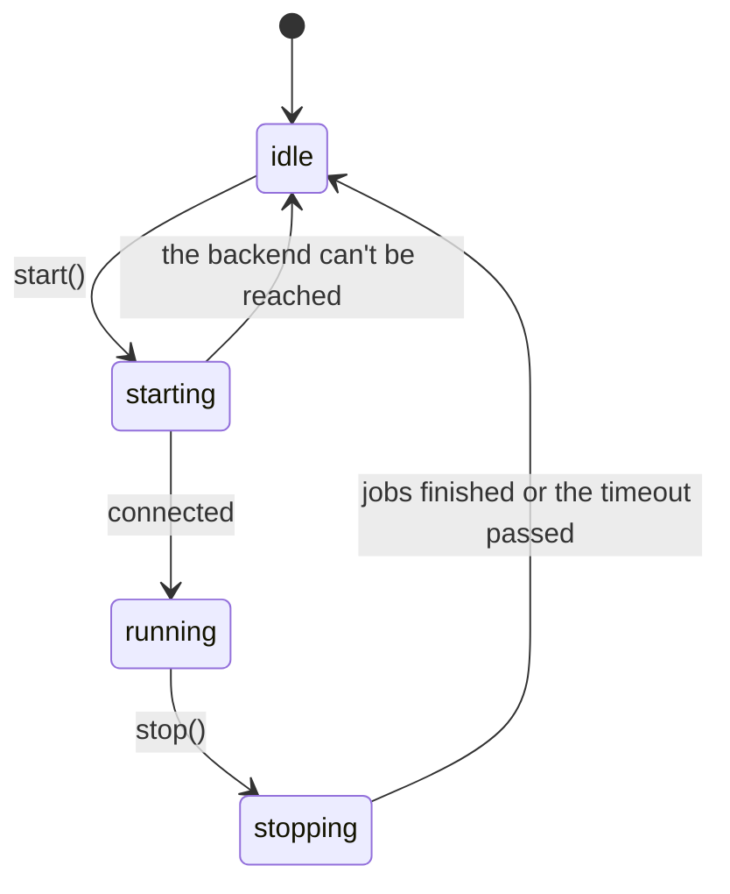
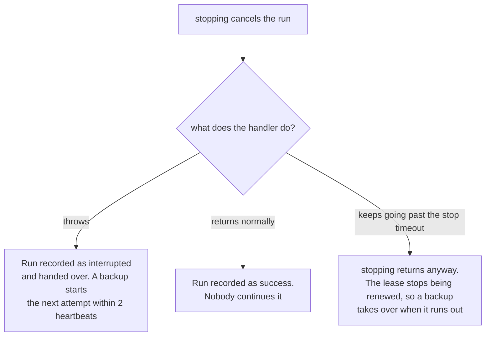

import { Tabs, TabItem } from '@astrojs/starlight/components';

A scheduler is in one of four states.



Nothing connects and nothing runs until the scheduler starts. In .NET the methods are `StartAsync()`, `StopAsync()`, `RunNowAsync()` and `Remove()`; with a host, the host starts and stops the scheduler for you.

## `start()`, `StartAsync()`

<Tabs syncKey="language">
<TabItem label="Node.js">

```ts
await scheduler.start();
```

</TabItem>
<TabItem label=".NET">

```csharp
await scheduler.StartAsync();
```

</TabItem>
</Tabs>

In order, starting:

1. **Connects** to the backend and checks that the server is new enough.
2. **Prepares each job**: creates what the backend needs (tables, streams, queues).
3. **Sets a timer** for the next slot of each job.
4. On a lease backend, **recovers** what was left behind:
   - a run whose runner died is taken over;
   - a run that is alive on another instance gets this instance as a backup;
   - the latest run is caught up, if nobody ran it and it was due less than the catch-up window ago.

If the backend can't be reached, starting fails and the scheduler stays idle; it closes what it opened, and can be started again. Handle that at boot:

<Tabs syncKey="language">
<TabItem label="Node.js">

```ts
try {
  await scheduler.start();
} catch (error) {
  console.error('scheduler could not start', error);
  process.exit(1);
}
```

</TabItem>
<TabItem label=".NET">

```csharp
try
{
    await scheduler.StartAsync();
}
catch (Exception error)
{
    logger.LogCritical(error, "scheduler could not start");
    return 1;
}
// With a host, a failed StartAsync of a hosted service stops the host from starting.
```

</TabItem>
</Tabs>

Starting a scheduler that is already running does nothing. Jobs can be added before or after it.

## `stop()`, `StopAsync()`

<Tabs syncKey="language">
<TabItem label="Node.js">

```ts
await scheduler.stop();                    // waits up to 30 s for running jobs
await scheduler.stop({ timeoutMs: 10_000 });
```

</TabItem>
<TabItem label=".NET">

```csharp
await scheduler.StopAsync();   // waits up to StopTimeout (30 s by default) for running jobs
await scheduler.DisposeAsync(); // the same, for await using
```

</TabItem>
</Tabs>

In order, stopping:

1. **Stops scheduling.** No new run starts on this instance.
2. **Cancels** every job running here (`ctx.signal` aborts, `ctx.CancellationToken` is cancelled).
3. **Waits** for those jobs to end, and for claims still in flight, up to the stop timeout (`stop({ timeoutMs })` in Node.js, `StopTimeout` in .NET; default 30 seconds). A run whose claim is won after stopping began doesn't start; it is recorded as interrupted.
4. **Closes the connection**, if anarchon opened it. A client you passed in stays open.

After stopping returns, anarchon sends nothing more to the store. You can start it again later. Reading history still works: after a stop, each read opens the connection for itself and closes it when it is done, so the process can exit.

### What happens to a job that was running

It depends on what the handler does once its signal aborts.



The hand-over needs a lease backend. On claim-only backends an interrupted run is simply recorded as interrupted.

A hand-over doesn't count against the attempts, so rolling deploys can't use up a run's retries.

## Graceful shutdown

Stop the scheduler when the process is asked to end. Orchestrators send `SIGTERM`; Ctrl+C sends `SIGINT`.

<Tabs syncKey="language">
<TabItem label="Node.js">

```ts
async function shutdown() {
  await scheduler.stop({ timeoutMs: 20_000 });
  process.exit(0);
}
process.on('SIGTERM', shutdown);
process.on('SIGINT', shutdown);
```

</TabItem>
<TabItem label=".NET">

```csharp
// With a host (ASP.NET Core, a worker service), nothing to write: on SIGTERM or Ctrl+C the host stops
// its hosted services, the scheduler among them, within HostOptions.ShutdownTimeout.
builder.Services.AddAnarchon(options => options.StopTimeout = TimeSpan.FromSeconds(20)).UseRedis(redisUrl);

// Without a host:
Console.CancelKeyPress += (_, e) => { e.Cancel = true; stopping.TrySetResult(); };
AppDomain.CurrentDomain.ProcessExit += (_, _) => scheduler.StopAsync().GetAwaiter().GetResult(); // SIGTERM
```

</TabItem>
</Tabs>

Keep the stop timeout **shorter** than the time your platform allows before it kills the process. On Kubernetes that is `terminationGracePeriodSeconds`, 30 seconds by default. If the process is killed while the scheduler is still stopping, a running job isn't handed over; a backup takes it over only after the lease runs out.

With an HTTP server, stop accepting requests first, then stop the scheduler:

<Tabs syncKey="language">
<TabItem label="Node.js">

```ts
process.on('SIGTERM', async () => {
  server.close();
  await scheduler.stop({ timeoutMs: 20_000 });
  process.exit(0);
});
```

</TabItem>
<TabItem label=".NET">

```csharp
// ASP.NET Core does this order for you: the server stops taking requests (ApplicationStopping),
// then hosted services stop, the scheduler among them.
var app = builder.Build();
await app.RunAsync();
```

</TabItem>
</Tabs>

[Rolling deploys on Kubernetes](../../recipes/kubernetes/) covers this end to end.

## `runNow()`, `RunNowAsync()`

<Tabs syncKey="language">
<TabItem label="Node.js">

```ts
const run = await scheduler.runNow('sync');
console.log(run.status, run.durationMs);
```

</TabItem>
<TabItem label=".NET">

```csharp
var run = await scheduler.RunNowAsync("sync");
Console.WriteLine($"{run.Status} {run.Duration}");
```

</TabItem>
</Tabs>

Runs a job immediately on this instance, whatever its schedule, and resolves with its [run record](../history/#the-run-record) when the handler has finished. If the scheduler stops before the handler starts, it resolves with status interrupted and the job doesn't run.

A manual run is different from a scheduled one:

| | Scheduled run | Manual run |
| --- | --- | --- |
| Deduplicated across instances | Yes | No: calling it on two instances runs it twice |
| Blocked by a run in progress | Yes, with the default overlap (skip) | No |
| Retried by a backup if the runner dies | Yes | No |
| In history | Yes | Yes, marked manual (`manual`, `IsManual`) |
| The reason | scheduled | manual |

It throws if the job isn't registered on this instance, or if the scheduler isn't started.

A typical use is an admin endpoint:

<Tabs syncKey="language">
<TabItem label="Node.js">

```ts
app.post('/jobs/:name/run', async (req, res) => {
  const run = await scheduler.runNow(req.params.name);
  res.json({ status: run.status, ms: run.durationMs, error: run.error });
});
```

</TabItem>
<TabItem label=".NET">

```csharp
app.MapPost("/jobs/{name}/run", async (string name, Scheduler scheduler) =>
{
    var run = await scheduler.RunNowAsync(name);
    return new { status = run.Status.ToString(), ms = run.Duration?.TotalMilliseconds, error = run.Error };
});
```

</TabItem>
</Tabs>

## `remove()`, `Remove()`

<Tabs syncKey="language">
<TabItem label="Node.js">

```ts
scheduler.remove('sync'); // true if the job existed
```

</TabItem>
<TabItem label=".NET">

```csharp
scheduler.Remove("sync"); // true if the job existed
```

</TabItem>
</Tabs>

Stops scheduling a job on this instance. Other instances keep running it, its history is kept, and a run in progress here finishes. See [Adding and removing jobs](../defining-jobs/#adding-and-removing-jobs-at-run-time).

## The whole life of a service

<Tabs syncKey="language">
<TabItem label="Node.js">

```ts
import { RedisBackend, Scheduler } from 'anarchon';

const scheduler = new Scheduler({ backend: new RedisBackend({ redis: process.env.REDIS_URL }), log: true });

scheduler
  .every('sync', '10s', (ctx) => syncCustomers({ signal: ctx.signal }))
  .cron('digest', '0 8 * * 1-5', () => sendDigest(), { timezone: 'Europe/Athens' });

scheduler.on('failure', (run) => console.error(`${run.job} failed: ${run.error}`));

async function main() {
  await scheduler.start();

  const shutdown = async () => {
    await scheduler.stop({ timeoutMs: 20_000 });
    process.exit(0);
  };
  process.on('SIGTERM', shutdown);
  process.on('SIGINT', shutdown);
}

main().catch((error) => {
  console.error(error);
  process.exit(1);
});
```

</TabItem>
<TabItem label=".NET">

```csharp
// Program.cs of a worker service (dotnet new worker); ASP.NET Core is the same with WebApplication
using Anarchon;

var builder = Host.CreateApplicationBuilder(args);
builder.Services
    .AddAnarchon(options => options.StopTimeout = TimeSpan.FromSeconds(20))
    .UseRedis(builder.Configuration.GetConnectionString("redis")!);

var host = builder.Build();
var scheduler = host.Services.GetRequiredService<Scheduler>();
scheduler
    .Every("sync", TimeSpan.FromSeconds(10), ctx => SyncCustomersAsync(ctx.CancellationToken))
    .Cron("digest", "0 8 * * 1-5", _ => SendDigestAsync(), new() { TimeZone = TimeZoneInfo.FindSystemTimeZoneById("Europe/Athens") });
scheduler.Failed += (_, run) => Console.Error.WriteLine($"{run.Job} failed: {run.Error}");

await host.RunAsync(); // starts the scheduler, and stops it on SIGTERM or Ctrl+C
```

</TabItem>
</Tabs>

## Next

- [Events and logging](../events-and-logging/)
- [History](../history/)
