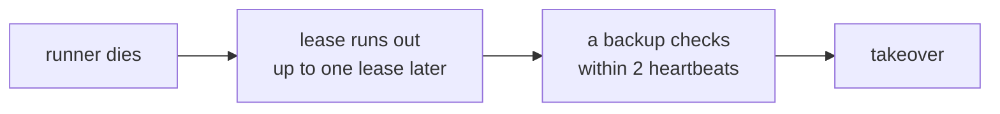

import { Tabs, TabItem } from '@astrojs/starlight/components';

The scheduler takes one options object: `new Scheduler({ ... })` in Node.js, `new Scheduler(new SchedulerOptions { ... })` in .NET, or `AddAnarchon(options => ...)` with a .NET host. One thing in it is required: where runs are stored, the backend. No store is assumed, so a scheduler without one throws. Everything else is optional.

Give every instance of a service the same options, apart from the instance ID.

## Where runs are stored

The backend (`backend`, `Backend`) is the store: a `RedisBackend` for Redis and Valkey, or any other backend.

<Tabs syncKey="language">
<TabItem label="Node.js">

```ts
import { PostgresBackend, RedisBackend, Scheduler, SqliteBackend } from 'anarchon';

new Scheduler({ backend: new RedisBackend({ redis: 'redis://localhost:6379' }) });
new Scheduler({ backend: new RedisBackend({ redis: process.env.REDIS_URL }) });             // rediss:// for TLS; user, password and database go in the URL
new Scheduler({ backend: new RedisBackend({ redis: { host: 'localhost', port: 6390 } }) });  // Valkey works the same
new Scheduler({ backend: new RedisBackend({ redis: existingIoredisClient }) });              // your client; stop() leaves it open
new Scheduler({ backend: new PostgresBackend({ connection: process.env.DATABASE_URL }) });
new Scheduler({ backend: new SqliteBackend({ database: './jobs.db' }) });
```

</TabItem>
<TabItem label=".NET">

```csharp
using Anarchon;
using Anarchon.Postgres;
using Anarchon.Redis;
using Anarchon.Sqlite;

new Scheduler(new SchedulerOptions { Backend = new RedisBackend("localhost:6379") });
new Scheduler(new SchedulerOptions { Backend = new RedisBackend("cache:6380,password=...,ssl=true") });    // a StackExchange.Redis configuration string
new Scheduler(new SchedulerOptions { Backend = new RedisBackend("localhost:6390") });                      // Valkey works the same
new Scheduler(new SchedulerOptions { Backend = new RedisBackend(new RedisBackendOptions { Connection = existingMultiplexer }) }); // yours; stop leaves it open
new Scheduler(new SchedulerOptions { Backend = new PostgresBackend(connectionString) });                   // an Npgsql connection string
new Scheduler(new SchedulerOptions { Backend = new SqliteBackend("Data Source=jobs.db") });
```

</TabItem>
</Tabs>

The Redis connection, strategy and key prefix are options of the backend: see [Redis and Valkey](../../backends/redis/).

## Identity

### `instanceId`, `InstanceId`

The name of this instance in history and events. The default is `hostname:pid`.

It must differ between instances, or history can't tell them apart. A pod name reads better than a process id:

<Tabs syncKey="language">
<TabItem label="Node.js">

```ts
new Scheduler({ backend, instanceId: process.env.POD_NAME });                              // Kubernetes: 'billing-7d9f8c-x2x4q'
new Scheduler({ backend, instanceId: `${os.hostname()}-${process.env.pm_id}` });           // PM2 cluster: one per process
new Scheduler({ backend, instanceId: process.env.HOSTNAME });                              // Docker: the container id
```

</TabItem>
<TabItem label=".NET">

```csharp
new Scheduler(new SchedulerOptions { Backend = backend, InstanceId = Environment.GetEnvironmentVariable("POD_NAME") }); // Kubernetes: "billing-7d9f8c-x2x4q"
new Scheduler(new SchedulerOptions { Backend = backend, InstanceId = Environment.MachineName });                        // Docker: the container id
```

</TabItem>
</Tabs>

Use it to answer "which instance ran this?" in history, logs and metrics. Two instances with the same id still work, but their history is indistinguishable.

## Defaults for every job

These set the default of the [job option](../job-options/) with the same name. A job can still override each one.

| Node.js | .NET | Default | Meaning |
| --- | --- | --- | --- |
| `jitterMs` | `Jitter` | 2 s | Maximum random delay before claiming. Lowered automatically for short intervals |
| `maxLateMs` | `MaxLate` | 60 s | Skip a run this instance reaches later than this |
| `historySize` | `HistorySize` | `1000` | Runs kept per job |
| `historyTtlMs` | `HistoryTtl` | none | Also drop history older than this |
| `timezone` | `TimeZone` | the server's | Time zone for cron expressions |

<Tabs syncKey="language">
<TabItem label="Node.js">

```ts
new Scheduler({
  backend,
  timezone: 'Europe/Athens',
  historySize: 200,
  historyTtlMs: 7 * 24 * 60 * 60_000, // one week
});
```

</TabItem>
<TabItem label=".NET">

```csharp
new Scheduler(new SchedulerOptions
{
    Backend = backend,
    TimeZone = TimeZoneInfo.FindSystemTimeZoneById("Europe/Athens"),
    HistorySize = 200,
    HistoryTtl = TimeSpan.FromDays(7), // one week
});
```

</TabItem>
</Tabs>

Different services want different defaults:

<Tabs syncKey="language">
<TabItem label="Node.js">

```ts
// A service for one country: cron times are local times
new Scheduler({ backend, timezone: 'Europe/Athens' });

// A global service: cron in UTC, and each job that is local to a region sets its own zone
const scheduler = new Scheduler({ backend, timezone: 'UTC' });
scheduler.cron('eu-digest', '0 8 * * *', euDigest, { timezone: 'Europe/Berlin' });

// Many cheap jobs: smaller history, and runs dropped quickly when an instance falls behind
new Scheduler({ backend, historySize: 100, maxLateMs: 10_000, jitterMs: 500 });

// Audited jobs: a year of history by age
new Scheduler({ backend, historySize: 5_000, historyTtlMs: 365 * 24 * 60 * 60_000 });
```

</TabItem>
<TabItem label=".NET">

```csharp
// A service for one country: cron times are local times
new Scheduler(new SchedulerOptions { Backend = backend, TimeZone = TimeZoneInfo.FindSystemTimeZoneById("Europe/Athens") });

// A global service: cron in UTC, and each job that is local to a region sets its own zone
var scheduler = new Scheduler(new SchedulerOptions { Backend = backend, TimeZone = TimeZoneInfo.Utc });
scheduler.Cron("eu-digest", "0 8 * * *", EuDigestAsync, new() { TimeZone = TimeZoneInfo.FindSystemTimeZoneById("Europe/Berlin") });

// Many cheap jobs: smaller history, and runs dropped quickly when an instance falls behind
new Scheduler(new SchedulerOptions { Backend = backend, HistorySize = 100, MaxLate = TimeSpan.FromSeconds(10), Jitter = TimeSpan.FromMilliseconds(500) });

// Audited jobs: a year of history by age
new Scheduler(new SchedulerOptions { Backend = backend, HistorySize = 5_000, HistoryTtl = TimeSpan.FromDays(365) });
```

</TabItem>
</Tabs>

:::tip
Always set the time zone if you use cron jobs. The default is the server's local zone, which can differ between your laptop, your CI and production.
:::

## Name and data

| Node.js | .NET | Default | Meaning |
| --- | --- | --- | --- |
| `name` | `AddAnarchon(name)` | none | A name for the scheduler. In Node.js it is unique in the process, and decorated jobs choose a scheduler by it ([Decorators](../decorators/#choosing-a-scheduler-for-a-job)). In .NET a named scheduler is a keyed service ([Hosting](../../reference/dotnet/hosting/)) |
| `data` | `Data` | none | Data for the runs of every job, read in the handler as `ctx.data` (`ctx.Data`): a value, or a function (`JobDataProvider`) called when a run starts. See [Run data](../run-data/) |

<Tabs syncKey="language">
<TabItem label="Node.js">

```ts
// Two schedulers in one process: decorated jobs pick one by name
new Scheduler({ name: 'billing', backend: new PostgresBackend({ connection: billingPool }) });
new Scheduler({ name: 'reports', backend: new RedisBackend({ redis: process.env.REDIS_URL, prefix: 'reports:cron:' }) });

// Shared dependencies for every handler, without globals
new Scheduler({ backend, data: { db, mailer, environment: process.env.APP_ENV } });

// Data read when each run starts: a feature flag as it is now
new Scheduler({ backend, data: async () => ({ dryRun: await flags.isOn('jobs-dry-run') }) });
```

</TabItem>
<TabItem label=".NET">

```csharp
// Two schedulers in one app: the default one, and "reports" as a keyed service
builder.Services.AddAnarchon().UsePostgres(billingConnectionString);
builder.Services.AddAnarchon("reports", options => options.TimeZone = TimeZoneInfo.Utc)
    .UseRedis(options => { options.Configuration = redisUrl; options.Prefix = "reports:cron:"; });
// ... public sealed class ReportsApi([FromKeyedServices("reports")] Scheduler reports)

// Data for every handler (with a host, prefer services: AddJobs<T>() gives each run a scope)
new Scheduler(new SchedulerOptions { Backend = backend, Data = new Dictionary<string, object?> { ["environment"] = appEnvironment } });

// Data read when each run starts: a feature flag as it is now
new Scheduler(new SchedulerOptions
{
    Backend = backend,
    Data = new JobDataProvider(async _ => new Dictionary<string, object?> { ["dryRun"] = await flags.IsOnAsync("jobs-dry-run") }),
});
```

</TabItem>
</Tabs>

## Lease timing

*Lease backends only.* With RabbitMQ, or NATS, Redis or Valkey without their lease strategy, the scheduler refuses the lease and the heartbeat: in TypeScript they don't compile, and when set anyway the scheduler throws (in .NET, an `AnarchonException` of code `Unsupported`).

| Node.js | .NET | Default | Meaning |
| --- | --- | --- | --- |
| `leaseMs` | `Lease` | 30 s | How long a running job's lease lasts without a heartbeat |
| `heartbeatMs` | `Heartbeat` | 5 s, or a sixth of the lease if smaller | How often the runner renews its lease, and how often backups check on it (every 1 to 2 heartbeats) |

The heartbeat must be under half of the lease, so a lease is renewed at least twice before it can run out.

These two numbers decide how quickly a dead runner is replaced:



So a crashed run is taken over at most one lease plus two heartbeats after the runner's last heartbeat. With the defaults that is 40 seconds.

| Goal | Setting | Trade-off |
| --- | --- | --- |
| Faster failover | 6 s lease, 1 s heartbeat | More heartbeat traffic. A pause longer than 6 s (a long GC, a brief network drop) causes a takeover while the original runner is still alive |
| Tolerate long pauses | 2 min lease | A really dead runner is replaced only after 2 minutes |

<Tabs syncKey="language">
<TabItem label="Node.js">

```ts
new Scheduler({ backend, leaseMs: 10_000, heartbeatMs: 2_000 }); // a dead runner is replaced within about 14 s
new Scheduler({ backend, leaseMs: 60_000 });                     // jobs that block the event loop for seconds at a time
new Scheduler({ backend, leaseMs: 6_000, heartbeatMs: 1_000 });  // short jobs where a quick takeover matters most
```

</TabItem>
<TabItem label=".NET">

```csharp
new Scheduler(new SchedulerOptions { Backend = backend, Lease = TimeSpan.FromSeconds(10), Heartbeat = TimeSpan.FromSeconds(2) }); // a dead runner is replaced within about 14 s
new Scheduler(new SchedulerOptions { Backend = backend, Lease = TimeSpan.FromMinutes(1) });                                           // a store far away, long GC pauses
new Scheduler(new SchedulerOptions { Backend = backend, Lease = TimeSpan.FromSeconds(6), Heartbeat = TimeSpan.FromSeconds(1) });   // short jobs where a quick takeover matters most
```

</TabItem>
</Tabs>

Raise the lease when a healthy runner can go quiet for a while: CPU-heavy handlers that block the Node.js event loop or starve the .NET thread pool, a store far away, a debugger. Lower it when a dead runner must be replaced fast and pauses are rare.

[Leases](../../internals/leases/) explains the mechanism.

## Logging

<Tabs syncKey="language">
<TabItem label="Node.js">

| Option | Default | Meaning |
| --- | --- | --- |
| `log` | `false` | Write one line per start, finish, failure, interruption, skip and lost run |
| `logger` | `console` | Where those lines, and errors nobody listens for, are written |

```ts
import pino from 'pino';

new Scheduler({ backend, log: true, logger: pino() });
new Scheduler({ backend, log: true, logger: pino().child({ component: 'scheduler' }) });     // tagged lines
new Scheduler({ backend, logger: winston.createLogger({ transports: [new winston.transports.Console()] }) }); // errors only
new Scheduler({ backend, log: process.env.NODE_ENV !== 'production' });                    // run lines in development only
```

A logger needs `warn` and `error`. `info` is optional; without it, run messages go to `console.log`.

</TabItem>
<TabItem label=".NET">

The scheduler logs through `ILoggerFactory` (`LoggerFactory`), under the category `Anarchon.Scheduler`: each run at Debug, failed and lost runs at Warning, errors nobody handles at Error. With a host, `AddAnarchon()` uses the host's factory, so the usual configuration applies.

```csharp
using var logging = LoggerFactory.Create(builder => builder.AddConsole().AddFilter("Anarchon", LogLevel.Debug));
new Scheduler(new SchedulerOptions { Backend = backend, LoggerFactory = logging });
```

```json
{ "Logging": { "LogLevel": { "Anarchon": "Debug" } } }
```

</TabItem>
</Tabs>

See [Events and logging](../events-and-logging/).

## Process behavior

### `unrefTimers` (Node.js)

By default the scheduler's timers keep the Node process alive, which is what a service wants. Set `unrefTimers: true` to let the process exit even while runs are scheduled. This is useful in scripts and tests.

```ts
new Scheduler({ backend, unrefTimers: true });
```

```ts
// A one-shot script: run the job once now, then let the process exit by itself
const scheduler = new Scheduler({ backend, unrefTimers: true });
scheduler.every('backfill', '1d', backfill);
await scheduler.start();
await scheduler.runNow('backfill');
await scheduler.stop();
```

In .NET, timers never keep a process alive: the process ends when `Main` returns or the host stops.

### `StopTimeout` (.NET)

How long `StopAsync()` waits for running jobs before it returns and leaves them behind (their lease then runs out and a backup takes over). Default 30 seconds. With a host, keep it under the host's shutdown timeout (`HostOptions.ShutdownTimeout`, also 30 seconds by default). In Node.js it is `stop({ timeoutMs })`: see [Lifecycle](../lifecycle/).

```csharp
new Scheduler(new SchedulerOptions { Backend = backend, StopTimeout = TimeSpan.FromSeconds(20) }); // within a 30 s grace period
```

### `TimeProvider` (.NET)

The clock and timers the scheduler uses; default `TimeProvider.System`. Tests can pass a `FakeTimeProvider` to move time by hand.

## Setups by environment

Complete setups for common places a service runs. Every instance of the service uses the same one.

### Production on Kubernetes, with Redis

<Tabs syncKey="language">
<TabItem label="Node.js">

```ts
import pino from 'pino';
import { RedisBackend, Scheduler } from 'anarchon';

export const scheduler = new Scheduler({
  backend: new RedisBackend({ redis: process.env.REDIS_URL, prefix: 'billing:cron:' }), // this service's own keys
  instanceId: process.env.POD_NAME, // readable names in history
  timezone: 'Europe/Athens',
  logger: pino(),
  log: true,
});
// On SIGTERM: await scheduler.stop({ timeoutMs: 20_000 }), within the pod's grace period
```

</TabItem>
<TabItem label=".NET">

```csharp
builder.Services
    .AddAnarchon(options =>
    {
        options.InstanceId = Environment.GetEnvironmentVariable("POD_NAME"); // readable names in history
        options.TimeZone = TimeZoneInfo.FindSystemTimeZoneById("Europe/Athens");
        options.StopTimeout = TimeSpan.FromSeconds(20);                     // within the pod's grace period
    })
    .UseRedis(options =>
    {
        options.Configuration = builder.Configuration.GetConnectionString("redis");
        options.Prefix = "billing:cron:"; // this service's own keys
    });
// The host stops the scheduler on SIGTERM; logs go to the host's loggers
```

</TabItem>
</Tabs>

### Production with PostgreSQL, next to the app's data

<Tabs syncKey="language">
<TabItem label="Node.js">

```ts
export const scheduler = new Scheduler({
  backend: new PostgresBackend({ connection: pool, table: 'scheduler.runs' }), // the app's pool; tables in their own schema
  instanceId: process.env.HOSTNAME,
  timezone: 'UTC',
  historyTtlMs: 90 * 24 * 60 * 60_000, // 90 days of history, queryable with SQL
});
```

</TabItem>
<TabItem label=".NET">

```csharp
builder.Services.AddNpgsqlDataSource(builder.Configuration.GetConnectionString("postgres")!);
builder.Services
    .AddAnarchon(options =>
    {
        options.TimeZone = TimeZoneInfo.Utc;
        options.HistoryTtl = TimeSpan.FromDays(90); // 90 days of history, queryable with SQL
    })
    .UsePostgres((services, options) =>
    {
        options.DataSource = services.GetRequiredService<NpgsqlDataSource>(); // the app's pool
        options.Table = "scheduler.runs";                                     // tables in their own schema
    });
```

</TabItem>
</Tabs>

### One machine, several processes, with SQLite

<Tabs syncKey="language">
<TabItem label="Node.js">

```ts
export const scheduler = new Scheduler({
  backend: new SqliteBackend({ database: '/var/lib/app/jobs.db', busyTimeoutMs: 10_000 }),
  instanceId: `${os.hostname()}-${process.env.pm_id ?? process.pid}`,
  timezone: 'Europe/Athens',
});
```

</TabItem>
<TabItem label=".NET">

```csharp
var scheduler = new Scheduler(new SchedulerOptions
{
    Backend = new SqliteBackend("Data Source=/var/lib/app/jobs.db;Default Timeout=10"), // waits up to 10 s for another process's write
    TimeZone = TimeZoneInfo.FindSystemTimeZoneById("Europe/Athens"),
});
```

</TabItem>
</Tabs>

### A stack with only RabbitMQ or NATS

<Tabs syncKey="language">
<TabItem label="Node.js">

```ts
export const scheduler = new Scheduler({
  backend: new NatsBackend({ servers: process.env.NATS_URL, replicas: 3 }),
  instanceId: process.env.POD_NAME,
  maxLateMs: 60_000, // under duplicateWindowMs (5 min by default)
  historySize: 200,  // history is kept by count only
  // no leaseMs or heartbeatMs: the default 'msg-id' strategy has no leases
});
```

</TabItem>
<TabItem label=".NET">

```csharp
var scheduler = new Scheduler(new SchedulerOptions
{
    Backend = new NatsBackend(new NatsBackendOptions { ConnectionString = natsUrl, Replicas = 3 }),
    InstanceId = Environment.GetEnvironmentVariable("POD_NAME"),
    MaxLate = TimeSpan.FromMinutes(1), // under DuplicateWindow (5 min by default)
    HistorySize = 200,                 // history is kept by count only
    // no Lease or Heartbeat: the default MsgId strategy has no leases
});
```

</TabItem>
</Tabs>

With NATS, the lease strategy gives the full feature set, and takes the lease and the heartbeat:

<Tabs syncKey="language">
<TabItem label="Node.js">

```ts
export const scheduler = new Scheduler({
  backend: new NatsBackend({ servers: process.env.NATS_URL, replicas: 3, strategy: 'lease' }),
  instanceId: process.env.POD_NAME,
  leaseMs: 30_000,
  historySize: 200, // history is kept by count only
});
```

</TabItem>
<TabItem label=".NET">

```csharp
var scheduler = new Scheduler(new SchedulerOptions
{
    Backend = new NatsBackend(new NatsBackendOptions { ConnectionString = natsUrl, Replicas = 3, Strategy = NatsStrategy.Lease }),
    InstanceId = Environment.GetEnvironmentVariable("POD_NAME"),
    Lease = TimeSpan.FromSeconds(30),
    HistorySize = 200, // history is kept by count only
});
```

</TabItem>
</Tabs>

### Local development

<Tabs syncKey="language">
<TabItem label="Node.js">

```ts
export const scheduler = new Scheduler({
  backend: new SqliteBackend({ database: './dev-jobs.db' }), // no server to run
  timezone: 'Europe/Athens',
  log: true,                      // one line per run in the terminal
  leaseMs: 10 * 60_000,           // a breakpoint doesn't make a backup take the run over
});
```

</TabItem>
<TabItem label=".NET">

```csharp
var scheduler = new Scheduler(new SchedulerOptions
{
    Backend = new SqliteBackend("Data Source=dev-jobs.db"), // no server to run
    TimeZone = TimeZoneInfo.FindSystemTimeZoneById("Europe/Athens"),
    LoggerFactory = logging,                                // with "Anarchon" at Debug: one line per run
    Lease = TimeSpan.FromMinutes(10),                       // a breakpoint doesn't make a backup take the run over
});
```

</TabItem>
</Tabs>

### Tests

<Tabs syncKey="language">
<TabItem label="Node.js">

```ts
const scheduler = new Scheduler({
  backend: new SqliteBackend({ database: ':memory:' }),
  unrefTimers: true, // the test runner can exit
  jitterMs: 0,       // runs start on time
});
afterEach(() => scheduler.stop());
```

</TabItem>
<TabItem label=".NET">

```csharp
await using var scheduler = new Scheduler(new SchedulerOptions
{
    Backend = new SqliteBackend($"Data Source={Path.Combine(Path.GetTempPath(), $"jobs-{Guid.NewGuid():N}.db")}"), // a file per test
    Jitter = TimeSpan.Zero,                                                                                           // runs start on time
    TimeProvider = fakeTime, // optional: Microsoft.Extensions.TimeProvider.Testing's FakeTimeProvider
});
```

</TabItem>
</Tabs>

The examples folders have runnable setups for real situations: [Node.js](https://github.com/aristoteliss/anarchon/tree/main/examples) (`billing.ts`, `cache-refresh.ts`, `nightly-export.ts`, `tenants.ts`, `broker-notifications.ts`) and [.NET](https://github.com/aristoteliss/anarchon-dotnet/tree/main/examples) (`Billing`, `CacheRefresh`, `NightlyExport`, `Tenants`, `BrokerNotifications`).

## What throws

The constructor validates its options and throws at once, so a bad setting can't reach production silently:

| Problem | Node.js | .NET |
| --- | --- | --- |
| No backend | `TypeError` | `ArgumentException` |
| The instance ID is an empty string | `TypeError` | `ArgumentException` |
| A number or duration is negative, or zero where not allowed | `RangeError` | `ArgumentOutOfRangeException` |
| The heartbeat is not under half of the lease | `RangeError` | `ArgumentOutOfRangeException` |
| A lease or heartbeat with a backend that has no leases | `TypeError` | `AnarchonException` (`Unsupported`) |

Nothing connects in the constructor. Connection problems appear when the scheduler starts.

## Next

- [Writing handlers](../writing-handlers/)
- [Lifecycle](../lifecycle/)
