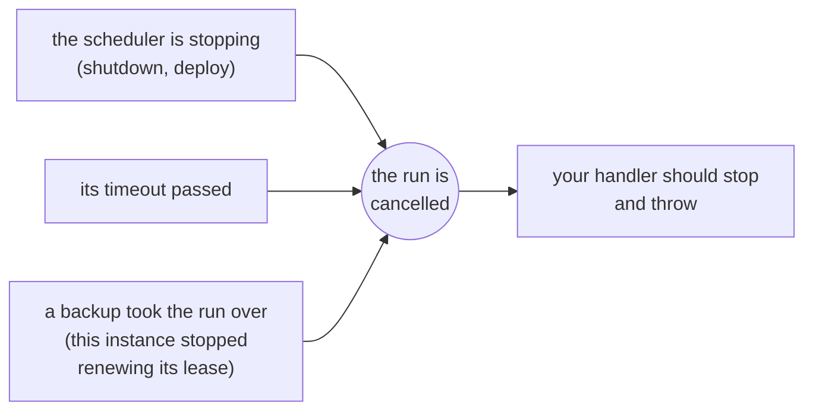

import { Tabs, TabItem } from '@astrojs/starlight/components';

The handler is the function a job runs. In Node.js it can be sync or async; in .NET it returns a `Task` (`Func<JobContext, Task>`).

<Tabs syncKey="language">
<TabItem label="Node.js">

```ts
scheduler.every('sync', '10s', async (ctx) => {
  await syncCustomers();
});
```

</TabItem>
<TabItem label=".NET">

```csharp
scheduler.Every("sync", TimeSpan.FromSeconds(10), async ctx =>
{
    await SyncCustomersAsync(ctx.CancellationToken);
});
```

</TabItem>
</Tabs>

How the handler ends decides how the run is recorded:

| The handler | The run is recorded as |
| --- | --- |
| Returns (any value) | success |
| Throws | failed, with the error message |
| Runs past its timeout | failed, with `TimeoutError` (`TimeoutException` in .NET) |
| Throws after a stop or a takeover cancelled the run (`ctx.signal`, `ctx.CancellationToken`) | interrupted (not a failure) |

## The context: `ctx`

Every handler receives one argument: the run's context (`JobContext` in both languages).

| Node.js | .NET | Meaning |
| --- | --- | --- |
| `name` | `Name` | The job's name |
| `slot` | `Slot` (`long`) | The scheduled time in ms since 1970. The same on every instance and every attempt |
| `scheduledAt` (`Date`) | `ScheduledAt` (`DateTimeOffset`) | The slot as a time. When the run was due, not when it started |
| `instanceId` | `InstanceId` | The instance running this (you) |
| `attempt` | `Attempt` | `1` for the first try; `2` or more when a backup took over |
| `reason` | `Reason` (`RunReason`) | Why this run started: scheduled, manual, catch-up or takeover |
| `manual` | `IsManual` | true when started with `runNow()`, `RunNowAsync()` |
| `signal` (`AbortSignal`) | `CancellationToken` | Fires when the run should stop |
| `data` | `Data`, `GetData<T>()` | The data you gave the scheduler, the job or the manual run. See [Run data](../run-data/) |

## Stopping when asked

The run's cancellation (`ctx.signal` aborts, `ctx.CancellationToken` is cancelled) fires in three situations:



anarchon can't stop your function from outside; neither JavaScript nor .NET has a way to do that. The signal or token is a request, and the handler has to honor it.

### In a loop

Check between units of work. `ctx.signal.throwIfAborted()` and `ctx.CancellationToken.ThrowIfCancellationRequested()` throw if the run was cancelled, and do nothing otherwise:

<Tabs syncKey="language">
<TabItem label="Node.js">

```ts
scheduler.every('export', '10m', async (ctx) => {
  for (const batch of await loadBatches()) {
    ctx.signal.throwIfAborted();
    await exportBatch(batch);
  }
});
```

</TabItem>
<TabItem label=".NET">

```csharp
scheduler.Every("export", TimeSpan.FromMinutes(10), async ctx =>
{
    foreach (var batch in await LoadBatchesAsync())
    {
        ctx.CancellationToken.ThrowIfCancellationRequested();
        await ExportBatchAsync(batch);
    }
});
```

</TabItem>
</Tabs>

### Passing it on

Many APIs accept a signal or a token and stop on their own:

<Tabs syncKey="language">
<TabItem label="Node.js">

```ts
scheduler.every('fetch-rates', '1m', async (ctx) => {
  const response = await fetch('https://rates.example.com/latest', { signal: ctx.signal });
  await saveRates(await response.json());
});
```

</TabItem>
<TabItem label=".NET">

```csharp
scheduler.Every("fetch-rates", TimeSpan.FromMinutes(1), async ctx =>
{
    var rates = await http.GetFromJsonAsync<Rates>("https://rates.example.com/latest", ctx.CancellationToken);
    await SaveRatesAsync(rates!, ctx.CancellationToken);
});
```

</TabItem>
</Tabs>

### Waiting

Waits take it too:

<Tabs syncKey="language">
<TabItem label="Node.js">

```ts
import { setTimeout as delay } from 'node:timers/promises';

await delay(5_000, undefined, { signal: ctx.signal }); // rejects as soon as the signal aborts
```

</TabItem>
<TabItem label=".NET">

```csharp
await Task.Delay(TimeSpan.FromSeconds(5), ctx.CancellationToken); // throws as soon as the run is cancelled
```

</TabItem>
</Tabs>

### Why throw, and not just return?

On a lease backend the difference matters:

- If the handler **throws** after a stop cancelled the run, the run is recorded as `interrupted` and **handed to another instance**, which starts it again as the next attempt.
- If the handler **returns**, the run counts as **finished**. Nobody continues it.

So: throw when the work isn't done, and return when it is.

<Tabs syncKey="language">
<TabItem label="Node.js">

```ts
scheduler.every('reindex', '1h', async (ctx) => {
  for (const page of pages) {
    if (ctx.signal.aborted) {
      await saveProgress(page);      // optional: leave a note for the next attempt
      ctx.signal.throwIfAborted();   // then hand the run over
    }
    await indexPage(page);
  }
});
```

</TabItem>
<TabItem label=".NET">

```csharp
scheduler.Every("reindex", TimeSpan.FromHours(1), async ctx =>
{
    foreach (var page in pages)
    {
        if (ctx.CancellationToken.IsCancellationRequested)
        {
            await SaveProgressAsync(page);                         // optional: leave a note for the next attempt
            ctx.CancellationToken.ThrowIfCancellationRequested();  // then hand the run over
        }

        await IndexPageAsync(page);
    }
});
```

</TabItem>
</Tabs>

## Make jobs safe to run twice

anarchon guarantees one winner per **attempt**, not one execution per run. A run can execute more than once:

- The runner crashes halfway. A backup starts the run again from the beginning.
- The runner freezes longer than its lease. A backup takes over, and when the frozen one wakes up it runs for a moment before it learns it lost the run.

The fix is to write jobs that are **idempotent**: running them twice has the same effect as running them once. The slot (`ctx.slot`, `ctx.Slot`) is the tool for that, because it is the same number on every attempt of the same run.

### Use the slot as a key

<Tabs syncKey="language">
<TabItem label="Node.js">

```ts
scheduler.cron('monthly-invoices', '0 6 1 * *', async (ctx) => {
  for (const customer of await customers()) {
    // The unique key (customer, period) makes a second attempt a no-op
    await db.query(
      `INSERT INTO invoices (customer_id, period, amount) VALUES ($1, $2, $3)
       ON CONFLICT (customer_id, period) DO NOTHING`,
      [customer.id, ctx.slot, await amountFor(customer)],
    );
  }
});
```

</TabItem>
<TabItem label=".NET">

```csharp
scheduler.Cron("monthly-invoices", "0 6 1 * *", async ctx =>
{
    foreach (var customer in await CustomersAsync())
    {
        // The unique key (customer, period) makes a second attempt a no-op
        await using var insert = dataSource.CreateCommand(
            "INSERT INTO invoices (customer_id, period, amount) VALUES ($1, $2, $3) ON CONFLICT (customer_id, period) DO NOTHING");
        insert.Parameters.AddWithValue(customer.Id);
        insert.Parameters.AddWithValue(ctx.Slot);
        insert.Parameters.AddWithValue(await AmountForAsync(customer));
        await insert.ExecuteNonQueryAsync(ctx.CancellationToken);
    }
});
```

</TabItem>
</Tabs>

### Use the slot as an idempotency key for other services

<Tabs syncKey="language">
<TabItem label="Node.js">

```ts
scheduler.every('payouts', '1h', async (ctx) => {
  await paymentProvider.createPayout(
    { amount, destination },
    { idempotencyKey: `payout-${ctx.slot}` },
  );
});
```

</TabItem>
<TabItem label=".NET">

```csharp
scheduler.Every("payouts", TimeSpan.FromHours(1), async ctx =>
{
    await paymentProvider.CreatePayoutAsync(new Payout(amount, destination), idempotencyKey: $"payout-{ctx.Slot}", ctx.CancellationToken);
});
```

</TabItem>
</Tabs>

### Work on a time window, not on "now"

A takeover can start minutes after the slot. If the job asks "what happened in the last hour" using the current time, a late attempt covers a different hour. Use the slot:

<Tabs syncKey="language">
<TabItem label="Node.js">

```ts
scheduler.every('hourly-rollup', '1h', async (ctx) => {
  const to = ctx.slot;
  const from = to - 60 * 60_000;
  await rollUp({ from, to }); // the same window on every attempt
});
```

</TabItem>
<TabItem label=".NET">

```csharp
scheduler.Every("hourly-rollup", TimeSpan.FromHours(1), async ctx =>
{
    var to = ctx.ScheduledAt;
    var from = to.AddHours(-1);
    await RollUpAsync(from, to, ctx.CancellationToken); // the same window on every attempt
});
```

</TabItem>
</Tabs>

A window tied to one slot gets done only if that slot runs, and a run can be skipped (see [Guarantees and limits](../../reference/guarantees/#that-every-slot-runs)). If every hour must be rolled up, have each run also do the earlier hours that are still missing:

<Tabs syncKey="language">
<TabItem label="Node.js">

```ts
scheduler.every('hourly-rollup', '1h', async (ctx) => {
  for (const hour of await hoursNotRolledUp({ before: ctx.slot })) {
    ctx.signal.throwIfAborted();
    await rollUp({ from: hour, to: hour + 60 * 60_000 });
  }
});
```

</TabItem>
<TabItem label=".NET">

```csharp
scheduler.Every("hourly-rollup", TimeSpan.FromHours(1), async ctx =>
{
    foreach (var hour in await HoursNotRolledUpAsync(before: ctx.ScheduledAt))
    {
        ctx.CancellationToken.ThrowIfCancellationRequested();
        await RollUpAsync(hour, hour.AddHours(1), ctx.CancellationToken);
    }
});
```

</TabItem>
</Tabs>

### Reject writes from an older attempt

An idempotent write makes a second attempt harmless when the attempts run one after the other. When they overlap (a frozen runner wakes up and writes before it learns that a backup took over), the older attempt can overwrite what the newer one wrote. On a lease backend, every attempt of a run has a higher attempt number than the one before, so the slot and the attempt together work as a fencing token: store the attempt with the row, and let a write apply only if its attempt isn't older.

<Tabs syncKey="language">
<TabItem label="Node.js">

```ts
scheduler.every('daily-totals', '1d', async (ctx) => {
  const total = await computeTotal(ctx.slot);
  await db.query(
    `INSERT INTO daily_totals (day, total, attempt) VALUES ($1, $2, $3)
     ON CONFLICT (day) DO UPDATE SET total = EXCLUDED.total, attempt = EXCLUDED.attempt
     WHERE daily_totals.attempt <= EXCLUDED.attempt`,
    [ctx.slot, total, ctx.attempt],
  );
});
```

</TabItem>
<TabItem label=".NET">

```csharp
scheduler.Every("daily-totals", TimeSpan.FromDays(1), async ctx =>
{
    var total = await ComputeTotalAsync(ctx.Slot);
    await using var upsert = dataSource.CreateCommand(
        """
        INSERT INTO daily_totals (day, total, attempt) VALUES ($1, $2, $3)
        ON CONFLICT (day) DO UPDATE SET total = EXCLUDED.total, attempt = EXCLUDED.attempt
        WHERE daily_totals.attempt <= EXCLUDED.attempt
        """);
    upsert.Parameters.AddWithValue(ctx.Slot);
    upsert.Parameters.AddWithValue(total);
    upsert.Parameters.AddWithValue(ctx.Attempt);
    await upsert.ExecuteNonQueryAsync(ctx.CancellationToken);
});
```

</TabItem>
</Tabs>

The same pair goes to another service as a version: reject a request whose `(slot, attempt)` is lower than one already seen. On a claim-only backend, the attempt is always 1 and nobody takes a run over, so there is nothing to fence.

## Knowing it's a retry

The attempt and the reason tell you that a previous attempt started and didn't finish:

<Tabs syncKey="language">
<TabItem label="Node.js">

```ts
scheduler.every('import', '30m', async (ctx) => {
  if (ctx.attempt > 1) {
    logger.warn(`import ${ctx.scheduledAt.toISOString()}: attempt ${ctx.attempt} after a ${ctx.reason}`);
    await cleanUpPartialImport(ctx.slot);
  }
  await runImport(ctx.slot);
});
```

</TabItem>
<TabItem label=".NET">

```csharp
scheduler.Every("import", TimeSpan.FromMinutes(30), async ctx =>
{
    if (ctx.Attempt > 1)
    {
        logger.LogWarning("import {Due:O}: attempt {Attempt} after a {Reason}", ctx.ScheduledAt, ctx.Attempt, ctx.Reason);
        await CleanUpPartialImportAsync(ctx.Slot);
    }

    await RunImportAsync(ctx.Slot);
});
```

</TabItem>
</Tabs>

## Errors

A handler that throws is recorded as failed. anarchon does **not** retry failed runs: the next run is the next scheduled slot.

If you want retries for errors, do them inside the handler:

<Tabs syncKey="language">
<TabItem label="Node.js">

```ts
scheduler.every('sync', '1m', async (ctx) => {
  for (let tries = 1; ; tries++) {
    try {
      return await syncCustomers({ signal: ctx.signal });
    } catch (error) {
      if (tries === 3 || ctx.signal.aborted) throw error;
      await delay(1_000 * tries, undefined, { signal: ctx.signal });
    }
  }
});
```

</TabItem>
<TabItem label=".NET">

```csharp
scheduler.Every("sync", TimeSpan.FromMinutes(1), async ctx =>
{
    for (var tries = 1; ; tries++)
    {
        try
        {
            await SyncCustomersAsync(ctx.CancellationToken);
            return;
        }
        catch (HttpRequestException) when (tries < 3 && !ctx.CancellationToken.IsCancellationRequested)
        {
            await Task.Delay(TimeSpan.FromSeconds(tries), ctx.CancellationToken);
        }
    }
});
```

</TabItem>
</Tabs>

To be told about failures, listen for the [failure event](../events-and-logging/) (`failure`, `Failed`).

## Long jobs

A job may run longer than its interval. With the default overlap (skip) the runs due meanwhile are skipped, so there is one at a time. For long jobs:

- Set a timeout, so a hung run can't block the job forever.
- Check the run's cancellation often, so shutdowns are quick.
- Keep the job idempotent, because a long job is more likely to be interrupted.

[Long-running jobs](../../recipes/long-running-jobs/) has a complete example with checkpoints.

## Next

- [Lifecycle](../lifecycle/): start, stop and graceful shutdown
- [Events and logging](../events-and-logging/)
