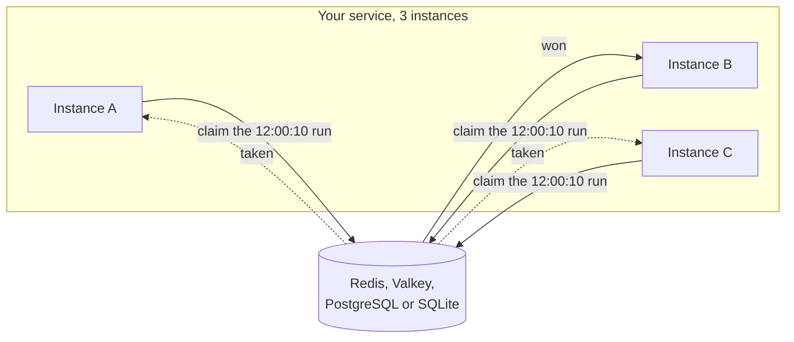

import { Card, CardGrid, LinkCard, Tabs, TabItem } from '@astrojs/starlight/components';

[](https://www.npmjs.com/package/anarchon)
[](https://www.npmjs.com/package/anarchon)
[](https://www.npmjs.com/package/anarchon)
[](https://github.com/aristoteliss/anarchon#license-and-commercial-use)

<Tabs syncKey="language">
<TabItem label="Node.js">

```ts
import { RedisBackend, Scheduler } from 'anarchon';

const scheduler = new Scheduler({ backend: new RedisBackend({ redis: 'redis://localhost:6379' }) });

scheduler
  .every('sync', '10s', async (ctx) => { /* ... */ })
  .cron('digest', '0 8 * * 1-5', async (ctx) => { /* ... */ }, { timezone: 'Europe/Athens' });

await scheduler.start();
```

</TabItem>
<TabItem label=".NET">

```csharp
using Anarchon;
using Anarchon.Redis;

await using var scheduler = new Scheduler(new SchedulerOptions { Backend = new RedisBackend("localhost:6379") });

scheduler
    .Every("sync", TimeSpan.FromSeconds(10), async ctx => { /* ... */ })
    .Cron("digest", "0 8 * * 1-5", async ctx => { /* ... */ }, new() { TimeZone = TimeZoneInfo.FindSystemTimeZoneById("Europe/Athens") });

await scheduler.StartAsync();
```

</TabItem>
</Tabs>

Run that code in three instances, and one instance runs "sync" every 10 seconds, not all three.
The Node.js package (`anarchon` on npm) and the .NET package (`Anarchon` on NuGet) share the
algorithm and the stored data, so Node.js and .NET instances can even share jobs. Pick your
language in any code tab; every page follows.



<CardGrid>
  <Card title="No leader election" icon="random">
    Nothing is elected. One atomic call to the store decides who runs each time, and a random delay
    spreads the work across instances.
  </Card>
  <Card title="Recovery after a runner fails" icon="warning">
    On Redis, Valkey, PostgreSQL and SQLite the winner renews a lease while the job runs. If it dies
    or freezes, another instance starts the run again as a new attempt, so handlers must tolerate
    retries. NATS does too with its `lease` strategy. RabbitMQ, and NATS by default, only select
    the winner.
  </Card>
  <Card title="Long jobs don't pile up" icon="seti:clock">
    On lease backends, the next run of a job is skipped while the current one holds a live lease. A
    frozen runner can briefly overlap the instance that replaced it.
  </Card>
  <Card title="Catch-up after downtime" icon="rocket">
    On lease backends, the latest run that was due while every instance was down runs when the first
    one comes back, if it was due within the catch-up window (`catchUpMs` in Node.js, `CatchUp` in .NET; 5 minutes by default). Older runs are not replayed.
  </Card>
</CardGrid>

anarchon does not guarantee exactly-once side effects. [Guarantees and limits](reference/guarantees/) states what is promised on each backend.

## Where to go next

<CardGrid>
  <LinkCard title="Introduction" description="The problem, in plain words, and how anarchon solves it." href="getting-started/introduction/" />
  <LinkCard title="Quick start" description="A working scheduler in five minutes, with no server to install." href="getting-started/quick-start/" />
  <LinkCard title="Guides" description="Every option, method and lifecycle step, with examples." href="guides/defining-jobs/" />
  <LinkCard title="Decorators (Node.js)" description="Declare jobs with @Every, @Cron and @At on the methods of a class." href="guides/decorators/" />
  <LinkCard title="Attributes (.NET)" description="Declare jobs with [Every], [Cron] and [At], and add them with AddJobs<T>()." href="guides/attributes/" />
  <LinkCard title="How it works" description="The claim and lease algorithms, step by step, with diagrams." href="internals/architecture/" />
  <LinkCard title="Backends" description="Redis, Valkey, PostgreSQL, SQLite, RabbitMQ and NATS." href="backends/overview/" />
  <LinkCard title="Recipes" description="Express, NestJS, ASP.NET Core, worker services, Kubernetes, long jobs." href="recipes/express/" />
  <LinkCard title=".NET reference" description="The Scheduler, its options, attributes, events, hosting and errors in .NET." href="reference/dotnet/scheduler/" />
</CardGrid>
