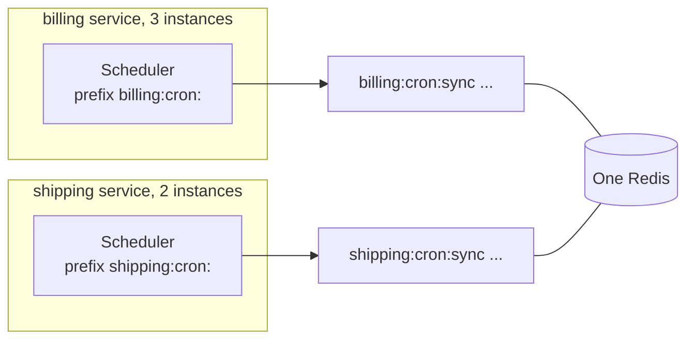

import { Tabs, TabItem } from '@astrojs/starlight/components';

Two services that share a Redis or a database must not see each other's jobs. If both have a job called `sync` under the same namespace, they compete for the same runs, and each run happens in only one of the two services.

The fix is a **namespace** per group of instances that should share jobs.



## The option, per backend

| Backend | Option | Default |
| --- | --- | --- |
| Redis / Valkey | `prefix` | `'cron:'` |
| PostgreSQL / SQLite | `table` | `'anarchon_runs'` |
| RabbitMQ | `prefix` | `'cron.'` |
| NATS | `prefix`, `stream` | `'cron.'`, `'CRON'` |

In .NET the options are `Prefix`, `Table` and `Stream`, with the same defaults.

The rule: instances that should **share** jobs use the same value, and everything else uses a different one.

## Per service

<Tabs syncKey="language">
<TabItem label="Node.js">

```ts
// billing
new Scheduler({ backend: new RedisBackend({ redis: process.env.REDIS_URL, prefix: 'billing:cron:' }) });

// shipping
new Scheduler({ backend: new RedisBackend({ redis: process.env.REDIS_URL, prefix: 'shipping:cron:' }) });
```

</TabItem>
<TabItem label=".NET">

```csharp
// billing
builder.Services.AddAnarchon().UseRedis(options =>
{
    options.Configuration = builder.Configuration.GetConnectionString("redis");
    options.Prefix = "billing:cron:";
});

// shipping
builder.Services.AddAnarchon().UseRedis(options =>
{
    options.Configuration = builder.Configuration.GetConnectionString("redis");
    options.Prefix = "shipping:cron:";
});
```

</TabItem>
</Tabs>

<Tabs syncKey="language">
<TabItem label="Node.js">

```ts
// PostgreSQL: a table per service, or a schema
new PostgresBackend({ connection: pool, table: 'billing_cron_runs' });
new PostgresBackend({ connection: pool, table: 'shipping.cron_runs' });
```

</TabItem>
<TabItem label=".NET">

```csharp
// PostgreSQL: a table per service, or a schema
new PostgresBackend(new PostgresBackendOptions { DataSource = dataSource, Table = "billing_cron_runs" });
new PostgresBackend(new PostgresBackendOptions { DataSource = dataSource, Table = "shipping.cron_runs" });
```

</TabItem>
</Tabs>

## Per environment

Staging and production should not share a store at all. When they must (a shared development Redis, for example), put the environment in the namespace:

<Tabs syncKey="language">
<TabItem label="Node.js">

```ts
new Scheduler({
  backend: new RedisBackend({
    redis: process.env.REDIS_URL,
    prefix: `${process.env.APP_ENV}:billing:cron:`, // staging:billing:cron:
  }),
});
```

</TabItem>
<TabItem label=".NET">

```csharp
builder.Services.AddAnarchon().UseRedis(options =>
{
    options.Configuration = builder.Configuration.GetConnectionString("redis");
    options.Prefix = $"{builder.Environment.EnvironmentName.ToLowerInvariant()}:billing:cron:"; // staging:billing:cron:
});
```

</TabItem>
</Tabs>

Without this, a developer's laptop pointed at the shared Redis takes runs away from staging.

## Per tenant

When each tenant should have its own run of a job, there are two designs.

### One job, looping over tenants

Simplest, and enough for most cases:

<Tabs syncKey="language">
<TabItem label="Node.js">

```ts
scheduler.every('tenant-reports', '1h', async (ctx) => {
  for (const tenant of await tenants()) {
    ctx.signal.throwIfAborted();
    await buildReport(tenant, ctx.slot);
  }
});
```

</TabItem>
<TabItem label=".NET">

```csharp
scheduler.Every("tenant-reports", TimeSpan.FromHours(1), async ctx =>
{
    foreach (var tenant in await TenantsAsync(ctx.CancellationToken))
    {
        await BuildReportAsync(tenant, ctx.Slot, ctx.CancellationToken);
    }
});
```

</TabItem>
</Tabs>

One instance handles all tenants for that hour.

### One job per tenant

Each tenant's job is claimed separately, so the work spreads across instances and one slow tenant doesn't delay the others:

<Tabs syncKey="language">
<TabItem label="Node.js">

```ts
for (const tenant of await tenants()) {
  scheduler.every(`report-${tenant.id}`, '1h', (ctx) => buildReport(tenant, ctx.slot));
}
```

</TabItem>
<TabItem label=".NET">

```csharp
foreach (var tenant in await TenantsAsync())
{
    scheduler.Every($"report-{tenant.Id}", TimeSpan.FromHours(1), ctx => BuildReportAsync(tenant, ctx.Slot, ctx.CancellationToken));
}
```

</TabItem>
</Tabs>

Every instance must register the same set of jobs. When tenants are added at run time, each instance has to learn about it: reload the tenant list periodically and call `every()` for new ones and `remove()` for deleted ones (`Every()` and `Remove()` in .NET).

<Tabs syncKey="language">
<TabItem label="Node.js">

```ts
async function syncTenantJobs() {
  const wanted = new Set((await tenants()).map((t) => `report-${t.id}`));
  const have = new Set(scheduler.jobs().map((j) => j.name).filter((n) => n.startsWith('report-')));

  for (const name of wanted) {
    if (!have.has(name)) scheduler.every(name, '1h', (ctx) => buildReport(name.slice('report-'.length), ctx.slot));
  }
  for (const name of have) {
    if (!wanted.has(name)) scheduler.remove(name);
  }
}

setInterval(syncTenantJobs, 60_000);
```

</TabItem>
<TabItem label=".NET">

```csharp
async Task SyncTenantJobsAsync(CancellationToken cancellationToken)
{
    var wanted = (await TenantsAsync(cancellationToken)).Select(t => $"report-{t.Id}").ToHashSet();
    var have = scheduler.GetJobs().Select(j => j.Name).Where(n => n.StartsWith("report-", StringComparison.Ordinal)).ToHashSet();

    foreach (var name in wanted.Except(have))
    {
        scheduler.Every(name, TimeSpan.FromHours(1), ctx => BuildReportAsync(name["report-".Length..], ctx.Slot, ctx.CancellationToken));
    }
    foreach (var name in have.Except(wanted))
    {
        scheduler.Remove(name);
    }
}

using var timer = new PeriodicTimer(TimeSpan.FromMinutes(1));
while (await timer.WaitForNextTickAsync(stoppingToken)) await SyncTenantJobsAsync(stoppingToken);
```

</TabItem>
</Tabs>

The [`Tenants` example](https://github.com/aristoteliss/anarchon-dotnet/tree/main/examples/Tenants) does this in .NET.

Each job has its own keys or rows, so thousands of tenant jobs mean thousands of small entries. That is fine on Redis and PostgreSQL. With RabbitMQ, which creates a queue per run, prefer the looping design.

## Several schedulers in one process

One process can hold more than one scheduler, for example one per store, or one per group of jobs with different lease timings:

<Tabs syncKey="language">
<TabItem label="Node.js">

```ts
const fast = new Scheduler({ backend: new RedisBackend({ redis, prefix: 'app:fast:' }), leaseMs: 6_000, heartbeatMs: 1_000 });
const slow = new Scheduler({ backend: new RedisBackend({ redis, prefix: 'app:slow:' }), leaseMs: 120_000 });

fast.every('refresh-cache', '5s', refresh);
slow.cron('rebuild-index', '0 2 * * *', rebuild, { timeoutMs: 2 * 60 * 60_000 });

await Promise.all([fast.start(), slow.start()]);
```

</TabItem>
<TabItem label=".NET">

```csharp
// Named schedulers: each is a keyed service, started and stopped by the host.
builder.Services.AddAnarchon("fast", options => (options.Lease, options.Heartbeat) = (TimeSpan.FromSeconds(6), TimeSpan.FromSeconds(1)))
    .UseRedis(options => (options.Connection, options.Prefix) = (redis, "app:fast:"))
    .AddJobs<CacheJobs>();      // [Every("5s", Name = "refresh-cache")]
builder.Services.AddAnarchon("slow", options => options.Lease = TimeSpan.FromMinutes(2))
    .UseRedis(options => (options.Connection, options.Prefix) = (redis, "app:slow:"))
    .AddJobs<IndexJobs>();      // [Cron("0 2 * * *", Name = "rebuild-index", Timeout = "2h")]

// Elsewhere: [FromKeyedServices("slow")] Scheduler slow
```

</TabItem>
</Tabs>

Give them different prefixes, and stop both on shutdown (a .NET host stops both).

## Reading across services

A dashboard can read every service's history by creating one reader per namespace:

<Tabs syncKey="language">
<TabItem label="Node.js">

```ts
const readers = {
  billing: new Scheduler({ backend: new RedisBackend({ redis, prefix: 'billing:cron:' }) }),
  shipping: new Scheduler({ backend: new RedisBackend({ redis, prefix: 'shipping:cron:' }) }),
};

app.get('/:service/jobs/:name/runs', async (req, res) => {
  const reader = readers[req.params.service as keyof typeof readers];
  if (!reader) return res.status(404).end();
  res.json(await reader.history(req.params.name, 20));
});
```

</TabItem>
<TabItem label=".NET">

```csharp
foreach (var service in new[] { "billing", "shipping" })
{
    builder.Services.AddAnarchon(service).UseRedis(options => (options.Connection, options.Prefix) = (redis, $"{service}:cron:"));
}

app.MapGet("/{service}/jobs/{name}/runs", async (string service, string name, IServiceProvider services) =>
    services.GetKeyedService<Scheduler>(service) is { } reader ? Results.Ok(await reader.HistoryAsync(name, 20)) : Results.NotFound());
```

</TabItem>
</Tabs>

## Next

- [Backends overview](../../backends/overview/)
- [A worker process and a read-only API](../worker-and-api/)
