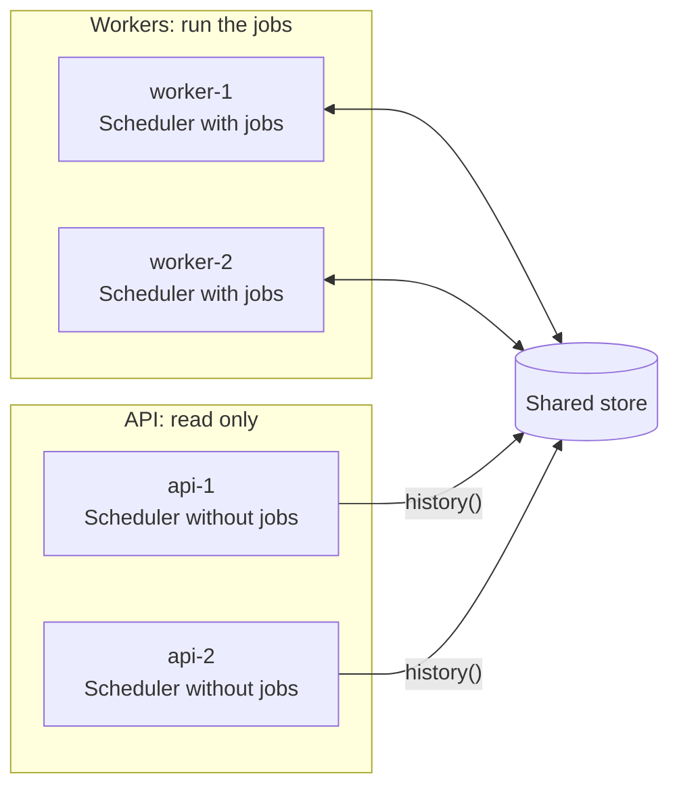

import { Tabs, TabItem } from '@astrojs/starlight/components';

You don't have to run jobs in the processes that serve requests. A common split:

- **Workers** register the jobs and run them. Run two or more for availability.
- **API processes** register nothing. They only read history and, if you want, start manual runs through a worker.



## Why split

- A heavy job can't slow down request handling.
- Workers can be sized, scaled and deployed separately.
- The web processes need no job code or job dependencies.

## The shared configuration

Both sides must point at the same store and namespace. Keep that in one place:

<Tabs syncKey="language">
<TabItem label="Node.js">

```ts
// cron/config.ts
import { RedisBackend, type SchedulerOptions } from 'anarchon';

export const cronOptions: SchedulerOptions = {
  backend: new RedisBackend({ redis: process.env.REDIS_URL, prefix: 'billing:cron:' }),
  timezone: 'Europe/Athens',
};
```

</TabItem>
<TabItem label=".NET">

```csharp
// Cron/CronSetup.cs, in a library both projects reference
public static class CronSetup
{
    public static AnarchonBuilder AddBillingCron(this IServiceCollection services, IConfiguration configuration) =>
        services
            .AddAnarchon(options => options.TimeZone = TimeZoneInfo.FindSystemTimeZoneById("Europe/Athens"))
            .UseRedis(options =>
            {
                options.Configuration = configuration.GetConnectionString("redis");
                options.Prefix = "billing:cron:";
            });
}
```

</TabItem>
</Tabs>

## The worker

<Tabs syncKey="language">
<TabItem label="Node.js">

```ts
// worker.ts
import { Scheduler } from 'anarchon';
import { cronOptions } from './cron/config';

const scheduler = new Scheduler({ ...cronOptions, instanceId: process.env.POD_NAME, log: true });

scheduler
  .every('sync', '10s', (ctx) => syncCustomers({ signal: ctx.signal }))
  .every('export', '15m', (ctx) => exportAll(ctx), { timeoutMs: 10 * 60_000 })
  .cron('digest', '0 8 * * 1-5', () => sendDigest());

async function main() {
  await scheduler.start();
  const shutdown = async () => {
    await scheduler.stop({ timeoutMs: 25_000 });
    process.exit(0);
  };
  process.on('SIGTERM', shutdown);
  process.on('SIGINT', shutdown);
}

main().catch((error) => {
  console.error(error);
  process.exit(1);
});
```

</TabItem>
<TabItem label=".NET">

```csharp
// Worker/Program.cs: a worker service (dotnet new worker)
var builder = Host.CreateApplicationBuilder(args);
builder.Services.AddBillingCron(builder.Configuration)
    .AddJobs<BillingJobs>();
builder.Services.Configure<SchedulerOptions>(options =>
{
    options.InstanceId = Environment.GetEnvironmentVariable("POD_NAME");
    options.StopTimeout = TimeSpan.FromSeconds(25);
});

// The host starts the scheduler, and stops it on SIGTERM and Ctrl+C.
await builder.Build().RunAsync();

public sealed class BillingJobs(CustomerSync sync, Exporter exporter, Mailer mailer)
{
    [Every("10s", Name = "sync")]
    public Task SyncAsync(CancellationToken cancellationToken) => sync.RunAsync(cancellationToken);

    [Every("15m", Name = "export", Timeout = "10m")]
    public Task ExportAsync(JobContext ctx) => exporter.ExportAllAsync(ctx);

    [Cron("0 8 * * 1-5", Name = "digest")]
    public Task DigestAsync(CancellationToken cancellationToken) => mailer.SendDigestAsync(cancellationToken);
}
```

</TabItem>
</Tabs>

Run at least two workers. With one, a crash means nobody is left to take the run over until it restarts. On a lease backend the restarted worker still recovers the run on start, so nothing is lost, only delayed.

## The API

The API process creates a scheduler with **no jobs** and never calls `start()`. `history()` and `lastRun()` connect on their own. In .NET the host starts the scheduler, which is harmless: with no jobs it claims nothing, and only reads.

<Tabs syncKey="language">
<TabItem label="Node.js">

```ts
// api.ts
import express from 'express';
import { Scheduler } from 'anarchon';
import { cronOptions } from './cron/config';

const reader = new Scheduler(cronOptions);
const app = express();

app.get('/jobs/:name/runs', async (req, res) => {
  res.json(await reader.history(req.params.name, Number(req.query.limit ?? 20)));
});

app.get('/jobs/:name/last', async (req, res) => {
  res.json(await reader.lastRun(req.params.name));
});

const server = app.listen(3000);

process.on('SIGTERM', async () => {
  server.close();
  await reader.stop(); // closes its connection
  process.exit(0);
});
```

</TabItem>
<TabItem label=".NET">

```csharp
// Api/Program.cs
var builder = WebApplication.CreateBuilder(args);
builder.Services.AddBillingCron(builder.Configuration); // no AddJobs: a reader

var app = builder.Build();
app.MapGet("/jobs/{name}/runs", (string name, int? limit, Scheduler reader) => reader.HistoryAsync(name, limit ?? 20));
app.MapGet("/jobs/{name}/last", (string name, Scheduler reader) => reader.LastRunAsync(name));

await app.RunAsync(); // stopping the host closes the scheduler's connection
```

</TabItem>
</Tabs>

What a reader can and can't do:

| Method | On a reader without jobs |
| --- | --- |
| `history(name)`, `lastRun(name)`; `HistoryAsync`, `LastRunAsync` | Works for any job name |
| `jobs()`, `GetJobs()` | Empty: it lists jobs registered on *this* instance |
| `nextRun(name)`, `GetNextRun(name)` | Throws: the job isn't registered here (`UnknownJob` in .NET) |
| `runNow(name)`, `RunNowAsync(name)` | Throws: the job isn't registered here (`UnknownJob` in .NET) |

## Showing the schedule in the API

The API doesn't know the schedules, since it registers no jobs. Two ways to show them:

**Share the definitions.** Put names and schedules in a module both sides import. The worker attaches handlers; the API only reads the list.

<Tabs syncKey="language">
<TabItem label="Node.js">

```ts
// cron/definitions.ts
export const JOBS = [
  { name: 'sync', kind: 'every', schedule: '10s' },
  { name: 'export', kind: 'every', schedule: '15m' },
  { name: 'digest', kind: 'cron', schedule: '0 8 * * 1-5' },
] as const;
```

</TabItem>
<TabItem label=".NET">

```csharp
// Cron/Definitions.cs
public static class Definitions
{
    public static readonly IReadOnlyList<(string Name, string Kind, string Schedule)> Jobs =
    [
        ("sync", "every", "10s"),
        ("export", "every", "15m"),
        ("digest", "cron", "0 8 * * 1-5"),
    ];
}
```

</TabItem>
</Tabs>

**Or ask a worker.** Give workers a small internal HTTP endpoint that returns `scheduler.jobs()` (`GetJobs()`).

## Manual runs from the API

`runNow()` (`RunNowAsync()`) runs on the instance it is called on, and the API has no job code. Forward the request to a worker:

<Tabs syncKey="language">
<TabItem label="Node.js">

```ts
// in the worker: a small internal server
import { createServer } from 'node:http';

createServer(async (req, res) => {
  const match = /^\/run\/([\w-]+)$/.exec(req.url ?? '');
  if (req.method !== 'POST' || !match) return res.writeHead(404).end();
  try {
    const run = await scheduler.runNow(match[1]);
    res.writeHead(200, { 'content-type': 'application/json' }).end(JSON.stringify(run));
  } catch (error) {
    res.writeHead(400).end(String(error));
  }
}).listen(9100);
```

</TabItem>
<TabItem label=".NET">

```csharp
// in the worker, made a web app (WebApplication.CreateBuilder) listening on an internal port
app.MapPost("/run/{name}", async (string name, Scheduler scheduler) =>
{
    try
    {
        return Results.Ok(await scheduler.RunNowAsync(name));
    }
    catch (AnarchonException error) when (error.Code == AnarchonErrorCode.UnknownJob)
    {
        return Results.BadRequest(error.Message);
    }
});
```

</TabItem>
</Tabs>

<Tabs syncKey="language">
<TabItem label="Node.js">

```ts
// in the API
app.post('/jobs/:name/run', requireAdmin, async (req, res) => {
  const response = await fetch(`http://cron-worker:9100/run/${req.params.name}`, { method: 'POST' });
  res.status(response.status).send(await response.text());
});
```

</TabItem>
<TabItem label=".NET">

```csharp
// in the API
builder.Services.AddHttpClient("worker", client => client.BaseAddress = new Uri("http://cron-worker:9100"));

app.MapPost("/jobs/{name}/run", async (string name, IHttpClientFactory clients) =>
{
    var response = await clients.CreateClient("worker").PostAsync($"/run/{Uri.EscapeDataString(name)}", null);
    return Results.Content(await response.Content.ReadAsStringAsync(), "application/json", statusCode: (int)response.StatusCode);
}).RequireAuthorization("admin");
```

</TabItem>
</Tabs>

## One code base, two modes

If you'd rather ship one image, choose the mode with an environment variable:

<Tabs syncKey="language">
<TabItem label="Node.js">

```ts
const scheduler = new Scheduler({ ...cronOptions, instanceId: process.env.POD_NAME });

if (process.env.RUN_JOBS === 'true') {
  registerJobs(scheduler);
  await scheduler.start();
}
```

</TabItem>
<TabItem label=".NET">

```csharp
var cron = builder.Services.AddBillingCron(builder.Configuration);

if (builder.Configuration.GetValue<bool>("RUN_JOBS"))
{
    cron.AddJobs<BillingJobs>();
}
```

</TabItem>
</Tabs>

Processes with `RUN_JOBS` unset behave as readers.

## Next

- [Rolling deploys on Kubernetes](../kubernetes/)
- [History](../../guides/history/)
